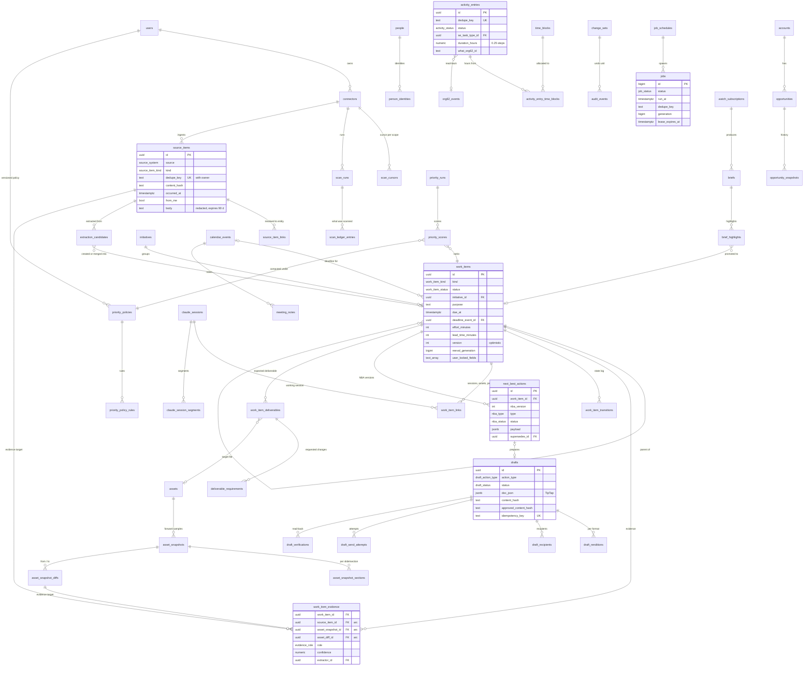
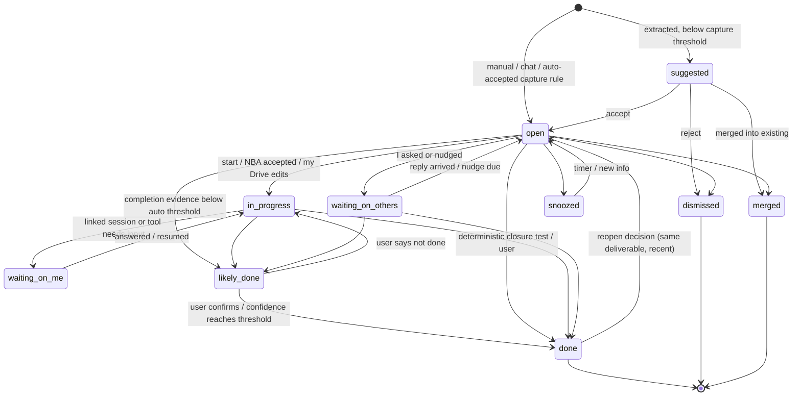
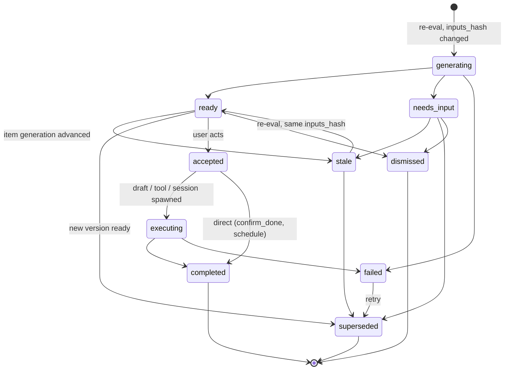
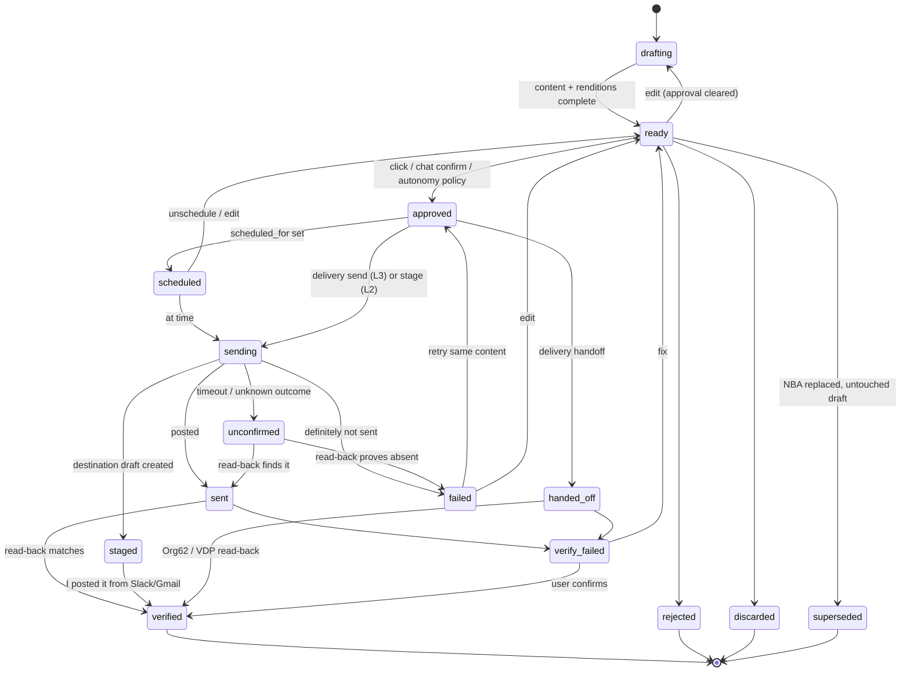
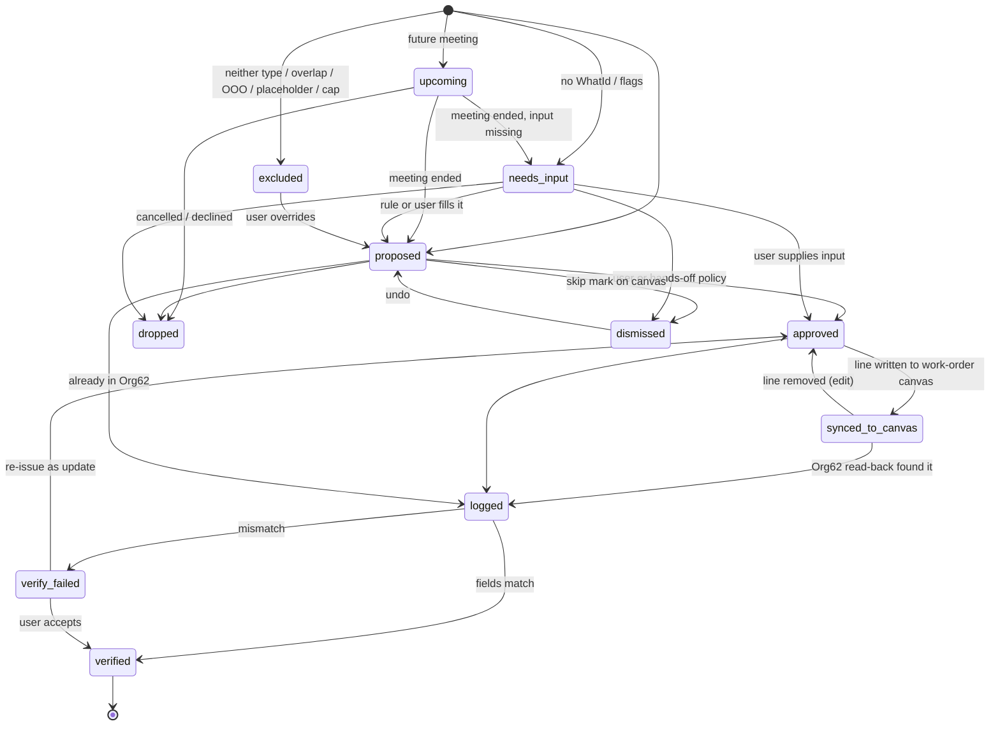
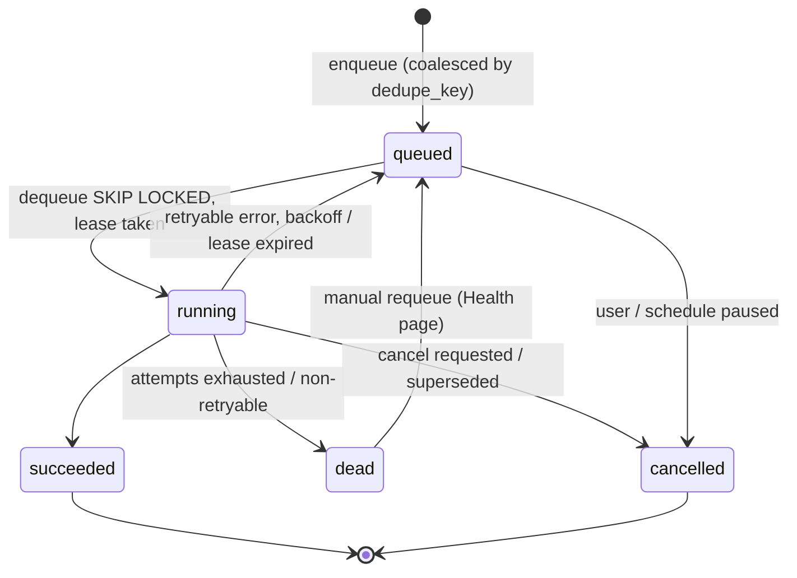

# Command Center: data model (adopted 2026-11-05)

This file was adopted from research draft 11. BE-1 implements it as-is, unless one of the decisions below changes it.

## Orchestrator decisions on the draft's open questions
1. **Postgres replaces SQLite.** D-4 and ARCHITECTURE's SQLite mentions are superseded: Postgres 17 + Drizzle, following vdp-app.
2. **Databases.** `command_center` is the orchestrator's integration DB; migrations run into it. Each BE lane uses its own `control_center_<chunk>` DB.
3. **Autonomy ladder exceptions.** The two approved private canvases (review <review-canvas-id>, Slackbot work order <work-order-canvas-id>) are **per-target L4 overrides**. These are rows in the autonomy/override settings, not a change to the ladder's wording. Hands-off activity approval is a per-user autonomy setting (`activity_entry` auto-approve = on for Tristan).
4. **Retention.** The 90-day body retention also redacts source-derived text inside audit payloads. A nightly job nulls or replaces those fields and keeps the structure.
5. **Trainings** come from:
   - Gmail: Field Readiness overdue notices, the CLO compliance mail, Trailhead cert maintenance;
   - the Slack "Astro's Course Tracker" bot (see brief 10).

   The `scan-trainings` skill lives in BE-2.
6. **`background_promise` is a derived lane, not a kind.** A commitment is in the background lane when it's old and low priority. If the enum exists, keep it only as a UI label alias; don't store it as a separate kind.
7. **Thresholds** (auto-close, reopen window, merge score) are per-user settings with defaults.
8. **No embeddings in v1.** Use Postgres FTS and trigram.
9. **Split the schema by domain** under `src/db/schema/*.ts`, with `src/db/schema.ts` re-exporting. That makes ownership and review easier.
10. **Use `drizzle-kit generate` + `migrate`, never `push`.** Some foreign-key names exceed 63 characters, so give them explicit short names.

---


> **Status:** draft v1, validated (2026-11-05).
> - **Covers:** R-UI-1 through R-UI-21 and R-BE-1 through R-BE-4 in `docs/archive/2026-build/REQUIREMENTS.md`.
> - **Replaces:** the SQLite table sketch in `ARCHITECTURE.md` §4 (see open question OQ-1).
> - **Read with:** `TENETS.md`, `ARCHITECTURE.md` §4–§6, `PLAN.md` P0 (contracts first), and the activity autopilot's `ap/db.py` (moved out of the repo before handoff; the owner keeps a private copy), whose natural keys and activity statuses carry over.
> - **Private:** this file lives in `docs/research/`. Examples use placeholders (ACME, `user@example.com`), so no customer names or Org62 IDs appear here.

## What was validated

All of this ran in a scratch project. Nothing was written to the repo or committed to any database.

- **Typecheck.** `tsc --strict` passes against VDP's toolchain (drizzle-orm 0.45.2, TypeScript 5.9).
- **Generation.** `drizzle-kit generate` emits a clean migration:

  | Object | Count |
  |---|---|
  | Tables | 108 |
  | Enums | 137 |
  | Indexes | 245 (73 partial) |
  | Named CHECK constraints | 63 |
  | Foreign keys | 382 |
  | NULLS NOT DISTINCT uniques | 8 |

- **Applied for real, then rolled back.** The generated migration and both companion SQL files ran on the local Postgres 17.10 (:5432), inside one transaction that was **rolled back**. They used a throwaway schema in the `postgres` database. Assertions passed for:
  - **Audit:** coalescing; rejecting writes outside a change set; immutable closed change sets.
  - **Constraints:** the human-hours exclusion and check; the approval-hash check; the quarter-hour duration check; the watch-subscription scope check.
  - **Jobs:** the `SKIP LOCKED` dequeue, backoff/retry, the lease reaper, and the weekend catch-up of schedules.
  - **Reconcile:** coverage-gap detection with multiranges; the degradation view.
  - **Queries:** every query and write path in §6, `PREPARE`d verbatim and executed. That included idempotent re-ingest, the generation bump with coalesced re-eval, the fenced write, the optimistic edit, and autosave coalescing.
  - **Plans:** the home list plan uses `work_items_home_lane_rank_idx`.
- **Existing database.** A `command_center` database already exists on :5432. It is empty (only `plpgsql`), and this work did not create it.

## Contents

0. Shape at a glance
1. Design principles: provenance, idempotency, undo, concurrency, resumability, DB-enforced guards, privacy, jsonb policy, multi-user, errors, tenet tensions
2. ER diagram (core)
3. Schema: `src/db/schema.ts` plus companion SQL
4. State machines
5. Requirement-to-table traceability
6. Key queries, write paths and their indexes
7. Open questions
- Appendix: build order

---

## 0. Shape at a glance

| Group | # | Tables |
|---|---|---|
| Identity, team pack, settings | 8 | `users`, `team_packs`, `se_task_types`, `org62_picklist_values`, `fiscal_periods`, `team_rules`, `user_settings`, `autonomy_policies` |
| Per-user policy + agent behavior | 6 | `role_templates`, `priority_policies`, `priority_policy_rules`, `task_capture_rules`, `voice_profiles`, `user_interests` |
| Connectors + health | 4 | `connectors`, `connector_health_checks`, `connector_auth_events`, `reauth_attempts` |
| Scanning | 4 | `scan_cursors`, `scan_runs`, `scan_ledger_entries`, `reconcile_findings` |
| Raw sources + extraction | 5 | `source_items`, `source_item_refs`, `source_item_links`, `extractors`, `extraction_candidates` |
| Entities | 13 | `accounts`, `account_aliases`, `opportunities`, `opportunity_snapshots`, `opportunity_team_members`, `people`, `person_identities`, `channels`, `channel_account_maps`, `repos`, `assets`, `mapping_rules`, `vdp_records` |
| Drive deliverables | 6 | `asset_snapshots`, `asset_snapshot_sections`, `asset_snapshot_diffs`, `work_item_deliverables`, `deliverable_requirements`, `deliverable_judgments` |
| Calendar | 3 | `calendar_events`, `calendar_event_attendees`, `meeting_notes` |
| Work items + initiatives | 11 | `work_items`, `work_item_transitions`, `work_item_evidence`, `work_item_links`, `work_item_relations`, `work_item_training_details`, `work_item_travel_details`, `initiatives`, `initiative_links`, `change_proposals`, `reopen_decisions` |
| Priority | 4 | `priority_runs`, `priority_scores`, `priority_score_rule_hits`, `priority_plan_steps` |
| NBA + provenance | 2 | `next_best_actions`, `provenance_links` |
| Drafts (the Outbox) | 5 | `drafts`, `draft_recipients`, `draft_renditions`, `draft_send_attempts`, `draft_verifications` |
| Claude sessions | 2 | `claude_sessions`, `claude_session_segments` |
| Time + activity logging | 7 | `time_blocks`, `activity_entries`, `activity_entry_time_blocks`, `canvases`, `canvas_sync_runs`, `canvas_lines`, `deal_contribution_requests` |
| Org62 | 4 | `org62_events`, `deal_contributions`, `missed_opp_sweeps`, `missed_opp_findings` |
| Jobs | 3 | `jobs`, `job_schedules`, `worker_instances` |
| LLM cost | 4 | `llm_calls`, `llm_budgets`, `llm_budget_days`, `llm_decisions` (D0, 2026-11-13: why a model was not called, escalated or held) |
| Chat, undo, audit | 6 | `chat_threads`, `chat_messages`, `chat_tool_calls`, `change_sets`, `audit_events`, `content_revisions` |
| Errors + notifications | 2 + view | `app_events`, `notifications`, view `work_item_degradations` |
| Tools (plugin seam) | 3 | `tool_adapters`, `tool_runs`, `tool_run_outputs` |
| Watch subscriptions + briefs | 7 | `watch_subscriptions`, `briefs`, `brief_scan_runs`, `brief_highlights`, `brief_highlight_reasons`, `relevance_feedback`, `relevance_weights` |
| **Total** | **108** | |

### Conventions

These follow `~/Projects/vdp-app/lib/db/schema.ts` and its `drizzle.config.ts` (`casing: 'snake_case'`, node-postgres):

- **Names:** plural snake_case tables, explicit snake_case column names. Indexes are `<table>_<cols>_idx`, unique indexes `_uidx`, unique constraints `_uq`, checks `_chk`.
- **Keys:** `uuid('id').primaryKey().defaultRandom()` for entities. `bigserial` (mode `number`) for append-only, high-volume logs (VDP's `audit_events` does the same).
- **Timestamps:** `created_at` / `updated_at` are timestamptz (`updated_at` uses `$onUpdate`). `archived_at` marks a soft delete.
- **Types:** `$inferSelect` / `$inferInsert` types are exported.

Three deliberate deviations from VDP:
1. **`pgEnum` for engine-owned closed sets.** VDP uses free text. State machines should reject a typo at the database.
2. **Lookup tables for team-pack vocabularies.** SE task types, Org62 picklists and role templates are tables rather than enums (*tenet: Config over code for people and teams*).
3. **Array-style third argument to `pgTable`.** The object form VDP uses is deprecated in 0.45.

Other conventions:
- **Time zones.** All instants are timestamptz in UTC. Day-grouped tables (calendar, time blocks, LLM budget) also store a `local_day` date that the app computes in the owner's timezone.
- **Numerics.** Money and scores are `numeric(..., mode: 'number')`.
- **Migrations come in three files**, applied with `drizzle-kit migrate`:
  1. `0000_extensions.sql` is custom: `pg_trgm` and `btree_gist`.
  2. `0001_init.sql` is generated from `schema.ts`.
  3. `0002_extras.sql` is custom. It holds what Drizzle can't model: exclusion constraints, the audit trigger, append-only guards, `NOTIFY` triggers, and the degradation view.

  Create them with:

  ```bash
  drizzle-kit generate --custom --name extensions
  ```

  ```bash
  drizzle-kit generate --name init
  ```

  ```bash
  drizzle-kit generate --custom --name extras
  ```

  Don't use `drizzle-kit push`. It can't see the triggers or exclusions, and 14 auto-generated FK names exceed Postgres's 63-character limit and get truncated, which push would diff forever.

---

## 1. Design principles

### 1.1 Provenance (*tenet: Provenance on everything*)

`source_items` is the **only** place raw content lives. There is one row per natural object:
- a Slack message, an email or a calendar-event snapshot;
- a Drive revision, a Gemini note or transcript;
- an Org62 or VDP record snapshot;
- a Claude session, a git commit or a manual note;
- a tool output or a canvas snapshot.

Every derived row points back to its source items:

| Derived thing | How it links to sources |
|---|---|
| Work item | `work_item_evidence`: role (`origin`, `progress`, `completion`, `context`, `contradiction`), `confidence`, `extractor_id`, `llm_call_id`, `rationale`. The target is a source item, a Drive snapshot or a Drive diff (an exclusive arc) |
| Extracted ask, promise or next step, before merge | `extraction_candidates.source_item_id` + `extractor_id`, with the merge decision |
| Entity mapping (item → account/opp/person/asset/meeting) | `source_item_links`: method, confidence, `mapping_rule_id`, `user_verdict` |
| NBA, draft, activity entry, tool run, missed-opp finding, chat answer, brief, highlight | `provenance_links` (an exclusive arc; role `trigger`, `context`, `quoted` or `basis`) |
| Time block | `time_blocks.source_item_id` (+ `calendar_event_id`, `claude_session_segment_id`, `asset_id`) |
| Logged hours | `activity_entry_time_blocks` → `time_blocks` → source items |
| Drive judgment | `deliverable_judgments.diff_id` → `asset_snapshot_diffs` → `asset_snapshots.source_item_id` |

**Who made it.** Every engine output names its producer in `extractors`: key, version, kind (`parser`, `rule`, `llm`, `user`, `chat`), model tier and prompt hash. A new prompt version is a new extractor row, so older links stay attributable. Every model call is an `llm_calls` row, and derived rows carry `llm_call_id`, so cost and model are traceable per decision.

**Why is stored, not recomputed.** It lives in several places:
- priority components are columns;
- rule hits are rows carrying the user-facing explanation (`priority_score_rule_hits`);
- evidence carries a `rationale`;
- highlights carry `brief_highlight_reasons`;
- reopen decisions carry their `rule_key` and `explanation`.

**Exclusive arcs over polymorphic ids.** Wherever a link is queried, cascades or needs a real FK, the table has one nullable FK per target type, plus:
- `CHECK (num_nonnulls(...) = 1)`;
- `UNIQUE NULLS NOT DISTINCT` over the arc, for dedupe.

Untyped `(entity_type, entity_id)` text references appear only in log-like tables, where the target set is open-ended and history must outlive the row: `audit_events`, `app_events`, `notifications`, `change_proposals` and `content_revisions`.

### 1.2 Idempotency (*tenet: Idempotent, re-runnable ingest*)

**Natural keys everywhere a sync can repeat:**

| Table | Unique key | Recipe / note |
|---|---|---|
| `source_items` | `(owner_user_id, dedupe_key)` | `slack:{team}:{channel}:{ts}` · `gmail:{messageId}` · `gcal:{calendarId}:{eventId}` · `drive:{fileId}@{modifiedTime}` · `gdoc:{docId}` (notes; mutable) · `org62:{sobject}:{id}@{SystemModstamp}` · `vdp:{slug}@{updatedAt}` · `claude:{sessionId}` · `git:{repo}:{sha}` · `manual:{uuid}` · `tool:{adapter}:{runId}` · `canvas:{id}@{hash}` |
| `calendar_events` | `(owner, calendar_id, external_event_id)` | One row per recurring instance |
| `asset_snapshots` | `(asset_id, modified_time)` | Re-sampling an unchanged file is a no-op |
| `opportunity_snapshots` | `(opportunity_id, captured_at)` | New row only when `fields_hash` changes |
| `time_blocks`, `activity_entries` | `(owner, dedupe_key)` | `cal\|{calendarId}\|{eventId}\|{start}` etc. The autopilot's `natural_key` scheme carries over |
| `org62_events`, `deal_contributions` | `(owner, Org62 Id)` | Read-back mirrors |
| `extraction_candidates` | `(source_item_id, extractor_id, ordinal)` | Re-extraction by the same extractor version never duplicates |
| Evidence / link / provenance arcs | `UNIQUE NULLS NOT DISTINCT` over the arc | |
| `drafts` | `idempotency_key` | Passed to the adapter (Slack `client_msg_id`, a Gmail draft marker), so a retry never double-sends |
| `jobs` | `idempotency_key` (exactly-once enqueue); `dedupe_key` (at most one *queued* job per key) | |

**Mutable vs immutable sources.** Messages, emails, notes and sessions update in place (`revision`, `content_changed_at`). Snapshots (Drive, Org62, VDP) are append-only rows. `content_hash` makes an unchanged re-pull a no-op: W1 is `ON CONFLICT … DO UPDATE … WHERE content_hash IS DISTINCT FROM excluded.content_hash`, and it never resurrects a purged body.

**Cursors move with the data.** A cursor advances in the **same transaction** that writes that page's items and its `scan_ledger_entries` rows. A crash mid-scan re-reads one page, and W1 absorbs it.

**Engines are idempotent by input hash:**
- `next_best_actions.inputs_hash`
- `priority_scores.inputs_hash`
- `briefs.inputs_hash`
- `initiatives.summary_inputs_hash`
- `llm_calls.request_hash`: a cache key, never the prompt itself.
- `llm_calls.content_hash` (D0): a hash of model + prompt version + prompt + input, so identical repeats are visible; never the prompt. Each row also says what started it (`trigger`), why that model (`model_reason`: `default`, `user_asked`, `policy:<trigger>`, `escalation:<why>`) and what came of it (`outcome`), with cache reads and writes apart from input tokens.
- `llm_decisions` (D0): one counted row per (day, skill, kind, reason, trigger, subject) for each decision not to call the model (`skip`), to escalate (`escalate`, with whether the verdict changed) or a call a budget refused (`block`). Ids and codes only. With `llm_calls` it is the spend audit trail: keep both at least 400 days, then roll up to daily totals.

### 1.3 Undo, audit and autosave (R-UI-18)

- **A change set is the unit of undo.** Every write to a curated table runs inside `withChangeSet()` (§3.3). That opens a `change_sets` row whose kind is one of `user_edit`, `autosave_burst`, `engine_pass`, `chat_tool_call`, `connector_sync`, `undo`, `redo`, `rollback` or `system`. It also sets three transaction-local GUCs: `cc.change_set_id`, `cc.actor_kind` and `cc.actor_ref`.
- **The database writes the audit, not the app.** An AFTER trigger (`cc_audit`) on 48 curated tables writes `audit_events` with before and after row images, for **every actor**: user, engine, chat and connector.
  - A write outside a change set raises an error, so no code path can skip auditing.
  - Ingest, derived and log tables aren't audited, because they're reproducible or are logs themselves. That covers `source_items` (except manual notes), scans, jobs, `llm_calls`, priority scores and snapshots.
- **Coalescing keeps autosave cheap.** Each (change set, table, row) gets exactly one audit row.
  - Repeated writes inside an open change set rewrite `after`, merge `changed_fields` and bump `coalesced_count`. `before` stays the first image, and that is the undo payload.
  - An autosave burst reuses one change set per (editor session, entity) until it has been idle about 30 s (`coalesce_until`). Then W6 closes it.
  - Closed change sets and their audit rows are immutable (guard trigger).
  - A no-op update (only `updated_at` or `version` changed) writes nothing.
- **Large documents stay out of the audit images.** `drafts.doc_json`, `drafts.plain_text` and manual-note bodies are excluded from the images. They live in `content_revisions`, one row per editor burst: W5 upserts into the open burst and bumps `save_count`. Undoing a burst restores the previous revision.
- **The undo algorithm.** Undo runs as a new change set of kind `undo`, with `undo_of_change_set_id` set, so redo is simply undoing the undo. It walks the target change set's audit rows newest first:
  - an **insert** is undone by deleting the row;
  - an **update** is undone by restoring the `before` values for `changed_fields`, but only if the row still matches `after`. Otherwise it stops and shows "changed since: review";
  - a **delete** is undone by re-inserting `before`.

  It then stamps `change_sets.undone_at` and, where present, `work_item_transitions.undone_at`.
- **Where the user sees undo:**
  - **Toast Undo:** the mutation returns its change set id.
  - **⌘Z:** Q14 finds the newest undoable user change set.
  - **Per-item history:** Q13, by `(entity_type, entity_id)`.
  - **Rollback to time T:** a `rollback` change set undoes every later change set on that entity, newest first.
- **Engine changes are undoable too.** An auto-close (D-26) is an `engine_pass` change set plus a transition row. Q6 ("Closed for you today") lists them, each with Undo.
- **Outbound audit** (*tenet: Audit everything outbound*). Approve, reject, hand-off and send decisions on `drafts` set `audit_events.destination` and `payload_hash`.

### 1.4 Concurrency: the user and agents on the same rows (R-UI-20)

**Optimistic concurrency.** These tables carry `version int`:
- `work_items`, `next_best_actions`, `drafts`, `activity_entries`
- `initiatives`, `watch_subscriptions`, `brief_highlights`

Updates are `WHERE id = $1 AND version = $2` and bump the version (W4). Zero rows means **409**. The client refetches, rebases its pending edit and retries. The UI never blocks on a spinner.

**Field locks become proposals.**
- **Where locks live.** `user_locked_fields text[]` sits on `work_items`, `initiatives`, `activity_entries` and `drafts`. `mapping_locked` sits on `calendar_events`, `assets` and `claude_sessions`. A user edit adds its field to the lock.
- **What engines do instead.** An engine never writes a locked field. It inserts a `change_proposals` row with:
  - the current and proposed values;
  - the reason;
  - the source item or evidence;
  - the extractor and `base_version`.

  The UI shows this as "New info → update? (diff)".
- **Resolving proposals.** Each (entity, field) has at most one pending proposal, and a newer one supersedes the older. Accepting applies it in an undoable change set. Rejecting is a learning signal.

**Save first, then re-evaluate asynchronously (W2).** New info is saved and attached immediately. The same transaction:
- bumps `work_items.reeval_generation`, `last_new_info_at` and `unseen_evidence_count`;
- requests cancellation of any running re-eval for that item;
- enqueues `reevaluate`, or coalesces into the queued one, under `dedupe_key = 'reeval:work_item:<id>'` with a debounce. Each burst pushes `run_at` out.

**Fencing (W3).** A re-eval writes with `WHERE reeval_generation = $jobGeneration AND version = $v`, so a superseded job writes nothing even if it ignores the cancel. Each NBA records the `work_item_generation` it was computed from, and one older than its item is stale.

**Cancel and live updates.**
- Setting `jobs.cancel_requested_at` fires `pg_notify('cc_job_cancel', id)`. The worker LISTENs and aborts that job's `AbortController`.
- The audit trigger also emits `pg_notify('cc_change', {cs, entity_type, entity_id, table, op})`, delivered at COMMIT. The web process fans it out to open views over SSE, and views patch rows in place without re-sorting under the cursor.

**The new-info badge** shows when `last_new_info_at > seen_by_user_at`. It's served by the partial index `work_items_new_info_idx` and cleared when the item is opened.

### 1.5 Resumable, app-run background work (R-UI-7, R-BE-4)

- **Everything background is a `jobs` row.** It's a Postgres queue (`FOR UPDATE SKIP LOCKED`) with:
  - leases (`lease_expires_at`, `heartbeat_at`, `timeout_seconds`);
  - exponential backoff with jitter;
  - typed `error_class`;
  - a `dead` (dead-letter) state.

  `dedupe_key` also guarantees that a key never runs twice at once: the dequeue skips keys that already have a running job.
- **`job_schedules` replaces cron.** Each schedule has `next_run_at` and a `catch_up` policy.
- **After a weekend away, the worker resumes in three steps:**
  1. The reaper re-queues jobs whose lease expired while the laptop slept.
  2. Every schedule whose `next_run_at` is in the past enqueues once. Under `backfill_window`, one job covers `[cursor.high_watermark_at, now]`, and the scanner pages through it.
  3. The gap between the last `worker_instances.last_beat_at` and the boot defines the "Since you left" window.
- **Scanners resume from `scan_cursors`.** `scan_ledger_entries` records *what* was covered (object ids, time and token ranges, result hashes). The reconciler finds holes with one multirange query (`range_agg`), and they become `reconcile_findings`.

### 1.6 Trust guards enforced by the database

| Tenet / rule | Guard |
|---|---|
| *Hours are human hours* | `time_blocks_human_hours_chk`: background, agent and overlay blocks can never count. Exclusions `time_blocks_no_double_count_excl` and `activity_entries_no_overlap_excl` stop counted time from ever overlapping. Both are `DEFERRABLE`, so the time engine can rewrite a day atomically |
| *Nothing leaves without approval* | `drafts_approval_chk`: every post-approval status requires `approved_content_hash = content_hash`, so a draft edited after approval cannot be sent. `drafts_autonomy_chk`: an auto-approval must cite an `autonomy_policies` row |
| D-40 Duration rounding | `activity_entries_duration_chk`: 0 < hours ≤ 99.99, in 0.25 steps |
| Org62 payload validity | `activity_entries_ready_chk`: no approval without an SE Task Type. `activity_entries_operation_chk`: an update or delete needs a target Event |
| *Audit everything outbound* + R-UI-18 | `cc_audit` raises on any write outside a change set. Closed change sets are immutable. `work_item_transitions` is append-only (only the `undone_*` columns may change) |
| State-machine invariants | `work_items_done_chk`, `_merged_chk`, `_snooze_chk` and `_waiting_on_me_chk`; `jobs_dead_chk` and `jobs_running_lease_chk`; `next_best_actions_one_live_uidx` (one live NBA per item); `priority_policies_owner_active_uidx` (one active policy per user); `brief_highlights_promoted_chk` |
| *Local data, privacy-safe logs* | By contract plus zod: `app_events.message`/`detail` and the health-check error text carry ids and codes only, and `connectors.config` is non-secret. There are no token or cookie columns anywhere |

### 1.7 Privacy and retention (D-7)

- **Bodies expire.** `source_items.body` and `asset_snapshot_sections.text` carry an `…_expires_at` set at ingest: 90 days for messages, `null` for manual notes. W7 nulls them out. Hashes, titles, deep links, metadata, work items and activity are kept forever. FTS (the generated `search_tsv`) drops purged text automatically.
- **Redaction happens before insert.** `redacted`, `redaction_count` and `redaction_kinds` record it, and a CHECK keeps them consistent. `source_items.meta` must never hold message text (zod per kind), so `body` is the only field that needs purging.
- **Re-ingest can't bring a purged body back** (W1).
- **Open:** audit images and content revisions can hold body-derived text past 90 days (OQ-5).
- **Table retention** (lane E, E4): jobs, scan runs (their coverage ledger compacted first), connector health checks, and the LLM audit trail. The trail is kept 400 days, then rolled up into `llm_call_days` / `llm_decision_days` (migration 0024). Horizons and rules are in WORKER.md "Nightly maintenance".

### 1.8 Normalized core; jsonb only where it is justified

There are 36 jsonb columns, each for one of five reasons. All are zod-validated at the boundary.

1. **Source-specific payloads:** `source_items.meta`, `opportunity_snapshots.extra`, `team_packs.raw`.
2. **Documents:** `drafts.doc_json` (TipTap/ProseMirror), `content_revisions.doc_json`, `chat_messages.content_blocks`.
3. **Type-specific arguments and results:**
   - NBAs and drafts: `next_best_actions.payload`, `drafts.payload` (dry-run payloads).
   - Jobs: `jobs.payload`/`result`, `job_schedules.payload`.
   - Tools and chat: `tool_runs.input`, `tool_adapters.input_schema`, `chat_tool_calls.input`/`output`.
   - Rules and config: `work_items.closure_params`, `team_rules.params`, `connectors.config`.
   - Scanning and sweeps: `scan_cursors.cursor_json`, `scan_runs.cursor_before`/`after`, `missed_opp_sweeps.criteria`.
   - Logs and settings: `app_events.detail`, `user_settings.value`.
4. **The declarative rule DSL:** `priority_policy_rules.condition`/`other_condition`, `task_capture_rules.condition`, `role_templates.*_seed`.
5. **Immutable history and diffs:** `audit_events.before`/`after`, `next_best_actions.diff` (RFC 6902), `asset_snapshot_diffs.changes`, `deliverable_judgments.requirement_verdicts`, `change_proposals.current_value`/`proposed_value`.

Everything that is queried, joined or constrained is a column or a child table: statuses, keys, scores, weights, recipients, renditions, reasons, requirements, attendees and identities.

### 1.9 Multi-user readiness and per-user behavior (R-UI-16)

- **Ownership.**
  - `owner_user_id` (FK `users`, cascade) sits on every root table, and child tables inherit ownership through their parent FK.
  - Team-pack tables are shared per pack, while `extractors` and `worker_instances` are global.
  - Unique keys include the owner, so a later shared database needs no key changes, and RLS can be added with `current_setting('cc.user_id')`.
- **Behavior is data, starting from a role template:**
  - `priority_policies`: versioned weights, exactly one active version per user.
  - `priority_policy_rules`: declarative and self-explaining, with a `rule_key` that stays stable across versions.
  - `task_capture_rules`: what counts as a task.
  - `voice_profiles`: versioned voice and drafting style.
  - `autonomy_policies`, per action type.
  - Watch settings: `channels.watch_mode`, `watch_subscriptions`, `user_interests`.
  - Everything else: `user_settings`.
- **Rankings explain themselves in the user's own terms.** Each `priority_runs` and `priority_scores` row references the policy version it used, and `priority_score_rule_hits` holds the rendered explanation.
- **Policy edits create a new version.** An edit from Settings (an explicit Apply, per R-UI-18) or from chat creates a new version with a `change_summary`, inside an audited change set.

### 1.10 Errors and feedback (R-UI-19)

- **Jobs** have `error_class`, backoff fields and a `dead` state (`dead_at`, `dead_reason`). Dead-lettering raises a `notifications` row.
- **`app_events`** is the Health page's event and error log. It records:
  - severity, component and code;
  - the related connector, job, scan or entity;
  - fingerprint coalescing (`occurrence_count`);
  - whether it has been seen, acknowledged or resolved.
- **`notifications`** holds anything that must **persist until acted on**, never toast-only.
  - `dedupe_key` keeps one live notification per issue.
  - The system resolves it automatically when the cause clears, for example when a connector is healthy again.
  - The feedback-channel matrix itself lives in UI-SPEC.
- **`work_item_degradations`** is a view of open items whose evidence or closure test depends on an unhealthy or stale connector. It drives the `degraded` flag in Q1.
- **LLM output is validated (zod) before any write.** `llm_calls.status` records refusals and timeouts, and each job step is one transaction, so a failure never leaves partial rows.

### 1.11 Tenet tensions to confirm (none blocking)

- **The canvas exception vs. the autonomy ladder.** `canvas_rewrite` runs at **L4** under `autonomy_policies`. That is the approved exception for <review-canvas-id> and <work-order-canvas-id>, narrowed to those two canvases by `target_external_id`. But `ARCHITECTURE.md` §6 defines L4 as "only internal, reversible actions". The tenet and ladder text should name the exception.
- **Hands-off logging.** It auto-approves activity entries (`approval_method = 'autonomy_policy'`). Org62 writes still happen only when Tristan tells Slackbot to execute the work-order canvas, so *Nothing leaves without approval* holds at that step. Please confirm.
- **Docs still say SQLite.** `ARCHITECTURE.md` (§1, §4) and `DECISIONS.md` D-4 still describe SQLite + FTS5, while R-BE-1 now says Postgres (OQ-1).

---

## 2. ER diagram (core)

This shows the core only. Two kinds of FK are left out for readability:
- `owner_user_id` on every root table;
- the `account_id` / `opportunity_id` mapping FKs on work items, events, sessions, assets, activity entries, initiatives and highlights.



---

## 3. Schema

### 3.1 `src/db/schema.ts`

The whole file, as validated (§0). `PLAN.md` proposes splitting the schema into per-domain files under `src/core/db/schema/<domain>.ts`. The section banners (`1.` through `17.`) are the intended split points (OQ-2).

```ts
/**
 * Command Center: Drizzle schema (Postgres 17, drizzle-orm 0.45, node-postgres).
 *
 * Source of truth: docs/research/11-data-model-draft.md (draft v1, 2026-11-05).
 * Conventions follow ~/Projects/vdp-app/lib/db/schema.ts:
 *   - plural snake_case tables, explicit snake_case column names
 *   - uuid `id` (defaultRandom) for entities; bigserial for append-only logs
 *   - `created_at` / `updated_at` timestamptz, `archived_at` soft delete
 *   - index names `<table>_<cols>_idx`, unique `<table>_<cols>_uidx`
 * Deviations from VDP (deliberate):
 *   - pgEnum for engine-owned state machines (VDP uses free text);
 *     team-pack vocabularies (SE task types, picklists) stay as lookup tables.
 *   - array-style third argument to pgTable (object style is deprecated in 0.45).
 *
 * Drizzle cannot express these; they live in the companion migration
 * `0001_extras.sql` (see the doc): extensions, the activity-entry exclusion
 * constraint, the audit trigger, and the append-only guards.
 *
 * Single-user today. Every root table carries `owner_user_id`; child tables
 * inherit ownership through their parent FK.
 */

import { sql } from 'drizzle-orm';
import {
  type AnyPgColumn,
  bigint,
  bigserial,
  boolean,
  check,
  customType,
  date,
  index,
  integer,
  jsonb,
  numeric,
  pgEnum,
  pgTable,
  pgView,
  primaryKey,
  smallint,
  text,
  timestamp,
  unique,
  uniqueIndex,
  uuid,
} from 'drizzle-orm/pg-core';

// ---------------------------------------------------------------------------
// Custom types and column helpers
// ---------------------------------------------------------------------------

/** Postgres full-text vector. Always GENERATED ALWAYS; never written by app code. */
const tsvector = customType<{ data: string; default: false }>({
  dataType() {
    return 'tsvector';
  },
});

/** Postgres tstzrange, surfaced as its text form ('[2026-11-01 ..., ...)'). */
const tstzrange = customType<{ data: string; default: false }>({
  dataType() {
    return 'tstzrange';
  },
});

const tstz = (name: string) => timestamp(name, { withTimezone: true });
const createdAt = () => tstz('created_at').notNull().defaultNow();
const updatedAt = () =>
  tstz('updated_at')
    .notNull()
    .defaultNow()
    .$onUpdate(() => new Date());
const ownerUserId = () =>
  uuid('owner_user_id')
    .notNull()
    .references((): AnyPgColumn => users.id, { onDelete: 'cascade' });
/** 0.000–1.000 */
const confidence = (name = 'confidence') => numeric(name, { precision: 4, scale: 3, mode: 'number' });
const usd = (name: string) => numeric(name, { precision: 12, scale: 6, mode: 'number' });
const amount = (name: string) => numeric(name, { precision: 14, scale: 2, mode: 'number' });
const scorePart = (name: string) =>
  numeric(name, { precision: 7, scale: 3, mode: 'number' }).notNull().default(0);
const textArray = (name: string) =>
  text(name)
    .array()
    .notNull()
    .default(sql`'{}'::text[]`);

// ---------------------------------------------------------------------------
// Enums (engine-owned closed sets; adding a value = ALTER TYPE ... ADD VALUE)
// ---------------------------------------------------------------------------

export const sourceSystem = pgEnum('source_system', [
  'slack', 'gmail', 'calendar', 'drive', 'gemini_notes', 'org62', 'vdp', 'claude', 'git',
  'manual', 'chat', 'tool', 'app',
]);
export const sourceItemKind = pgEnum('source_item_kind', [
  'slack_message', 'slack_canvas_snapshot', 'email_message', 'calendar_event',
  'drive_file_revision', 'gemini_note', 'meeting_transcript', 'org62_record_snapshot',
  'vdp_record_snapshot', 'claude_session', 'git_commit', 'manual_note', 'tool_output',
]);
export const bodyFormat = pgEnum('body_format', ['plain', 'slack_mrkdwn', 'html', 'markdown']);
export const actorKind = pgEnum('actor_kind', [
  'user', 'engine', 'chat', 'connector', 'system', 'autonomy_policy',
]);
export const userVerdict = pgEnum('user_verdict', ['confirmed', 'rejected']);
export const linkMethod = pgEnum('link_method', ['connector', 'rule', 'llm', 'user', 'chat']);
export const modelTier = pgEnum('model_tier', ['none', 'haiku', 'sonnet', 'opus']);

// connectors
export const connectorTransport = pgEnum('connector_transport', [
  'mcp_http', 'mcp_stdio', 'claude_headless', 'agent_sdk', 'local_files', 'local_api', 'cli',
]);
export const connectorStatus = pgEnum('connector_status', [
  'healthy', 'degraded', 'stale', 'auth_required', 'paused', 'disabled', 'error',
]);
export const authEventKind = pgEnum('auth_event_kind', [
  'expiring_soon', 'expired', 'refreshed', 'revoked', 'mfa_required', 'reauth_requested',
  'reauth_succeeded', 'reauth_failed',
]);
export const reauthMethod = pgEnum('reauth_method', [
  'refresh_script', 'mcp_oauth', 'devbar_login', 'manual_instructions',
]);
export const reauthStatus = pgEnum('reauth_status', [
  'requested', 'running', 'needs_user', 'succeeded', 'failed', 'cancelled',
]);

// scanning
export const cursorKind = pgEnum('cursor_kind', [
  'timestamp', 'page_token', 'sync_token', 'history_id', 'byte_offset', 'record_modstamp', 'composite',
]);
export const cursorStatus = pgEnum('cursor_status', ['active', 'backfilling', 'paused', 'retired']);
export const scanTrigger = pgEnum('scan_trigger', [
  'schedule', 'startup_catchup', 'manual', 'chat', 'hook', 'reconcile',
]);
export const scanMode = pgEnum('scan_mode', ['incremental', 'backfill', 'reconcile', 'probe']);
export const runStatus = pgEnum('run_status', [
  'queued', 'running', 'succeeded', 'partial', 'failed', 'cancelled',
]);
export const ledgerObjectKind = pgEnum('ledger_object_kind', [
  'channel_history', 'thread', 'dm', 'search_query', 'mailbox_page', 'calendar_range',
  'drive_query', 'file', 'transcript_file', 'soql_query', 'vdp_list', 'git_log', 'canvas',
]);
export const ledgerOutcome = pgEnum('ledger_outcome', ['complete', 'truncated', 'error', 'skipped']);
export const reconcileKind = pgEnum('reconcile_kind', [
  'coverage_gap', 'unlinked_item', 'missed_item', 'stale_cursor', 'count_mismatch',
  'deleted_upstream', 'duplicate_suspect', 'orphan_evidence',
]);
export const reconcileStatus = pgEnum('reconcile_status', ['open', 'rescan_queued', 'resolved', 'ignored']);

// sources, extraction, entities
export const refKind = pgEnum('ref_kind', [
  'person_mention', 'email_address', 'url', 'drive_file', 'slack_permalink', 'org62_id',
  'vdp_slug', 'repo_path', 'file_path', 'git_sha', 'calendar_event',
]);
export const entityLinkRole = pgEnum('entity_link_role', [
  'about', 'from', 'to', 'mentions', 'attachment', 'container',
]);
export const extractorKind = pgEnum('extractor_kind', ['parser', 'rule', 'llm', 'user', 'chat']);
export const candidateDecision = pgEnum('candidate_decision', [
  'pending', 'created', 'merged', 'needs_triage', 'rejected',
]);
export const aliasKind = pgEnum('alias_kind', [
  'name', 'short_name', 'domain', 'title_token', 'channel_pattern', 'repo_path', 'regex',
]);
export const ruleSource = pgEnum('rule_source', ['seed', 'team_pack', 'user_correction', 'llm_suggested']);
export const personAffiliation = pgEnum('person_affiliation', ['internal', 'customer', 'partner', 'unknown']);
export const stakeholderTier = pgEnum('stakeholder_tier', [
  'leader', 'manager', 'ae', 'teammate', 'customer_exec', 'customer', 'partner', 'normal', 'low',
]);
export const identitySystem = pgEnum('identity_system', [
  'slack', 'email', 'org62_user', 'org62_contact', 'google', 'github', 'vdp',
]);
export const channelKind = pgEnum('channel_kind', ['public', 'private', 'dm', 'group_dm', 'shared_external']);
export const watchMode = pgEnum('watch_mode', ['items', 'digest', 'ignore']);
export const repoKind = pgEnum('repo_kind', ['customer', 'demo_shared', 'tool', 'internal', 'unknown']);
export const assetKind = pgEnum('asset_kind', [
  'deck', 'doc', 'sheet', 'pdf', 'demo_org', 'repo_artifact', 'recording', 'talk_track',
  'estimate', 'link', 'other',
]);
export const assetSystem = pgEnum('asset_system', ['drive', 'local_fs', 'slack_file', 'vdp', 'tool']);
export const mappingRuleKind = pgEnum('mapping_rule_kind', [
  'domain_to_account', 'channel_to_account', 'repo_path_to_account', 'title_token_to_account',
  'sender_to_person', 'keyword_to_task_type', 'meeting_to_opportunity', 'ignore_sender',
  'ignore_channel',
]);
export const teamRuleKind = pgEnum('team_rule_kind', [
  'recurring_task', 'deadline_task', 'coverage_check', 'logging_rule', 'classification_rule',
]);
export const taskTypeBucket = pgEnum('task_type_bucket', ['pre_sale', 'post_sale', 'enablement', 'neither', 'pto']);

// calendar
export const calendarEventType = pgEnum('calendar_event_type', [
  'default', 'out_of_office', 'focus_time', 'working_location',
]);
export const calendarEventStatus = pgEnum('calendar_event_status', ['confirmed', 'tentative', 'cancelled']);
export const responseStatus = pgEnum('response_status', [
  'accepted', 'declined', 'tentative', 'needs_action', 'none',
]);
export const attendance = pgEnum('attendance', ['unknown', 'attended', 'missed', 'partial', 'not_applicable']);
export const attendanceSource = pgEnum('attendance_source', [
  'calendar_inference', 'transcript', 'notes_attendees', 'user',
]);
export const meetingNoteKind = pgEnum('meeting_note_kind', [
  'gemini_notes', 'transcript', 'zoom_summary', 'pasted_notes', 'manual',
]);
export const noteMatchMethod = pgEnum('note_match_method', [
  'calendar_attachment', 'title_and_date', 'email_subject', 'user',
]);

// work items
export const workItemKind = pgEnum('work_item_kind', [
  'task', 'commitment', 'ask', 'training', 'background_promise', 'travel', 'missed_meeting_followup',
]);
export const workItemOrigin = pgEnum('work_item_origin', [
  'manual', 'said_by_me', 'asked_of_me', 'meeting_next_step', 'system_rule', 'chat',
  'missed_opp_scan', 'reconcile', 'tool',
]);
export const workItemStatus = pgEnum('work_item_status', [
  'suggested', 'open', 'in_progress', 'waiting_on_others', 'waiting_on_me', 'likely_done',
  'done', 'snoozed', 'dismissed', 'merged',
]);
export const dueKind = pgEnum('due_kind', ['hard', 'soft', 'inferred']);
export const effortSource = pgEnum('effort_source', ['default', 'llm', 'history', 'user']);
export const importanceLevel = pgEnum('importance_level', ['critical', 'high', 'normal', 'low']);
export const closureKind = pgEnum('closure_kind', [
  'manual_only', 'reply_in_thread', 'email_sent', 'claude_session_completed', 'asset_delivered',
  'deliverable_judged', 'org62_readback', 'vdp_readback', 'tool_run_succeeded', 'training_completed',
  'llm_match',
]);
export const evidenceRole = pgEnum('evidence_role', [
  'origin', 'progress', 'completion', 'context', 'contradiction',
]);
export const workItemLinkRole = pgEnum('work_item_link_role', [
  'stakeholder', 'deliverable', 'working_session', 'missed_meeting', 'prep_for', 'related',
]);
export const workItemRelationKind = pgEnum('work_item_relation_kind', [
  'blocks', 'related', 'duplicate_of', 'follow_up_of',
]);
export const trainingProvider = pgEnum('training_provider', [
  'trailhead', 'workday_learning', 'internal_lms', 'slack', 'email', 'other',
]);
export const travelStepStatus = pgEnum('travel_step_status', [
  'not_started', 'submitted', 'approved', 'rejected', 'done', 'not_applicable',
]);

// Drive deliverables (R-UI-15)
export const assetTrackingTier = pgEnum('asset_tracking_tier', ['none', 'inventory', 'watched']);
export const snapshotStatus = pgEnum('snapshot_status', [
  'ok', 'unreadable', 'permission_denied', 'too_large', 'unsupported',
]);
export const sectionKind = pgEnum('section_kind', [
  'slide', 'heading_section', 'doc_tab', 'sheet_tab', 'page', 'whole_file',
]);
export const diffKind = pgEnum('diff_kind', ['consecutive', 'since_baseline', 'ad_hoc']);
export const deliverableKind = pgEnum('deliverable_kind', ['slides', 'doc', 'whitepaper', 'sheet', 'other']);
export const deliverableStatus = pgEnum('deliverable_status', [
  'file_unresolved', 'not_started', 'in_progress', 'likely_complete', 'complete', 'abandoned',
]);
export const requirementStatus = pgEnum('requirement_status', [
  'pending', 'addressed', 'partially_addressed', 'not_addressed', 'unclear', 'waived',
]);
export const judgmentVerdict = pgEnum('judgment_verdict', ['complete', 'partial', 'no_change', 'regressed', 'unclear']);

// Initiatives, proposals, reopen (R-UI-20)
export const initiativeStatus = pgEnum('initiative_status', ['proposed', 'active', 'paused', 'completed', 'abandoned']);
export const initiativeLinkRole = pgEnum('initiative_link_role', [
  'stakeholder', 'asset', 'working_session', 'milestone_meeting', 'channel', 'related_opportunity', 'repo',
]);
export const proposalStatus = pgEnum('proposal_status', ['pending', 'accepted', 'rejected', 'superseded', 'expired']);
export const reopenOutcome = pgEnum('reopen_outcome', ['reopened', 'new_sibling', 'attached_as_context', 'ignored']);

// Watch subscriptions + briefs (R-UI-21)
export const watchScopeKind = pgEnum('watch_scope_kind', [
  'channel', 'opportunity', 'account', 'person', 'initiative', 'search_query',
]);
export const briefCadence = pgEnum('brief_cadence', ['since_last', 'daily', 'weekly', 'on_demand']);
export const briefStyle = pgEnum('brief_style', ['digest', 'narrative', 'changes_only']);
export const briefStatus = pgEnum('brief_status', ['generating', 'ready', 'failed', 'superseded']);
export const highlightLevel = pgEnum('highlight_level', ['must_read', 'worth_a_look', 'fyi']);
export const highlightStatus = pgEnum('highlight_status', ['new', 'seen', 'promoted', 'dismissed']);
export const highlightReasonKind = pgEnum('highlight_reason_kind', [
  'my_account', 'my_opportunity', 'my_initiative', 'mentions_me', 'my_interest', 'policy_rule',
  'stakeholder', 'keyword', 'similar_to_promoted', 'org62_change',
]);
export const relevanceFeedbackKind = pgEnum('relevance_feedback_kind', [
  'promoted_to_triage', 'promoted_to_work_item', 'dismissed_not_relevant', 'marked_useful', 'opened',
]);
export const interestKind = pgEnum('interest_kind', ['skill', 'product', 'topic', 'keyword']);

// Per-user policy + agent behavior (R-UI-16)
export const configSource = pgEnum('config_source', ['role_template', 'team_pack', 'user', 'chat', 'learned']);
export const policyStatus = pgEnum('policy_status', ['draft', 'active', 'retired']);
export const policyRuleKind = pgEnum('policy_rule_kind', [
  'boost', 'penalty', 'sla', 'lane_floor', 'lane_cap', 'never_above', 'exclude',
]);
export const captureAction = pgEnum('capture_action', ['auto_accept', 'triage', 'ignore']);

// priority
export const priorityTrigger = pgEnum('priority_trigger', [
  'schedule', 'new_info', 'calendar_change', 'user_reprioritize', 'chat', 'startup',
]);
/** Declaration order is display order (ORDER BY priority_lane works). */
export const priorityLane = pgEnum('priority_lane', ['top3', 'now', 'next', 'later', 'background', 'hidden']);
export const planStepMode = pgEnum('plan_step_mode', [
  'kickoff_background', 'meeting_prep', 'focus', 'quick_win', 'meeting', 'buffer',
]);

// NBA
export const nbaType = pgEnum('nba_type', [
  'reply', 'send_email', 'draft_doc', 'start_claude_session', 'run_tool', 'log_activity',
  'update_vdp', 'schedule', 'nudge', 'confirm_done',
]);
export const nbaStatus = pgEnum('nba_status', [
  'generating', 'ready', 'needs_input', 'stale', 'accepted', 'executing', 'completed', 'failed',
  'superseded', 'dismissed',
]);
export const supersedeReason = pgEnum('supersede_reason', [
  'new_source_item', 'work_item_changed', 'entity_changed', 'calendar_changed', 'user_feedback',
  'model_or_prompt_upgrade', 'manual_refresh', 'expired',
]);
export const provenanceRole = pgEnum('provenance_role', ['trigger', 'context', 'quoted', 'basis']);

// drafts / outbox
export const draftActionType = pgEnum('draft_action_type', [
  'slack_message', 'slack_reply', 'email_message', 'email_reply', 'vdp_update',
  'org62_activity_batch', 'org62_deal_contribution', 'calendar_hold', 'canvas_rewrite', 'handoff',
]);
export const outboundChannel = pgEnum('outbound_channel', [
  'slack', 'email', 'vdp', 'org62', 'calendar', 'slack_canvas',
]);
export const deliveryMode = pgEnum('delivery_mode', ['send', 'stage', 'handoff']);
export const autonomyLevel = pgEnum('autonomy_level', [
  'L0_suggest', 'L1_draft', 'L2_stage', 'L3_one_click', 'L4_auto',
]);
export const draftStatus = pgEnum('draft_status', [
  'drafting', 'ready', 'approved', 'scheduled', 'sending', 'unconfirmed', 'sent', 'staged',
  'handed_off', 'verified', 'verify_failed', 'failed', 'rejected', 'discarded', 'superseded',
]);
export const approvalMethod = pgEnum('approval_method', ['click', 'keyboard', 'chat_confirm', 'autonomy_policy']);
export const recipientRole = pgEnum('recipient_role', ['to', 'cc', 'bcc', 'channel', 'mention']);
export const renditionFormat = pgEnum('rendition_format', [
  'slack_mrkdwn', 'slack_blocks', 'email_html', 'email_text', 'canvas_markdown', 'plain_text',
]);
export const sendAttemptStatus = pgEnum('send_attempt_status', ['started', 'succeeded', 'failed', 'unknown']);
export const verificationMethod = pgEnum('verification_method', [
  'slack_read', 'gmail_read', 'org62_soql', 'vdp_read', 'canvas_read', 'calendar_read', 'user_confirmed',
]);
export const verificationStatus = pgEnum('verification_status', [
  'pending', 'matched', 'mismatch', 'not_found', 'error',
]);

// Claude sessions
export const claudeEntrypoint = pgEnum('claude_entrypoint', [
  'cli', 'desktop', 'vscode', 'cowork', 'agent_sdk', 'scheduled_task', 'unknown',
]);
export const claudeSessionStatus = pgEnum('claude_session_status', [
  'launching', 'launch_failed', 'running', 'idle', 'waiting_on_me', 'completed', 'errored', 'abandoned',
]);
export const waitingOnMeReason = pgEnum('waiting_on_me_reason', [
  'permission_prompt', 'question', 'plan_approval', 'error', 'review_output', 'input_needed',
]);
export const titleSource = pgEnum('title_source', ['custom', 'ai', 'first_prompt', 'app']);
export const launchMode = pgEnum('launch_mode', ['desktop_session', 'agent_sdk', 'cli_headless']);

// time + activity logging
export const timeBlockSource = pgEnum('time_block_source', [
  'calendar', 'claude_hands_on', 'claude_background', 'doc_edit', 'slack_burst', 'git', 'manual',
  'estimate', 'travel',
]);
export const attentionKind = pgEnum('attention_kind', ['meeting', 'focused', 'background', 'ambient']);
export const activityOrigin = pgEnum('activity_origin', [
  'calendar', 'evidence', 'build_estimate', 'manual', 'chat', 'legacy_recreate', 'duration_backfill',
]);
export const org62Operation = pgEnum('org62_operation', ['create', 'update', 'delete']);
export const whatKind = pgEnum('what_kind', ['opportunity', 'account', 'dsr', 'strategic_initiative', 'none']);
export const activityStatus = pgEnum('activity_status', [
  'upcoming', 'needs_input', 'proposed', 'approved', 'synced_to_canvas', 'logged', 'verified',
  'verify_failed', 'excluded', 'dismissed', 'dropped',
]);
export const excludedReason = pgEnum('excluded_reason', [
  'neither_type', 'overlap', 'ooo', 'placeholder', 'cap_trimmed', 'duplicate',
]);
export const canvasPurpose = pgEnum('canvas_purpose', ['review_dashboard', 'slackbot_work_order']);
export const canvasSyncStatus = pgEnum('canvas_sync_status', ['in_sync', 'dirty', 'syncing', 'error']);
export const canvasSection = pgEnum('canvas_section', [
  'add_events', 'add_deal_contributions', 'update_fields', 'delete_events', 'needs_input',
  'ready_to_load', 'upcoming', 'recently_logged',
]);
export const dcRequestStatus = pgEnum('dc_request_status', [
  'proposed', 'approved', 'synced_to_canvas', 'logged', 'verified', 'dismissed',
]);

// Org62 missed-opportunity scan (R-UI-14)
export const missedOppTier = pgEnum('missed_opp_tier', [
  'won_no_dc', 'strong_evidence_no_dc', 'core_account_no_dc', 'core_account_flex_only', 'renewal',
  'light_touch', 'light_touch_flex_only', 'stranded_dc', 'already_covered',
]);
export const missedOppVerdict = pgEnum('missed_opp_verdict', ['claim', 'check', 'skip']);
export const evidenceStrength = pgEnum('evidence_strength', ['strong', 'some', 'none']);
export const oppFindingStatus = pgEnum('opp_finding_status', [
  'new', 'reviewing', 'actioned', 'dismissed', 'resolved',
]);

// jobs, LLM, chat, audit, tools
/** 'queued' includes retry-waiting (run_at in the future); 'dead' is the dead-letter state. */
export const jobStatus = pgEnum('job_status', ['queued', 'running', 'succeeded', 'dead', 'cancelled']);
export const errorClass = pgEnum('error_class', [
  'transient', 'rate_limited', 'auth', 'validation', 'not_found', 'budget', 'bug', 'unknown',
]);
export const severity = pgEnum('severity', ['debug', 'info', 'warn', 'error', 'critical']);
export const notificationKind = pgEnum('notification_kind', [
  'connector_auth_required', 'connector_degraded', 'job_dead_lettered', 'send_failed', 'verify_failed',
  'deadline_approaching', 'budget_alert', 'budget_blocked', 'claude_waiting_on_me', 'likely_done_review',
  'auto_closed', 'missed_meeting_followup', 'reconcile_gap', 'app_error',
]);
export const notificationStatus = pgEnum('notification_status', [
  'open', 'seen', 'snoozed', 'acknowledged', 'resolved', 'expired',
]);
export const changeSetKind = pgEnum('change_set_kind', [
  'user_edit', 'autosave_burst', 'engine_pass', 'chat_tool_call', 'connector_sync', 'undo', 'redo',
  'rollback', 'system',
]);
export const catchUpPolicy = pgEnum('catch_up_policy', ['run_once', 'backfill_window', 'skip_missed']);
export const llmPurpose = pgEnum('llm_purpose', [
  'scan_extract', 'classify', 'commitment_extract', 'merge_check', 'done_match', 'resolve_entity',
  'enrich', 'priority_explain', 'nba_generate', 'draft_generate', 'summarize', 'chat', 'other',
]);
export const llmCallStatus = pgEnum('llm_call_status', ['ok', 'error', 'refused', 'timeout', 'budget_blocked']);
export const budgetScope = pgEnum('budget_scope', ['total', 'purpose', 'model_tier']);
export const chatScope = pgEnum('chat_scope', ['global', 'day', 'work_item', 'account', 'opportunity']);
export const chatRole = pgEnum('chat_role', ['user', 'assistant', 'system', 'tool']);
export const toolCallStatus = pgEnum('tool_call_status', [
  'proposed', 'awaiting_confirmation', 'running', 'succeeded', 'failed', 'rejected',
]);
export const auditOp = pgEnum('audit_op', ['insert', 'update', 'delete']);
export const toolAdapterKind = pgEnum('tool_adapter_kind', ['http_local', 'cli', 'skill', 'claude_session', 'mcp']);
export const toolRunStatus = pgEnum('tool_run_status', [
  'queued', 'running', 'waiting_on_me', 'succeeded', 'failed', 'cancelled',
]);
export const toolOutputKind = pgEnum('tool_output_kind', ['url', 'asset', 'file', 'text']);

// ===========================================================================
// 1. Identity, team pack, settings
// ===========================================================================

export const users = pgTable('users', {
  id: uuid('id').primaryKey().defaultRandom(),
  email: text('email').notNull().unique(),
  displayName: text('display_name'),
  timezone: text('timezone').notNull().default('America/Denver'),
  /** The user's own row in `people` (drives from_me detection via person_identities). */
  personId: uuid('person_id').references((): AnyPgColumn => people.id, { onDelete: 'set null' }),
  teamPackId: uuid('team_pack_id').references((): AnyPgColumn => teamPacks.id, { onDelete: 'set null' }),
  /** Role starting point (SE IC, SE manager, ...) the user's policies were seeded from (R-UI-16). */
  roleTemplateId: uuid('role_template_id').references((): AnyPgColumn => roleTemplates.id, {
    onDelete: 'set null',
  }),
  /** Used by policy rules such as "my manager's asks within 24h". */
  managerPersonId: uuid('manager_person_id').references((): AnyPgColumn => people.id, { onDelete: 'set null' }),
  isActive: boolean('is_active').notNull().default(true),
  createdAt: createdAt(),
  updatedAt: updatedAt(),
});

/** Versioned team pack directory (team-packs/<slug>/), loaded at startup. */
export const teamPacks = pgTable(
  'team_packs',
  {
    id: uuid('id').primaryKey().defaultRandom(),
    slug: text('slug').notNull(),
    version: text('version').notNull(),
    name: text('name').notNull(),
    sourcePath: text('source_path').notNull(),
    contentHash: text('content_hash').notNull(),
    /** Raw pack for settings not yet normalized (Slackbot skill names, doc links). */
    raw: jsonb('raw').$type<Record<string, unknown>>().notNull().default({}),
    loadedAt: tstz('loaded_at').notNull().defaultNow(),
    createdAt: createdAt(),
  },
  (t) => [uniqueIndex('team_packs_slug_version_uidx').on(t.slug, t.version)],
);

/** SE_Task_Type__c values, verbatim from canvas <task-type-canvas-id> via the team pack. */
export const seTaskTypes = pgTable(
  'se_task_types',
  {
    id: uuid('id').primaryKey().defaultRandom(),
    teamPackId: uuid('team_pack_id')
      .notNull()
      .references(() => teamPacks.id, { onDelete: 'cascade' }),
    name: text('name').notNull(),
    countsCustomerRelated: boolean('counts_customer_related').notNull(),
    countsCustomerFacing: boolean('counts_customer_facing').notNull(),
    bucket: taskTypeBucket('bucket').notNull(),
    /** Type to use when an external attendee is present (CF swap). */
    externalSwapToId: uuid('external_swap_to_id').references((): AnyPgColumn => seTaskTypes.id, {
      onDelete: 'set null',
    }),
    /** Type to use when a CF type turns out to be internal-only. */
    internalDowngradeToId: uuid('internal_downgrade_to_id').references((): AnyPgColumn => seTaskTypes.id, {
      onDelete: 'set null',
    }),
    requiresMeetingType: boolean('requires_meeting_type').notNull().default(false),
    isActive: boolean('is_active').notNull().default(true),
    ordinal: integer('ordinal').notNull().default(0),
  },
  (t) => [uniqueIndex('se_task_types_pack_name_uidx').on(t.teamPackId, t.name)],
);

/** Other Org62 picklists the payload needs (Meeting_Type__c, ProductCategory__c). */
export const org62PicklistValues = pgTable(
  'org62_picklist_values',
  {
    id: uuid('id').primaryKey().defaultRandom(),
    teamPackId: uuid('team_pack_id')
      .notNull()
      .references(() => teamPacks.id, { onDelete: 'cascade' }),
    field: text('field').notNull(),
    value: text('value').notNull(),
    isActive: boolean('is_active').notNull().default(true),
    ordinal: integer('ordinal').notNull().default(0),
  },
  (t) => [uniqueIndex('org62_picklist_values_pack_field_value_uidx').on(t.teamPackId, t.field, t.value)],
);

/** Fiscal calendar + logging deadlines + hours targets (team pack). */
export const fiscalPeriods = pgTable(
  'fiscal_periods',
  {
    id: uuid('id').primaryKey().defaultRandom(),
    teamPackId: uuid('team_pack_id')
      .notNull()
      .references(() => teamPacks.id, { onDelete: 'cascade' }),
    name: text('name').notNull(),
    fiscalYear: smallint('fiscal_year').notNull(),
    fiscalQuarter: smallint('fiscal_quarter').notNull(),
    startsOn: date('starts_on', { mode: 'string' }).notNull(),
    endsOn: date('ends_on', { mode: 'string' }).notNull(),
    loggingDeadlineAt: tstz('logging_deadline_at'),
    deadlineAssumed: boolean('deadline_assumed').notNull().default(false),
    deadlineNote: text('deadline_note'),
    hoursTarget: numeric('hours_target', { precision: 6, scale: 2, mode: 'number' }),
  },
  (t) => [
    uniqueIndex('fiscal_periods_pack_fy_q_uidx').on(t.teamPackId, t.fiscalYear, t.fiscalQuarter),
    check('fiscal_periods_quarter_chk', sql`${t.fiscalQuarter} BETWEEN 1 AND 4`),
    check('fiscal_periods_range_chk', sql`${t.endsOn} >= ${t.startsOn}`),
  ],
);

/** Team-pack rules that generate system work items ("Friday logging", "DC per engaged opp"). */
export const teamRules = pgTable(
  'team_rules',
  {
    id: uuid('id').primaryKey().defaultRandom(),
    teamPackId: uuid('team_pack_id')
      .notNull()
      .references(() => teamPacks.id, { onDelete: 'cascade' }),
    key: text('key').notNull(),
    kind: teamRuleKind('kind').notNull(),
    /** RRULE or cron, interpreted in the user's timezone. */
    schedule: text('schedule'),
    /** Rule-specific parameters (zod-validated per kind). */
    params: jsonb('params').$type<Record<string, unknown>>().notNull().default({}),
    enabled: boolean('enabled').notNull().default(true),
  },
  (t) => [uniqueIndex('team_rules_pack_key_uidx').on(t.teamPackId, t.key)],
);

/** Misc user settings (quiet hours, caps like weekly 50 h / daily 11 h, UI prefs). */
export const userSettings = pgTable(
  'user_settings',
  {
    ownerUserId: ownerUserId(),
    key: text('key').notNull(),
    value: jsonb('value').notNull(),
    updatedAt: updatedAt(),
  },
  (t) => [primaryKey({ columns: [t.ownerUserId, t.key] })],
);

/** Autonomy ladder per action type. Raised only by the user (tenet: Nothing leaves without approval). */
export const autonomyPolicies = pgTable(
  'autonomy_policies',
  {
    id: uuid('id').primaryKey().defaultRandom(),
    ownerUserId: ownerUserId(),
    actionType: draftActionType('action_type').notNull(),
    level: autonomyLevel('level').notNull().default('L1_draft'),
    /** Optional narrowing, e.g. a single canvas id for canvas_rewrite. */
    targetExternalId: text('target_external_id'),
    note: text('note'),
    setByUserAt: tstz('set_by_user_at').notNull().defaultNow(),
    createdAt: createdAt(),
    updatedAt: updatedAt(),
  },
  (t) => [
    unique('autonomy_policies_owner_action_target_uq')
      .on(t.ownerUserId, t.actionType, t.targetExternalId)
      .nullsNotDistinct(),
  ],
);

// ===========================================================================
// 1b. Per-user priority policy + agent behavior (R-UI-16)
// ===========================================================================

/** Role starting points. Seeds are copied into per-user rows on adoption, then diverge. */
export const roleTemplates = pgTable(
  'role_templates',
  {
    id: uuid('id').primaryKey().defaultRandom(),
    teamPackId: uuid('team_pack_id').references(() => teamPacks.id, { onDelete: 'set null' }),
    /** 'se_ic', 'se_manager', ... */
    key: text('key').notNull(),
    version: text('version').notNull(),
    name: text('name').notNull(),
    description: text('description'),
    /** Same shape as priority_policies + priority_policy_rules (zod). */
    priorityPolicySeed: jsonb('priority_policy_seed').$type<Record<string, unknown>>().notNull(),
    /** Capture rules, autonomy defaults, voice defaults, watch defaults (zod). */
    agentPreferenceSeed: jsonb('agent_preference_seed').$type<Record<string, unknown>>().notNull(),
    createdAt: createdAt(),
  },
  (t) => [uniqueIndex('role_templates_key_version_uidx').on(t.key, t.version)],
);

/** Versioned per-user priority policy. Exactly one active version per user. */
export const priorityPolicies = pgTable(
  'priority_policies',
  {
    id: uuid('id').primaryKey().defaultRandom(),
    ownerUserId: ownerUserId(),
    version: integer('version').notNull(),
    status: policyStatus('status').notNull().default('draft'),
    basedOnPolicyId: uuid('based_on_policy_id').references((): AnyPgColumn => priorityPolicies.id, {
      onDelete: 'set null',
    }),
    roleTemplateId: uuid('role_template_id').references(() => roleTemplates.id, { onDelete: 'set null' }),
    // One weight per priority_scores component.
    weightDeadlineProximity: numeric('weight_deadline_proximity', { precision: 5, scale: 3, mode: 'number' }).notNull().default(1),
    weightCalendarPressure: numeric('weight_calendar_pressure', { precision: 5, scale: 3, mode: 'number' }).notNull().default(1),
    weightLeadTime: numeric('weight_lead_time', { precision: 5, scale: 3, mode: 'number' }).notNull().default(1),
    weightEffortFit: numeric('weight_effort_fit', { precision: 5, scale: 3, mode: 'number' }).notNull().default(1),
    weightStakeholderImportance: numeric('weight_stakeholder_importance', { precision: 5, scale: 3, mode: 'number' }).notNull().default(1),
    weightDealValue: numeric('weight_deal_value', { precision: 5, scale: 3, mode: 'number' }).notNull().default(1),
    weightCommitment: numeric('weight_commitment', { precision: 5, scale: 3, mode: 'number' }).notNull().default(1),
    weightStaleness: numeric('weight_staleness', { precision: 5, scale: 3, mode: 'number' }).notNull().default(1),
    weightObligation: numeric('weight_obligation', { precision: 5, scale: 3, mode: 'number' }).notNull().default(1),
    top3Size: smallint('top3_size').notNull().default(3),
    /** Why this version exists ("Raised manager asks to 24h SLA, per chat 11/05"). */
    changeSummary: text('change_summary').notNull(),
    source: configSource('source').notNull(),
    changeSetId: uuid('change_set_id').references((): AnyPgColumn => changeSets.id, { onDelete: 'set null' }),
    activatedAt: tstz('activated_at'),
    retiredAt: tstz('retired_at'),
    createdAt: createdAt(),
  },
  (t) => [
    uniqueIndex('priority_policies_owner_version_uidx').on(t.ownerUserId, t.version),
    uniqueIndex('priority_policies_owner_active_uidx').on(t.ownerUserId).where(sql`${t.status} = 'active'`),
    check('priority_policies_active_chk', sql`${t.status} <> 'active' OR ${t.activatedAt} IS NOT NULL`),
  ],
);

/** Declarative rules ("customer-facing > internal", "manager asks within 24h"), each self-explaining. */
export const priorityPolicyRules = pgTable(
  'priority_policy_rules',
  {
    id: uuid('id').primaryKey().defaultRandom(),
    policyId: uuid('policy_id')
      .notNull()
      .references(() => priorityPolicies.id, { onDelete: 'cascade' }),
    ordinal: smallint('ordinal').notNull(),
    /** Stable across versions, so diffs and explanations can follow a rule. */
    ruleKey: text('rule_key').notNull(),
    label: text('label').notNull(),
    /** Rendered into "why": "Ranked up: your rule 'my manager's asks within 24h'". */
    explanation: text('explanation').notNull(),
    kind: policyRuleKind('kind').notNull(),
    /** Predicate DSL over work-item features (zod): {all:[{field:'customer_facing',eq:true}]}. */
    condition: jsonb('condition').$type<Record<string, unknown>>().notNull(),
    /** never_above: the set this rule protects (e.g. customer prep). */
    otherCondition: jsonb('other_condition').$type<Record<string, unknown>>(),
    effectValue: numeric('effect_value', { precision: 7, scale: 3, mode: 'number' }),
    effectLane: priorityLane('effect_lane'),
    slaHours: integer('sla_hours'),
    enabled: boolean('enabled').notNull().default(true),
    source: configSource('source').notNull(),
    createdAt: createdAt(),
  },
  (t) => [
    uniqueIndex('priority_policy_rules_policy_key_uidx').on(t.policyId, t.ruleKey),
    uniqueIndex('priority_policy_rules_policy_ordinal_uidx').on(t.policyId, t.ordinal),
    check(
      'priority_policy_rules_effect_chk',
      sql`(${t.kind} NOT IN ('boost', 'penalty') OR ${t.effectValue} IS NOT NULL)
        AND (${t.kind} <> 'sla' OR ${t.slaHours} IS NOT NULL)
        AND (${t.kind} NOT IN ('lane_floor', 'lane_cap') OR ${t.effectLane} IS NOT NULL)
        AND (${t.kind} <> 'never_above' OR ${t.otherCondition} IS NOT NULL)`,
    ),
  ],
);

/** "What counts as a task" for this user (D-25/D-41 become editable rules). */
export const taskCaptureRules = pgTable(
  'task_capture_rules',
  {
    id: uuid('id').primaryKey().defaultRandom(),
    ownerUserId: ownerUserId(),
    ruleKey: text('rule_key').notNull(),
    label: text('label').notNull(),
    explanation: text('explanation').notNull(),
    /** null = any source. */
    sourceScope: sourceSystem('source_scope'),
    condition: jsonb('condition').$type<Record<string, unknown>>().notNull(),
    action: captureAction('action').notNull(),
    /** auto_accept only above this extraction confidence. */
    minConfidence: confidence('min_confidence'),
    targetKind: workItemKind('target_kind'),
    ordinal: smallint('ordinal').notNull().default(0),
    enabled: boolean('enabled').notNull().default(true),
    source: configSource('source').notNull(),
    createdAt: createdAt(),
    updatedAt: updatedAt(),
  },
  (t) => [
    uniqueIndex('task_capture_rules_owner_key_uidx').on(t.ownerUserId, t.ruleKey),
    index('task_capture_rules_owner_ordinal_idx').on(t.ownerUserId, t.ordinal).where(sql`${t.enabled}`),
  ],
);

/** Voice + drafting style, learned from sent messages and edited in Settings/chat. Versioned. */
export const voiceProfiles = pgTable(
  'voice_profiles',
  {
    id: uuid('id').primaryKey().defaultRandom(),
    ownerUserId: ownerUserId(),
    version: integer('version').notNull(),
    status: policyStatus('status').notNull().default('draft'),
    source: configSource('source').notNull(),
    tone: text('tone'),
    /** 1 casual … 5 formal */
    formality: smallint('formality').notNull().default(2),
    /** 1 terse … 5 thorough */
    verbosity: smallint('verbosity').notNull().default(2),
    /** 0 never … 3 often */
    emojiUse: smallint('emoji_use').notNull().default(1),
    greeting: text('greeting'),
    signoff: text('signoff'),
    phrasesToUse: textArray('phrases_to_use'),
    phrasesToAvoid: textArray('phrases_to_avoid'),
    /** Free-form drafting instructions the user can edit. */
    styleGuide: text('style_guide'),
    slackGuide: text('slack_guide'),
    emailGuide: text('email_guide'),
    learnedFromMessageCount: integer('learned_from_message_count').notNull().default(0),
    changeSummary: text('change_summary').notNull(),
    changeSetId: uuid('change_set_id').references((): AnyPgColumn => changeSets.id, { onDelete: 'set null' }),
    activatedAt: tstz('activated_at'),
    createdAt: createdAt(),
  },
  (t) => [
    uniqueIndex('voice_profiles_owner_version_uidx').on(t.ownerUserId, t.version),
    uniqueIndex('voice_profiles_owner_active_uidx').on(t.ownerUserId).where(sql`${t.status} = 'active'`),
    check(
      'voice_profiles_scales_chk',
      sql`${t.formality} BETWEEN 1 AND 5 AND ${t.verbosity} BETWEEN 1 AND 5 AND ${t.emojiUse} BETWEEN 0 AND 3`,
    ),
  ],
);

// ===========================================================================
// 2. Connectors, health, auth
// ===========================================================================

export const connectors = pgTable(
  'connectors',
  {
    id: uuid('id').primaryKey().defaultRandom(),
    ownerUserId: ownerUserId(),
    kind: sourceSystem('kind').notNull(),
    name: text('name').notNull(),
    transport: connectorTransport('transport').notNull(),
    /** Non-secret config only (profile name, watch scopes). Never tokens (invariant 3). */
    config: jsonb('config').$type<Record<string, unknown>>().notNull().default({}),
    /** MCP read-tool allowlist enforced by the client wrapper (invariant 2). */
    readToolAllowlist: textArray('read_tool_allowlist'),
    enabled: boolean('enabled').notNull().default(true),
    status: connectorStatus('status').notNull().default('healthy'),
    statusReason: text('status_reason'),
    statusChangedAt: tstz('status_changed_at').notNull().defaultNow(),
    lastSuccessAt: tstz('last_success_at'),
    lastErrorAt: tstz('last_error_at'),
    lastErrorCode: text('last_error_code'),
    consecutiveFailures: integer('consecutive_failures').notNull().default(0),
    /** Health turns 'stale' when last_success_at is older than this. */
    staleAfterSeconds: integer('stale_after_seconds').notNull().default(3600),
    /** Known credential expiry (e.g. VDP Okta cookie ~1 h). No secret values. */
    authExpiresAt: tstz('auth_expires_at'),
    createdAt: createdAt(),
    updatedAt: updatedAt(),
  },
  (t) => [
    uniqueIndex('connectors_owner_kind_name_uidx').on(t.ownerUserId, t.kind, t.name),
    index('connectors_owner_unhealthy_idx').on(t.ownerUserId).where(sql`${t.status} <> 'healthy'`),
  ],
);

export const connectorHealthChecks = pgTable(
  'connector_health_checks',
  {
    id: bigserial('id', { mode: 'number' }).primaryKey(),
    connectorId: uuid('connector_id')
      .notNull()
      .references(() => connectors.id, { onDelete: 'cascade' }),
    checkedAt: tstz('checked_at').notNull().defaultNow(),
    ok: boolean('ok').notNull(),
    status: connectorStatus('status').notNull(),
    probe: text('probe').notNull(),
    latencyMs: integer('latency_ms'),
    errorCode: text('error_code'),
    /** Redacted; never bodies or tokens. */
    errorMessage: text('error_message'),
  },
  (t) => [index('connector_health_checks_connector_checked_idx').on(t.connectorId, t.checkedAt.desc())],
);

export const reauthAttempts = pgTable(
  'reauth_attempts',
  {
    id: uuid('id').primaryKey().defaultRandom(),
    connectorId: uuid('connector_id')
      .notNull()
      .references(() => connectors.id, { onDelete: 'cascade' }),
    method: reauthMethod('method').notNull(),
    status: reauthStatus('status').notNull().default('requested'),
    requestedBy: actorKind('requested_by').notNull(),
    requestedAt: tstz('requested_at').notNull().defaultNow(),
    startedAt: tstz('started_at'),
    finishedAt: tstz('finished_at'),
    jobId: bigint('job_id', { mode: 'number' }).references((): AnyPgColumn => jobs.id, { onDelete: 'set null' }),
    /** What the user must do (e.g. "complete Okta MFA in the opened window"). */
    userInstruction: text('user_instruction'),
    errorCode: text('error_code'),
  },
  (t) => [index('reauth_attempts_connector_requested_idx').on(t.connectorId, t.requestedAt.desc())],
);

export const connectorAuthEvents = pgTable(
  'connector_auth_events',
  {
    id: bigserial('id', { mode: 'number' }).primaryKey(),
    connectorId: uuid('connector_id')
      .notNull()
      .references(() => connectors.id, { onDelete: 'cascade' }),
    kind: authEventKind('kind').notNull(),
    occurredAt: tstz('occurred_at').notNull().defaultNow(),
    actorKind: actorKind('actor_kind').notNull().default('system'),
    reauthAttemptId: uuid('reauth_attempt_id').references(() => reauthAttempts.id, { onDelete: 'set null' }),
    expiresAt: tstz('expires_at'),
    detail: text('detail'),
  },
  (t) => [index('connector_auth_events_connector_occurred_idx').on(t.connectorId, t.occurredAt.desc())],
);

// ===========================================================================
// 3. Scanning: cursors, runs, ledger, reconcile
// ===========================================================================

export const scanCursors = pgTable(
  'scan_cursors',
  {
    id: uuid('id').primaryKey().defaultRandom(),
    ownerUserId: ownerUserId(),
    connectorId: uuid('connector_id')
      .notNull()
      .references(() => connectors.id, { onDelete: 'cascade' }),
    /** e.g. 'slack:dm', 'slack:channel:C0123', 'gmail:inbox', 'claude:file:<path>'. */
    scope: text('scope').notNull(),
    cursorKind: cursorKind('cursor_kind').notNull(),
    cursorValue: text('cursor_value'),
    /** Composite cursors only (e.g. {historyId, pageToken}). */
    cursorJson: jsonb('cursor_json').$type<Record<string, unknown>>(),
    /** Everything up to here is fully scanned. */
    highWatermarkAt: tstz('high_watermark_at'),
    /** Backfill floor: nothing older is expected. */
    lowWatermarkAt: tstz('low_watermark_at'),
    status: cursorStatus('status').notNull().default('active'),
    lastRunId: uuid('last_run_id').references((): AnyPgColumn => scanRuns.id, { onDelete: 'set null' }),
    lastAdvancedAt: tstz('last_advanced_at'),
    createdAt: createdAt(),
    updatedAt: updatedAt(),
  },
  (t) => [uniqueIndex('scan_cursors_connector_scope_uidx').on(t.connectorId, t.scope)],
);

export const scanRuns = pgTable(
  'scan_runs',
  {
    id: uuid('id').primaryKey().defaultRandom(),
    ownerUserId: ownerUserId(),
    connectorId: uuid('connector_id')
      .notNull()
      .references(() => connectors.id, { onDelete: 'cascade' }),
    /** Null when the run covers several scopes; the ledger has per-scope detail. */
    scope: text('scope'),
    trigger: scanTrigger('trigger').notNull(),
    mode: scanMode('mode').notNull(),
    status: runStatus('status').notNull().default('queued'),
    windowStart: tstz('window_start'),
    windowEnd: tstz('window_end'),
    jobId: bigint('job_id', { mode: 'number' }).references((): AnyPgColumn => jobs.id, { onDelete: 'set null' }),
    /** Prescriptive scanner skill (R-BE-2): key + version + content hash. */
    skillKey: text('skill_key'),
    skillVersion: text('skill_version'),
    modelTier: modelTier('model_tier').notNull().default('none'),
    cursorBefore: jsonb('cursor_before').$type<Record<string, unknown>>(),
    cursorAfter: jsonb('cursor_after').$type<Record<string, unknown>>(),
    itemsSeen: integer('items_seen').notNull().default(0),
    itemsNew: integer('items_new').notNull().default(0),
    itemsUpdated: integer('items_updated').notNull().default(0),
    itemsUnchanged: integer('items_unchanged').notNull().default(0),
    itemsSkipped: integer('items_skipped').notNull().default(0),
    linksCreated: integer('links_created').notNull().default(0),
    candidatesCreated: integer('candidates_created').notNull().default(0),
    errorCount: integer('error_count').notNull().default(0),
    /** Denormalized sum of llm_calls.cost_usd for this run. */
    costUsd: usd('cost_usd').notNull().default(0),
    inputTokens: integer('input_tokens').notNull().default(0),
    outputTokens: integer('output_tokens').notNull().default(0),
    startedAt: tstz('started_at'),
    finishedAt: tstz('finished_at'),
    errorCode: text('error_code'),
    errorMessage: text('error_message'),
    createdAt: createdAt(),
  },
  (t) => [
    index('scan_runs_connector_started_idx').on(t.connectorId, t.startedAt.desc()),
    index('scan_runs_owner_started_idx').on(t.ownerUserId, t.startedAt.desc()),
  ],
);

/** What was scanned: object ids and time/token ranges, so misses can be reconciled. */
export const scanLedgerEntries = pgTable(
  'scan_ledger_entries',
  {
    id: bigserial('id', { mode: 'number' }).primaryKey(),
    scanRunId: uuid('scan_run_id')
      .notNull()
      .references(() => scanRuns.id, { onDelete: 'cascade' }),
    connectorId: uuid('connector_id')
      .notNull()
      .references(() => connectors.id, { onDelete: 'cascade' }),
    scope: text('scope').notNull(),
    objectKind: ledgerObjectKind('object_kind').notNull(),
    /** Channel id, thread ts, file path, SOQL hash, calendar id, ... */
    objectExternalId: text('object_external_id'),
    coveredFrom: tstz('covered_from'),
    coveredTo: tstz('covered_to'),
    covered: tstzrange('covered').generatedAlwaysAs(
      sql`CASE WHEN covered_from IS NOT NULL AND covered_to IS NOT NULL THEN tstzrange(covered_from, covered_to, '[)') END`,
    ),
    /** Provider-native range bounds (Slack ts, byte offsets, page tokens). */
    startToken: text('start_token'),
    endToken: text('end_token'),
    itemCount: integer('item_count').notNull().default(0),
    newItemCount: integer('new_item_count').notNull().default(0),
    /** Hash of the returned id set; a changed hash on re-scan means drift. */
    resultHash: text('result_hash'),
    outcome: ledgerOutcome('outcome').notNull(),
    createdAt: createdAt(),
  },
  (t) => [
    index('scan_ledger_entries_scope_from_idx').on(t.connectorId, t.scope, t.coveredFrom),
    index('scan_ledger_entries_object_idx').on(t.objectKind, t.objectExternalId),
    index('scan_ledger_entries_covered_gist_idx').using('gist', t.connectorId, t.scope, t.covered),
    index('scan_ledger_entries_run_idx').on(t.scanRunId),
    check(
      'scan_ledger_entries_range_chk',
      sql`${t.coveredFrom} IS NULL OR ${t.coveredTo} IS NULL OR ${t.coveredTo} >= ${t.coveredFrom}`,
    ),
  ],
);

export const reconcileFindings = pgTable(
  'reconcile_findings',
  {
    id: uuid('id').primaryKey().defaultRandom(),
    ownerUserId: ownerUserId(),
    connectorId: uuid('connector_id').references(() => connectors.id, { onDelete: 'cascade' }),
    scanRunId: uuid('scan_run_id').references(() => scanRuns.id, { onDelete: 'set null' }),
    kind: reconcileKind('kind').notNull(),
    scope: text('scope'),
    gapFrom: tstz('gap_from'),
    gapTo: tstz('gap_to'),
    sourceItemId: uuid('source_item_id').references((): AnyPgColumn => sourceItems.id, { onDelete: 'cascade' }),
    workItemId: uuid('work_item_id').references((): AnyPgColumn => workItems.id, { onDelete: 'cascade' }),
    /** Set when the chat reported "you missed X" (R-UI-10). */
    chatMessageId: uuid('chat_message_id').references((): AnyPgColumn => chatMessages.id, {
      onDelete: 'set null',
    }),
    detail: text('detail'),
    status: reconcileStatus('status').notNull().default('open'),
    resolutionJobId: bigint('resolution_job_id', { mode: 'number' }).references((): AnyPgColumn => jobs.id, {
      onDelete: 'set null',
    }),
    resolvedAt: tstz('resolved_at'),
    resolutionNote: text('resolution_note'),
    createdAt: createdAt(),
    updatedAt: updatedAt(),
  },
  (t) => [
    index('reconcile_findings_owner_open_idx').on(t.ownerUserId, t.kind).where(sql`${t.status} = 'open'`),
    index('reconcile_findings_source_item_idx').on(t.sourceItemId),
  ],
);

// ===========================================================================
// 4. Raw source items + extraction
// ===========================================================================

export const sourceItems = pgTable(
  'source_items',
  {
    id: uuid('id').primaryKey().defaultRandom(),
    ownerUserId: ownerUserId(),
    connectorId: uuid('connector_id').references(() => connectors.id, { onDelete: 'set null' }),
    source: sourceSystem('source').notNull(),
    kind: sourceItemKind('kind').notNull(),
    /** Provider id (Slack ts, Gmail id, Drive fileId, Org62 Id, session UUID, sha). */
    externalId: text('external_id').notNull(),
    /** Thread ts / Gmail threadId / Drive fileId / recurringEventId / Org62 record id. */
    externalParentId: text('external_parent_id'),
    /** Channel id / label / calendar id / repo path. */
    externalContainerId: text('external_container_id'),
    /** Canonical natural key; see "Idempotency" for the per-kind recipe. */
    dedupeKey: text('dedupe_key').notNull(),
    /** sha256 of the canonical (redacted) content; unchanged hash = no-op re-ingest. */
    contentHash: text('content_hash').notNull(),
    revision: integer('revision').notNull().default(1),
    occurredAt: tstz('occurred_at').notNull(),
    sourceUpdatedAt: tstz('source_updated_at'),
    firstSeenAt: tstz('first_seen_at').notNull().defaultNow(),
    lastSeenAt: tstz('last_seen_at').notNull().defaultNow(),
    contentChangedAt: tstz('content_changed_at'),
    firstScanRunId: uuid('first_scan_run_id').references(() => scanRuns.id, { onDelete: 'set null' }),
    lastScanRunId: uuid('last_scan_run_id').references(() => scanRuns.id, { onDelete: 'set null' }),
    actorPersonId: uuid('actor_person_id').references((): AnyPgColumn => people.id, { onDelete: 'set null' }),
    /** Raw author id (Slack U…, email) kept until the resolver maps it. */
    actorExternalId: text('actor_external_id'),
    fromMe: boolean('from_me').notNull().default(false),
    addressedToMe: boolean('addressed_to_me').notNull().default(false),
    channelId: uuid('channel_id').references((): AnyPgColumn => channels.id, { onDelete: 'set null' }),
    assetId: uuid('asset_id').references((): AnyPgColumn => assets.id, { onDelete: 'set null' }),
    repoId: uuid('repo_id').references((): AnyPgColumn => repos.id, { onDelete: 'set null' }),
    title: text('title'),
    /** Deep link back to the source (tenet: Provenance on everything). */
    url: text('url'),
    /** Redacted body. Nulled by the retention sweeper at body_expires_at. */
    body: text('body'),
    bodyFormat: bodyFormat('body_format').notNull().default('plain'),
    bodyExpiresAt: tstz('body_expires_at'),
    bodyPurgedAt: tstz('body_purged_at'),
    redacted: boolean('redacted').notNull().default(false),
    redactionCount: integer('redaction_count').notNull().default(0),
    redactionKinds: textArray('redaction_kinds'),
    /** Source-specific structured payload; zod schema per kind; never message text. */
    meta: jsonb('meta').$type<Record<string, unknown>>().notNull().default({}),
    deletedUpstreamAt: tstz('deleted_upstream_at'),
    searchTsv: tsvector('search_tsv').generatedAlwaysAs(
      sql`to_tsvector('english', coalesce(title, '') || ' ' || coalesce(body, ''))`,
    ),
    createdAt: createdAt(),
    updatedAt: updatedAt(),
  },
  (t) => [
    uniqueIndex('source_items_owner_dedupe_key_uidx').on(t.ownerUserId, t.dedupeKey),
    index('source_items_owner_source_external_idx').on(t.ownerUserId, t.source, t.externalId),
    index('source_items_thread_idx').on(t.ownerUserId, t.source, t.externalParentId, t.occurredAt),
    index('source_items_my_thread_replies_idx')
      .on(t.ownerUserId, t.externalParentId, t.occurredAt)
      .where(sql`${t.fromMe}`),
    index('source_items_inbound_to_me_idx')
      .on(t.ownerUserId, t.occurredAt.desc())
      .where(sql`${t.addressedToMe} AND NOT ${t.fromMe}`),
    index('source_items_owner_kind_occurred_idx').on(t.ownerUserId, t.kind, t.occurredAt.desc()),
    index('source_items_body_expiry_idx').on(t.bodyExpiresAt).where(sql`${t.body} IS NOT NULL`),
    index('source_items_search_tsv_idx').using('gin', t.searchTsv),
    index('source_items_actor_idx').on(t.actorPersonId),
    index('source_items_asset_idx').on(t.assetId),
    index('source_items_channel_idx').on(t.channelId, t.occurredAt.desc()),
    check('source_items_redaction_chk', sql`${t.redacted} = (${t.redactionCount} > 0)`),
  ],
);

/** Raw references found in an item (Drive links, Org62 ids, @mentions) for deterministic linking. */
export const sourceItemRefs = pgTable(
  'source_item_refs',
  {
    id: bigserial('id', { mode: 'number' }).primaryKey(),
    sourceItemId: uuid('source_item_id')
      .notNull()
      .references(() => sourceItems.id, { onDelete: 'cascade' }),
    kind: refKind('kind').notNull(),
    value: text('value').notNull(),
    createdAt: createdAt(),
  },
  (t) => [
    uniqueIndex('source_item_refs_item_kind_value_uidx').on(t.sourceItemId, t.kind, t.value),
    index('source_item_refs_kind_value_idx').on(t.kind, t.value),
  ],
);

/** Registry of everything that creates links/candidates: parsers, rules, LLM prompts, user, chat. */
export const extractors = pgTable(
  'extractors',
  {
    id: uuid('id').primaryKey().defaultRandom(),
    key: text('key').notNull(),
    version: text('version').notNull(),
    kind: extractorKind('kind').notNull(),
    modelTier: modelTier('model_tier').notNull().default('none'),
    model: text('model'),
    skillKey: text('skill_key'),
    promptHash: text('prompt_hash'),
    description: text('description'),
    createdAt: createdAt(),
  },
  (t) => [uniqueIndex('extractors_key_version_uidx').on(t.key, t.version)],
);

/** Resolver output: source item -> business entity (exclusive arc, one target per row). */
export const sourceItemLinks = pgTable(
  'source_item_links',
  {
    id: uuid('id').primaryKey().defaultRandom(),
    sourceItemId: uuid('source_item_id')
      .notNull()
      .references(() => sourceItems.id, { onDelete: 'cascade' }),
    accountId: uuid('account_id').references((): AnyPgColumn => accounts.id, { onDelete: 'cascade' }),
    opportunityId: uuid('opportunity_id').references((): AnyPgColumn => opportunities.id, { onDelete: 'cascade' }),
    personId: uuid('person_id').references((): AnyPgColumn => people.id, { onDelete: 'cascade' }),
    assetId: uuid('asset_id').references((): AnyPgColumn => assets.id, { onDelete: 'cascade' }),
    calendarEventId: uuid('calendar_event_id').references((): AnyPgColumn => calendarEvents.id, {
      onDelete: 'cascade',
    }),
    role: entityLinkRole('role').notNull().default('about'),
    method: linkMethod('method').notNull(),
    confidence: confidence().notNull(),
    extractorId: uuid('extractor_id').references(() => extractors.id, { onDelete: 'set null' }),
    mappingRuleId: uuid('mapping_rule_id').references((): AnyPgColumn => mappingRules.id, { onDelete: 'set null' }),
    userVerdict: userVerdict('user_verdict'),
    createdAt: createdAt(),
    updatedAt: updatedAt(),
  },
  (t) => [
    check(
      'source_item_links_one_target_chk',
      sql`num_nonnulls(${t.accountId}, ${t.opportunityId}, ${t.personId}, ${t.assetId}, ${t.calendarEventId}) = 1`,
    ),
    unique('source_item_links_target_uq')
      .on(t.sourceItemId, t.role, t.accountId, t.opportunityId, t.personId, t.assetId, t.calendarEventId)
      .nullsNotDistinct(),
    index('source_item_links_account_idx').on(t.accountId).where(sql`${t.accountId} IS NOT NULL`),
    index('source_item_links_opportunity_idx').on(t.opportunityId).where(sql`${t.opportunityId} IS NOT NULL`),
    index('source_item_links_person_idx').on(t.personId).where(sql`${t.personId} IS NOT NULL`),
    index('source_item_links_asset_idx').on(t.assetId).where(sql`${t.assetId} IS NOT NULL`),
    index('source_item_links_event_idx').on(t.calendarEventId).where(sql`${t.calendarEventId} IS NOT NULL`),
    index('source_item_links_unconfirmed_idx')
      .on(t.confidence)
      .where(sql`${t.userVerdict} IS NULL AND ${t.method} = 'llm'`),
  ],
);

/** Commitment-engine output before merge: one extracted ask/promise/next step per row. */
export const extractionCandidates = pgTable(
  'extraction_candidates',
  {
    id: uuid('id').primaryKey().defaultRandom(),
    ownerUserId: ownerUserId(),
    sourceItemId: uuid('source_item_id')
      .notNull()
      .references(() => sourceItems.id, { onDelete: 'cascade' }),
    extractorId: uuid('extractor_id')
      .notNull()
      .references(() => extractors.id, { onDelete: 'restrict' }),
    /** Position within the source (e.g. 3rd Gemini next step). */
    ordinal: smallint('ordinal').notNull().default(0),
    proposedKind: workItemKind('proposed_kind').notNull(),
    proposedTitle: text('proposed_title').notNull(),
    proposedDueAt: tstz('proposed_due_at'),
    dueText: text('due_text'),
    assigneeText: text('assignee_text'),
    assignedToMe: boolean('assigned_to_me').notNull().default(false),
    sharedAssignment: boolean('shared_assignment').notNull().default(false),
    counterpartyPersonId: uuid('counterparty_person_id').references((): AnyPgColumn => people.id, {
      onDelete: 'set null',
    }),
    confidence: confidence().notNull(),
    decision: candidateDecision('decision').notNull().default('pending'),
    workItemId: uuid('work_item_id').references((): AnyPgColumn => workItems.id, { onDelete: 'set null' }),
    mergeScore: confidence('merge_score'),
    mergeRationale: text('merge_rationale'),
    llmCallId: bigint('llm_call_id', { mode: 'number' }).references((): AnyPgColumn => llmCalls.id, {
      onDelete: 'set null',
    }),
    decidedAt: tstz('decided_at'),
    decidedBy: actorKind('decided_by'),
    createdAt: createdAt(),
    updatedAt: updatedAt(),
  },
  (t) => [
    uniqueIndex('extraction_candidates_item_extractor_ordinal_uidx').on(t.sourceItemId, t.extractorId, t.ordinal),
    index('extraction_candidates_open_idx')
      .on(t.ownerUserId, t.decision, t.createdAt)
      .where(sql`${t.decision} IN ('pending', 'needs_triage')`),
    index('extraction_candidates_work_item_idx').on(t.workItemId),
  ],
);

// ===========================================================================
// 5. Entities
// ===========================================================================

export const accounts = pgTable(
  'accounts',
  {
    id: uuid('id').primaryKey().defaultRandom(),
    ownerUserId: ownerUserId(),
    org62AccountId: text('org62_account_id'),
    name: text('name').notNull(),
    /** Sibling/parent orgs (e.g. a payer and its subsidiary). */
    parentAccountId: uuid('parent_account_id').references((): AnyPgColumn => accounts.id, { onDelete: 'set null' }),
    family: text('family'),
    industry: text('industry'),
    isMyBook: boolean('is_my_book').notNull().default(false),
    isWatched: boolean('is_watched').notNull().default(false),
    notes: text('notes'),
    archivedAt: tstz('archived_at'),
    createdAt: createdAt(),
    updatedAt: updatedAt(),
  },
  (t) => [
    uniqueIndex('accounts_owner_org62_uidx')
      .on(t.ownerUserId, t.org62AccountId)
      .where(sql`${t.org62AccountId} IS NOT NULL`),
    index('accounts_name_trgm_idx').using('gin', sql`lower(name) gin_trgm_ops`),
  ],
);

export const accountAliases = pgTable(
  'account_aliases',
  {
    id: uuid('id').primaryKey().defaultRandom(),
    accountId: uuid('account_id')
      .notNull()
      .references(() => accounts.id, { onDelete: 'cascade' }),
    kind: aliasKind('kind').notNull(),
    value: text('value').notNull(),
    /** lower-cased, trimmed; domains without "www." */
    normalizedValue: text('normalized_value').notNull(),
    source: ruleSource('source').notNull(),
    confidence: confidence().notNull().default(1),
    createdAt: createdAt(),
  },
  (t) => [
    uniqueIndex('account_aliases_account_kind_value_uidx').on(t.accountId, t.kind, t.normalizedValue),
    index('account_aliases_kind_value_idx').on(t.kind, t.normalizedValue),
    index('account_aliases_value_trgm_idx').using('gin', sql`normalized_value gin_trgm_ops`),
  ],
);

export const opportunities = pgTable(
  'opportunities',
  {
    id: uuid('id').primaryKey().defaultRandom(),
    ownerUserId: ownerUserId(),
    accountId: uuid('account_id').references(() => accounts.id, { onDelete: 'set null' }),
    org62OpportunityId: text('org62_opportunity_id').notNull(),
    name: text('name').notNull(),
    stage: text('stage'),
    amount: amount('amount'),
    currencyCode: text('currency_code').notNull().default('USD'),
    closeDate: date('close_date', { mode: 'string' }),
    forecastCategory: text('forecast_category'),
    type: text('type'),
    isClosed: boolean('is_closed').notNull().default(false),
    isWon: boolean('is_won').notNull().default(false),
    lastActivityDate: date('last_activity_date', { mode: 'string' }),
    onMyTeam: boolean('on_my_team').notNull().default(false),
    myTeamRole: text('my_team_role'),
    isWatched: boolean('is_watched').notNull().default(false),
    latestSnapshotId: uuid('latest_snapshot_id').references((): AnyPgColumn => opportunitySnapshots.id, {
      onDelete: 'set null',
    }),
    org62ModifiedAt: tstz('org62_modified_at'),
    archivedAt: tstz('archived_at'),
    createdAt: createdAt(),
    updatedAt: updatedAt(),
  },
  (t) => [
    uniqueIndex('opportunities_owner_org62_uidx').on(t.ownerUserId, t.org62OpportunityId),
    index('opportunities_account_idx').on(t.accountId),
    index('opportunities_owner_open_close_idx').on(t.ownerUserId, t.closeDate).where(sql`NOT ${t.isClosed}`),
    index('opportunities_name_trgm_idx').using('gin', sql`lower(name) gin_trgm_ops`),
  ],
);

/** Org62 opportunity snapshots; a new row only when fields_hash changes. */
export const opportunitySnapshots = pgTable(
  'opportunity_snapshots',
  {
    id: uuid('id').primaryKey().defaultRandom(),
    opportunityId: uuid('opportunity_id')
      .notNull()
      .references(() => opportunities.id, { onDelete: 'cascade' }),
    sourceItemId: uuid('source_item_id').references(() => sourceItems.id, { onDelete: 'set null' }),
    capturedAt: tstz('captured_at').notNull(),
    fieldsHash: text('fields_hash').notNull(),
    stage: text('stage'),
    amount: amount('amount'),
    closeDate: date('close_date', { mode: 'string' }),
    forecastCategory: text('forecast_category'),
    isClosed: boolean('is_closed'),
    isWon: boolean('is_won'),
    nextStep: text('next_step'),
    productNames: textArray('product_names'),
    d360LineAmount: amount('d360_line_amount'),
    flexLineAmount: amount('flex_line_amount'),
    /** Remaining Org62 fields not promoted to columns. */
    extra: jsonb('extra').$type<Record<string, unknown>>().notNull().default({}),
    createdAt: createdAt(),
  },
  (t) => [uniqueIndex('opportunity_snapshots_opp_captured_uidx').on(t.opportunityId, t.capturedAt)],
);

export const people = pgTable(
  'people',
  {
    id: uuid('id').primaryKey().defaultRandom(),
    ownerUserId: ownerUserId(),
    displayName: text('display_name').notNull(),
    primaryEmail: text('primary_email'),
    title: text('title'),
    affiliation: personAffiliation('affiliation').notNull().default('unknown'),
    accountId: uuid('account_id').references(() => accounts.id, { onDelete: 'set null' }),
    /** Stakeholder importance input to priority (D-24 VIP list). */
    tier: stakeholderTier('tier').notNull().default('normal'),
    isMe: boolean('is_me').notNull().default(false),
    mergedIntoPersonId: uuid('merged_into_person_id').references((): AnyPgColumn => people.id, {
      onDelete: 'set null',
    }),
    archivedAt: tstz('archived_at'),
    createdAt: createdAt(),
    updatedAt: updatedAt(),
  },
  (t) => [
    uniqueIndex('people_owner_me_uidx').on(t.ownerUserId).where(sql`${t.isMe}`),
    index('people_account_idx').on(t.accountId),
    index('people_name_trgm_idx').using('gin', sql`lower(display_name) gin_trgm_ops`),
  ],
);

/** One person, many identities: Slack U…, email, Org62 005…/003…, Google. */
export const personIdentities = pgTable(
  'person_identities',
  {
    id: uuid('id').primaryKey().defaultRandom(),
    ownerUserId: ownerUserId(),
    personId: uuid('person_id')
      .notNull()
      .references(() => people.id, { onDelete: 'cascade' }),
    system: identitySystem('system').notNull(),
    /** Normalized (emails lower-cased). */
    externalId: text('external_id').notNull(),
    handle: text('handle'),
    isPrimary: boolean('is_primary').notNull().default(false),
    method: linkMethod('method').notNull(),
    confidence: confidence().notNull().default(1),
    verifiedAt: tstz('verified_at'),
    createdAt: createdAt(),
  },
  (t) => [
    uniqueIndex('person_identities_owner_system_external_uidx').on(t.ownerUserId, t.system, t.externalId),
    index('person_identities_person_idx').on(t.personId),
  ],
);

export const opportunityTeamMembers = pgTable(
  'opportunity_team_members',
  {
    id: uuid('id').primaryKey().defaultRandom(),
    opportunityId: uuid('opportunity_id')
      .notNull()
      .references(() => opportunities.id, { onDelete: 'cascade' }),
    personId: uuid('person_id').references(() => people.id, { onDelete: 'set null' }),
    org62UserId: text('org62_user_id').notNull(),
    teamRole: text('team_role').notNull(),
    isMe: boolean('is_me').notNull().default(false),
    firstSeenAt: tstz('first_seen_at').notNull().defaultNow(),
    lastSeenAt: tstz('last_seen_at').notNull().defaultNow(),
    removedAt: tstz('removed_at'),
  },
  (t) => [
    uniqueIndex('opportunity_team_members_opp_user_role_uidx').on(t.opportunityId, t.org62UserId, t.teamRole),
    index('opportunity_team_members_person_idx').on(t.personId),
  ],
);

export const channels = pgTable(
  'channels',
  {
    id: uuid('id').primaryKey().defaultRandom(),
    ownerUserId: ownerUserId(),
    system: sourceSystem('system').notNull().default('slack'),
    externalId: text('external_id').notNull(),
    name: text('name'),
    kind: channelKind('kind').notNull(),
    watchMode: watchMode('watch_mode').notNull().default('items'),
    isCustomerChannel: boolean('is_customer_channel').notNull().default(false),
    isMember: boolean('is_member').notNull().default(true),
    archivedAt: tstz('archived_at'),
    createdAt: createdAt(),
    updatedAt: updatedAt(),
  },
  (t) => [
    uniqueIndex('channels_owner_system_external_uidx').on(t.ownerUserId, t.system, t.externalId),
    index('channels_owner_watch_idx').on(t.ownerUserId, t.watchMode),
  ],
);

export const channelAccountMaps = pgTable(
  'channel_account_maps',
  {
    id: uuid('id').primaryKey().defaultRandom(),
    channelId: uuid('channel_id')
      .notNull()
      .references(() => channels.id, { onDelete: 'cascade' }),
    accountId: uuid('account_id')
      .notNull()
      .references(() => accounts.id, { onDelete: 'cascade' }),
    opportunityId: uuid('opportunity_id').references(() => opportunities.id, { onDelete: 'set null' }),
    method: linkMethod('method').notNull(),
    confidence: confidence().notNull(),
    mappingRuleId: uuid('mapping_rule_id').references((): AnyPgColumn => mappingRules.id, { onDelete: 'set null' }),
    userVerdict: userVerdict('user_verdict'),
    createdAt: createdAt(),
    updatedAt: updatedAt(),
  },
  (t) => [
    uniqueIndex('channel_account_maps_channel_account_uidx').on(t.channelId, t.accountId),
    index('channel_account_maps_account_idx').on(t.accountId),
  ],
);

export const repos = pgTable(
  'repos',
  {
    id: uuid('id').primaryKey().defaultRandom(),
    ownerUserId: ownerUserId(),
    path: text('path').notNull(),
    name: text('name').notNull(),
    remoteUrl: text('remote_url'),
    kind: repoKind('kind').notNull().default('unknown'),
    defaultAccountId: uuid('default_account_id').references(() => accounts.id, { onDelete: 'set null' }),
    ignored: boolean('ignored').notNull().default(false),
    createdAt: createdAt(),
    updatedAt: updatedAt(),
  },
  (t) => [uniqueIndex('repos_owner_path_uidx').on(t.ownerUserId, t.path)],
);

export const assets = pgTable(
  'assets',
  {
    id: uuid('id').primaryKey().defaultRandom(),
    ownerUserId: ownerUserId(),
    system: assetSystem('system').notNull(),
    externalId: text('external_id').notNull(),
    kind: assetKind('kind').notNull(),
    title: text('title'),
    url: text('url'),
    mimeType: text('mime_type'),
    ownerPersonId: uuid('owner_person_id').references(() => people.id, { onDelete: 'set null' }),
    iOwn: boolean('i_own').notNull().default(false),
    lastModifiedAt: tstz('last_modified_at'),
    lastModifyingPersonId: uuid('last_modifying_person_id').references(() => people.id, { onDelete: 'set null' }),
    lastModifiedByMeAt: tstz('last_modified_by_me_at'),
    /** Drive headRevisionId / version when the API exposes them (often null via MCP). */
    headRevisionId: text('head_revision_id'),
    driveVersion: bigint('drive_version', { mode: 'number' }),
    /** inventory = daily; watched = 5-min sampling while an open deliverable targets it (R-UI-15). */
    trackingTier: assetTrackingTier('tracking_tier').notNull().default('inventory'),
    watchedUntil: tstz('watched_until'),
    latestSnapshotId: uuid('latest_snapshot_id').references((): AnyPgColumn => assetSnapshots.id, {
      onDelete: 'set null',
    }),
    accountId: uuid('account_id').references(() => accounts.id, { onDelete: 'set null' }),
    opportunityId: uuid('opportunity_id').references(() => opportunities.id, { onDelete: 'set null' }),
    mappingMethod: linkMethod('mapping_method'),
    mappingConfidence: confidence('mapping_confidence'),
    mappingLocked: boolean('mapping_locked').notNull().default(false),
    repoId: uuid('repo_id').references(() => repos.id, { onDelete: 'set null' }),
    archivedAt: tstz('archived_at'),
    createdAt: createdAt(),
    updatedAt: updatedAt(),
  },
  (t) => [
    uniqueIndex('assets_owner_system_external_uidx').on(t.ownerUserId, t.system, t.externalId),
    index('assets_owner_my_edits_idx').on(t.ownerUserId, t.lastModifiedByMeAt.desc()),
    index('assets_watched_idx').on(t.ownerUserId, t.watchedUntil).where(sql`${t.trackingTier} = 'watched'`),
    index('assets_account_idx').on(t.accountId),
    index('assets_opportunity_idx').on(t.opportunityId),
    index('assets_title_trgm_idx').using('gin', sql`lower(coalesce(title, '')) gin_trgm_ops`),
  ],
);

// ===========================================================================
// 5b. Drive snapshots + diffs (R-UI-15: forward sampling, no revision API via MCP)
// ===========================================================================

/** One row per observed modifiedTime of a file. 1:1 with a drive_file_revision source item. */
export const assetSnapshots = pgTable(
  'asset_snapshots',
  {
    id: uuid('id').primaryKey().defaultRandom(),
    assetId: uuid('asset_id')
      .notNull()
      .references(() => assets.id, { onDelete: 'cascade' }),
    sourceItemId: uuid('source_item_id')
      .notNull()
      .references(() => sourceItems.id, { onDelete: 'cascade' }),
    scanRunId: uuid('scan_run_id').references(() => scanRuns.id, { onDelete: 'set null' }),
    sampledAt: tstz('sampled_at').notNull(),
    modifiedTime: tstz('modified_time').notNull(),
    lastModifyingPersonId: uuid('last_modifying_person_id').references(() => people.id, { onDelete: 'set null' }),
    /** Raw lastModifyingUser (email or display name) until resolved. */
    lastModifyingIdentity: text('last_modifying_identity'),
    modifiedByMe: boolean('modified_by_me').notNull().default(false),
    headRevisionId: text('head_revision_id'),
    driveVersion: bigint('drive_version', { mode: 'number' }),
    title: text('title'),
    /** Digest of the ordered section hashes. */
    contentHash: text('content_hash').notNull(),
    sectionCount: smallint('section_count').notNull().default(0),
    wordCount: integer('word_count').notNull().default(0),
    /** e.g. 'slides.read_presentation@1', 'docs.get_doc_as_markdown@2'. */
    extractor: text('extractor').notNull(),
    status: snapshotStatus('status').notNull().default('ok'),
    createdAt: createdAt(),
  },
  (t) => [
    uniqueIndex('asset_snapshots_asset_modified_uidx').on(t.assetId, t.modifiedTime),
    uniqueIndex('asset_snapshots_source_item_uidx').on(t.sourceItemId),
    index('asset_snapshots_asset_sampled_idx').on(t.assetId, t.sampledAt.desc()),
  ],
);

/** Per-slide / per-section digest. Text follows body retention; hashes are kept. */
export const assetSnapshotSections = pgTable(
  'asset_snapshot_sections',
  {
    id: bigserial('id', { mode: 'number' }).primaryKey(),
    snapshotId: uuid('snapshot_id')
      .notNull()
      .references(() => assetSnapshots.id, { onDelete: 'cascade' }),
    ordinal: smallint('ordinal').notNull(),
    /** Slide objectId, heading anchor or tab id: stable across snapshots, so moves are detectable. */
    sectionKey: text('section_key').notNull(),
    kind: sectionKind('kind').notNull(),
    title: text('title'),
    contentHash: text('content_hash').notNull(),
    speakerNotesHash: text('speaker_notes_hash'),
    wordCount: integer('word_count').notNull().default(0),
    text: text('text'),
    textExpiresAt: tstz('text_expires_at'),
  },
  (t) => [
    uniqueIndex('asset_snapshot_sections_snapshot_ordinal_uidx').on(t.snapshotId, t.ordinal),
    index('asset_snapshot_sections_snapshot_key_idx').on(t.snapshotId, t.sectionKey),
    index('asset_snapshot_sections_text_expiry_idx').on(t.textExpiresAt).where(sql`${t.text} IS NOT NULL`),
  ],
);

/** Computed diff between two snapshots: consecutive, or baseline (item creation) -> latest. */
export const assetSnapshotDiffs = pgTable(
  'asset_snapshot_diffs',
  {
    id: uuid('id').primaryKey().defaultRandom(),
    assetId: uuid('asset_id')
      .notNull()
      .references(() => assets.id, { onDelete: 'cascade' }),
    fromSnapshotId: uuid('from_snapshot_id')
      .notNull()
      .references(() => assetSnapshots.id, { onDelete: 'cascade' }),
    toSnapshotId: uuid('to_snapshot_id')
      .notNull()
      .references(() => assetSnapshots.id, { onDelete: 'cascade' }),
    kind: diffKind('kind').notNull(),
    sectionsAdded: smallint('sections_added').notNull().default(0),
    sectionsRemoved: smallint('sections_removed').notNull().default(0),
    sectionsModified: smallint('sections_modified').notNull().default(0),
    sectionsMoved: smallint('sections_moved').notNull().default(0),
    wordsAdded: integer('words_added').notNull().default(0),
    wordsRemoved: integer('words_removed').notNull().default(0),
    changedSectionKeys: textArray('changed_section_keys'),
    modifiedByMeOnly: boolean('modified_by_me_only').notNull().default(false),
    modifierPersonIds: uuid('modifier_person_ids')
      .array()
      .notNull()
      .default(sql`'{}'::uuid[]`),
    /** Deterministic or Haiku summary ("added pricing slide 7; edited title on 2"). */
    summary: text('summary'),
    /** [{sectionKey, change: added|removed|modified|moved, beforeHash, afterHash}] */
    changes: jsonb('changes').$type<unknown[]>().notNull().default([]),
    summaryLlmCallId: bigint('summary_llm_call_id', { mode: 'number' }).references((): AnyPgColumn => llmCalls.id, {
      onDelete: 'set null',
    }),
    computedAt: tstz('computed_at').notNull().defaultNow(),
  },
  (t) => [
    uniqueIndex('asset_snapshot_diffs_from_to_uidx').on(t.fromSnapshotId, t.toSnapshotId),
    index('asset_snapshot_diffs_asset_computed_idx').on(t.assetId, t.computedAt.desc()),
    check('asset_snapshot_diffs_distinct_chk', sql`${t.fromSnapshotId} <> ${t.toSnapshotId}`),
  ],
);

/** Learned + seeded mapping rules (tenet: Suggest, then learn). */
export const mappingRules = pgTable(
  'mapping_rules',
  {
    id: uuid('id').primaryKey().defaultRandom(),
    ownerUserId: ownerUserId(),
    kind: mappingRuleKind('kind').notNull(),
    pattern: text('pattern').notNull(),
    isRegex: boolean('is_regex').notNull().default(false),
    accountId: uuid('account_id').references(() => accounts.id, { onDelete: 'cascade' }),
    opportunityId: uuid('opportunity_id').references(() => opportunities.id, { onDelete: 'cascade' }),
    personId: uuid('person_id').references(() => people.id, { onDelete: 'cascade' }),
    seTaskTypeId: uuid('se_task_type_id').references(() => seTaskTypes.id, { onDelete: 'cascade' }),
    targetValue: text('target_value'),
    /** Lower wins. User corrections default ahead of seeds. */
    priority: integer('priority').notNull().default(100),
    source: ruleSource('source').notNull(),
    createdFromChangeSetId: uuid('created_from_change_set_id').references((): AnyPgColumn => changeSets.id, {
      onDelete: 'set null',
    }),
    hitCount: integer('hit_count').notNull().default(0),
    lastHitAt: tstz('last_hit_at'),
    enabled: boolean('enabled').notNull().default(true),
    note: text('note'),
    createdAt: createdAt(),
    updatedAt: updatedAt(),
  },
  (t) => [
    uniqueIndex('mapping_rules_owner_kind_pattern_uidx').on(t.ownerUserId, t.kind, t.pattern),
    index('mapping_rules_owner_kind_priority_idx').on(t.ownerUserId, t.kind, t.priority).where(sql`${t.enabled}`),
    check(
      'mapping_rules_target_chk',
      sql`${t.kind} IN ('ignore_sender', 'ignore_channel') OR num_nonnulls(${t.accountId}, ${t.opportunityId}, ${t.personId}, ${t.seTaskTypeId}, ${t.targetValue}) >= 1`,
    ),
  ],
);

/** VDP coverage per opp (read-only mirror of vdp-app-fir). */
export const vdpRecords = pgTable(
  'vdp_records',
  {
    id: uuid('id').primaryKey().defaultRandom(),
    ownerUserId: ownerUserId(),
    vdpSlug: text('vdp_slug').notNull(),
    url: text('url'),
    opportunityId: uuid('opportunity_id').references(() => opportunities.id, { onDelete: 'set null' }),
    accountId: uuid('account_id').references(() => accounts.id, { onDelete: 'set null' }),
    fiscalYear: smallint('fiscal_year'),
    fiscalQuarter: smallint('fiscal_quarter'),
    hasAe: boolean('has_ae').notNull().default(false),
    hasTa: boolean('has_ta').notNull().default(false),
    useCaseCount: integer('use_case_count').notNull().default(0),
    useCaseWithAiCount: integer('use_case_with_ai_count').notNull().default(0),
    assetCount: integer('asset_count').notNull().default(0),
    dcNoteCached: boolean('dc_note_cached').notNull().default(false),
    missingItems: textArray('missing_items'),
    sourceItemId: uuid('source_item_id').references(() => sourceItems.id, { onDelete: 'set null' }),
    lastSeenAt: tstz('last_seen_at').notNull().defaultNow(),
    createdAt: createdAt(),
    updatedAt: updatedAt(),
  },
  (t) => [
    uniqueIndex('vdp_records_owner_slug_uidx').on(t.ownerUserId, t.vdpSlug),
    index('vdp_records_opportunity_idx').on(t.opportunityId),
  ],
);

// ===========================================================================
// 6. Calendar + meeting notes
// ===========================================================================

export const calendarEvents = pgTable(
  'calendar_events',
  {
    id: uuid('id').primaryKey().defaultRandom(),
    ownerUserId: ownerUserId(),
    connectorId: uuid('connector_id').references(() => connectors.id, { onDelete: 'set null' }),
    calendarId: text('calendar_id').notNull(),
    /** Instance id (recurring instances carry the _YYYYMMDDTHHMMSSZ suffix). */
    externalEventId: text('external_event_id').notNull(),
    recurringEventId: text('recurring_event_id'),
    icalUid: text('ical_uid'),
    /** Latest raw snapshot. */
    sourceItemId: uuid('source_item_id').references(() => sourceItems.id, { onDelete: 'set null' }),
    title: text('title'),
    startsAt: tstz('starts_at').notNull(),
    endsAt: tstz('ends_at').notNull(),
    /** Start date in the owner's timezone (app-computed). */
    localDay: date('local_day', { mode: 'string' }).notNull(),
    isAllDay: boolean('is_all_day').notNull().default(false),
    timezone: text('timezone'),
    eventType: calendarEventType('event_type').notNull().default('default'),
    status: calendarEventStatus('status').notNull().default('confirmed'),
    organizerPersonId: uuid('organizer_person_id').references(() => people.id, { onDelete: 'set null' }),
    iAmOrganizer: boolean('i_am_organizer').notNull().default(false),
    myResponse: responseStatus('my_response').notNull().default('none'),
    attendance: attendance('attendance').notNull().default('unknown'),
    attendanceSource: attendanceSource('attendance_source'),
    attendanceConfidence: confidence('attendance_confidence'),
    /** From the transcript ("Transcription ended after 01:05:13"). */
    actualStartedAt: tstz('actual_started_at'),
    actualEndedAt: tstz('actual_ended_at'),
    hasExternalAttendees: boolean('has_external_attendees').notNull().default(false),
    externalDomains: textArray('external_domains'),
    conferenceUrl: text('conference_url'),
    htmlLink: text('html_link'),
    accountId: uuid('account_id').references(() => accounts.id, { onDelete: 'set null' }),
    opportunityId: uuid('opportunity_id').references(() => opportunities.id, { onDelete: 'set null' }),
    mappingMethod: linkMethod('mapping_method'),
    mappingConfidence: confidence('mapping_confidence'),
    /** User corrected the mapping; engines must not overwrite. */
    mappingLocked: boolean('mapping_locked').notNull().default(false),
    deletedUpstreamAt: tstz('deleted_upstream_at'),
    createdAt: createdAt(),
    updatedAt: updatedAt(),
  },
  (t) => [
    uniqueIndex('calendar_events_owner_cal_event_uidx').on(t.ownerUserId, t.calendarId, t.externalEventId),
    index('calendar_events_owner_starts_idx').on(t.ownerUserId, t.startsAt),
    index('calendar_events_owner_day_idx').on(t.ownerUserId, t.localDay),
    index('calendar_events_opportunity_idx').on(t.opportunityId),
    index('calendar_events_missed_idx').on(t.ownerUserId, t.startsAt.desc()).where(sql`${t.attendance} = 'missed'`),
    check('calendar_events_range_chk', sql`${t.endsAt} >= ${t.startsAt}`),
  ],
);

export const calendarEventAttendees = pgTable(
  'calendar_event_attendees',
  {
    id: uuid('id').primaryKey().defaultRandom(),
    calendarEventId: uuid('calendar_event_id')
      .notNull()
      .references(() => calendarEvents.id, { onDelete: 'cascade' }),
    personId: uuid('person_id').references(() => people.id, { onDelete: 'set null' }),
    email: text('email').notNull(),
    displayName: text('display_name'),
    responseStatus: responseStatus('response_status').notNull().default('none'),
    isOrganizer: boolean('is_organizer').notNull().default(false),
    isOptional: boolean('is_optional').notNull().default(false),
    isSelf: boolean('is_self').notNull().default(false),
    isExternal: boolean('is_external').notNull().default(false),
    domain: text('domain'),
  },
  (t) => [
    uniqueIndex('calendar_event_attendees_event_email_uidx').on(t.calendarEventId, t.email),
    index('calendar_event_attendees_person_idx').on(t.personId),
  ],
);

export const meetingNotes = pgTable(
  'meeting_notes',
  {
    id: uuid('id').primaryKey().defaultRandom(),
    ownerUserId: ownerUserId(),
    calendarEventId: uuid('calendar_event_id').references(() => calendarEvents.id, { onDelete: 'set null' }),
    sourceItemId: uuid('source_item_id')
      .notNull()
      .references(() => sourceItems.id, { onDelete: 'cascade' }),
    kind: meetingNoteKind('kind').notNull(),
    docExternalId: text('doc_external_id'),
    url: text('url'),
    arrivedAt: tstz('arrived_at').notNull(),
    matchMethod: noteMatchMethod('match_method'),
    matchConfidence: confidence('match_confidence'),
    actualDurationSeconds: integer('actual_duration_seconds'),
    nextStepsParsedAt: tstz('next_steps_parsed_at'),
    nextStepCount: smallint('next_step_count').notNull().default(0),
    myNextStepCount: smallint('my_next_step_count').notNull().default(0),
    createdAt: createdAt(),
    updatedAt: updatedAt(),
  },
  (t) => [
    uniqueIndex('meeting_notes_source_item_uidx').on(t.sourceItemId),
    index('meeting_notes_event_idx').on(t.calendarEventId),
    index('meeting_notes_unmatched_idx').on(t.ownerUserId, t.arrivedAt.desc()).where(sql`${t.calendarEventId} IS NULL`),
  ],
);

// ===========================================================================
// 7. Work items
// ===========================================================================

export const workItems = pgTable(
  'work_items',
  {
    id: uuid('id').primaryKey().defaultRandom(),
    ownerUserId: ownerUserId(),
    kind: workItemKind('kind').notNull(),
    origin: workItemOrigin('origin').notNull(),
    status: workItemStatus('status').notNull().default('suggested'),
    statusChangedAt: tstz('status_changed_at').notNull().defaultNow(),
    statusReason: text('status_reason'),
    title: text('title').notNull(),
    /** "For: ACME Headless Phase 2 demo on 11/12": what this task is for (R-UI-20). */
    purpose: text('purpose'),
    description: text('description'),
    initiativeId: uuid('initiative_id').references((): AnyPgColumn => initiatives.id, { onDelete: 'set null' }),
    accountId: uuid('account_id').references(() => accounts.id, { onDelete: 'set null' }),
    opportunityId: uuid('opportunity_id').references(() => opportunities.id, { onDelete: 'set null' }),
    /** Who asked me / whom I promised / whom I'm waiting on. */
    counterpartyPersonId: uuid('counterparty_person_id').references(() => people.id, { onDelete: 'set null' }),
    parentId: uuid('parent_id').references((): AnyPgColumn => workItems.id, { onDelete: 'set null' }),
    mergedIntoId: uuid('merged_into_id').references((): AnyPgColumn => workItems.id, { onDelete: 'set null' }),
    dueAt: tstz('due_at'),
    dueKind: dueKind('due_kind'),
    /** The meeting this work must be ready for (calendar-aware deadline, R-UI-4). */
    deadlineEventId: uuid('deadline_event_id').references(() => calendarEvents.id, { onDelete: 'set null' }),
    /** My hands-on minutes. */
    effortMinutes: integer('effort_minutes'),
    /** Wall-clock minutes incl. background/agent time (the "long build"). */
    leadTimeMinutes: integer('lead_time_minutes'),
    effortSource: effortSource('effort_source').notNull().default('default'),
    /** Can run as a Claude session / tool in the background. */
    backgroundable: boolean('backgroundable').notNull().default(false),
    importance: importanceLevel('importance').notNull().default('normal'),
    confidence: confidence(),
    closureKind: closureKind('closure_kind').notNull().default('manual_only'),
    /** e.g. thread key, email thread id, Org62 subject+start, tool capability. */
    closureTarget: text('closure_target'),
    closureParams: jsonb('closure_params').$type<Record<string, unknown>>(),
    autoCloseAllowed: boolean('auto_close_allowed').notNull().default(false),
    snoozedUntil: tstz('snoozed_until'),
    snoozedFromStatus: workItemStatus('snoozed_from_status'),
    waitingReason: text('waiting_reason'),
    waitingSince: tstz('waiting_since'),
    likelyDoneAt: tstz('likely_done_at'),
    likelyDoneConfidence: confidence('likely_done_confidence'),
    doneAt: tstz('done_at'),
    doneBy: actorKind('done_by'),
    reopenedCount: integer('reopened_count').notNull().default(0),
    lastReopenedAt: tstz('last_reopened_at'),
    // New-info markers (R-UI-20): "new" badge = last_new_info_at > seen_by_user_at.
    seenByUserAt: tstz('seen_by_user_at'),
    lastNewInfoAt: tstz('last_new_info_at'),
    unseenEvidenceCount: integer('unseen_evidence_count').notNull().default(0),
    /** Bumped in the same txn that saves new info; re-eval jobs fence their writes on it. */
    reevalGeneration: bigint('reeval_generation', { mode: 'number' }).notNull().default(0),
    // Cache of the current priority_scores row (row is the source of truth).
    priorityScore: numeric('priority_score', { precision: 8, scale: 3, mode: 'number' }),
    priorityLane: priorityLane('priority_lane'),
    priorityRank: integer('priority_rank'),
    priorityScoreId: bigint('priority_score_id', { mode: 'number' }).references(
      (): AnyPgColumn => priorityScores.id,
      { onDelete: 'set null' },
    ),
    priorityComputedAt: tstz('priority_computed_at'),
    /** Pointer to the live NBA version. */
    currentNbaId: uuid('current_nba_id').references((): AnyPgColumn => nextBestActions.id, {
      onDelete: 'set null',
    }),
    createdByExtractorId: uuid('created_by_extractor_id').references(() => extractors.id, {
      onDelete: 'set null',
    }),
    /** Columns the user edited; engines never overwrite them (tenet: Suggest, then learn). */
    userLockedFields: textArray('user_locked_fields'),
    /** Optimistic concurrency: UPDATE ... WHERE version = $v. */
    version: integer('version').notNull().default(1),
    searchTsv: tsvector('search_tsv').generatedAlwaysAs(
      sql`to_tsvector('english', coalesce(title, '') || ' ' || coalesce(description, ''))`,
    ),
    createdAt: createdAt(),
    updatedAt: updatedAt(),
  },
  (t) => [
    index('work_items_owner_status_idx').on(t.ownerUserId, t.status),
    index('work_items_home_lane_rank_idx')
      .on(t.ownerUserId, t.priorityLane, t.priorityRank)
      .where(sql`${t.status} IN ('open', 'in_progress', 'waiting_on_me', 'likely_done')`),
    index('work_items_triage_idx').on(t.ownerUserId, t.createdAt).where(sql`${t.status} = 'suggested'`),
    index('work_items_snooze_wake_idx').on(t.snoozedUntil).where(sql`${t.status} = 'snoozed'`),
    index('work_items_open_due_idx')
      .on(t.ownerUserId, t.dueAt)
      .where(sql`${t.status} NOT IN ('done', 'dismissed', 'merged')`),
    index('work_items_deadline_event_idx').on(t.deadlineEventId).where(sql`${t.deadlineEventId} IS NOT NULL`),
    index('work_items_opportunity_idx').on(t.opportunityId),
    index('work_items_account_idx').on(t.accountId),
    index('work_items_counterparty_idx').on(t.counterpartyPersonId),
    index('work_items_parent_idx').on(t.parentId),
    index('work_items_initiative_idx').on(t.initiativeId, t.status),
    index('work_items_new_info_idx')
      .on(t.ownerUserId, t.lastNewInfoAt.desc())
      .where(sql`${t.lastNewInfoAt} IS NOT NULL AND (${t.seenByUserAt} IS NULL OR ${t.lastNewInfoAt} > ${t.seenByUserAt})`),
    index('work_items_title_trgm_idx').using('gin', sql`lower(title) gin_trgm_ops`),
    index('work_items_search_tsv_idx').using('gin', t.searchTsv),
    check(
      'work_items_snooze_chk',
      sql`${t.status} <> 'snoozed' OR (${t.snoozedUntil} IS NOT NULL AND ${t.snoozedFromStatus} IS NOT NULL AND ${t.snoozedFromStatus} NOT IN ('snoozed', 'done', 'dismissed', 'merged'))`,
    ),
    check('work_items_done_chk', sql`(${t.status} = 'done') = (${t.doneAt} IS NOT NULL AND ${t.doneBy} IS NOT NULL)`),
    check('work_items_merged_chk', sql`(${t.status} = 'merged') = (${t.mergedIntoId} IS NOT NULL)`),
    check('work_items_waiting_on_me_chk', sql`${t.status} <> 'waiting_on_me' OR ${t.waitingReason} IS NOT NULL`),
    check(
      'work_items_no_self_ref_chk',
      sql`${t.parentId} IS DISTINCT FROM ${t.id} AND ${t.mergedIntoId} IS DISTINCT FROM ${t.id}`,
    ),
    check(
      'work_items_effort_chk',
      sql`(${t.effortMinutes} IS NULL OR ${t.effortMinutes} >= 0) AND (${t.leadTimeMinutes} IS NULL OR ${t.effortMinutes} IS NULL OR ${t.leadTimeMinutes} >= ${t.effortMinutes})`,
    ),
  ],
);

/** Typed state-machine log; drives undo, "closed for you", and the commitments ledger. */
export const workItemTransitions = pgTable(
  'work_item_transitions',
  {
    id: bigserial('id', { mode: 'number' }).primaryKey(),
    workItemId: uuid('work_item_id')
      .notNull()
      .references(() => workItems.id, { onDelete: 'cascade' }),
    fromStatus: workItemStatus('from_status'),
    toStatus: workItemStatus('to_status').notNull(),
    actorKind: actorKind('actor_kind').notNull(),
    actorRef: text('actor_ref'),
    reason: text('reason'),
    evidenceId: uuid('evidence_id').references((): AnyPgColumn => workItemEvidence.id, { onDelete: 'set null' }),
    changeSetId: uuid('change_set_id').references((): AnyPgColumn => changeSets.id, { onDelete: 'set null' }),
    occurredAt: tstz('occurred_at').notNull().defaultNow(),
    undoneAt: tstz('undone_at'),
    undoneByChangeSetId: uuid('undone_by_change_set_id').references((): AnyPgColumn => changeSets.id, {
      onDelete: 'set null',
    }),
  },
  (t) => [
    index('work_item_transitions_item_occurred_idx').on(t.workItemId, t.occurredAt.desc()),
    index('work_item_transitions_auto_done_idx')
      .on(t.occurredAt.desc())
      .where(sql`${t.toStatus} = 'done' AND ${t.actorKind} = 'engine'`),
  ],
);

/**
 * Evidence: work_item <-> (source_item | Drive snapshot | Drive diff), many-to-many,
 * with role + confidence + extractor. Exclusive arc: exactly one evidence target.
 */
export const workItemEvidence = pgTable(
  'work_item_evidence',
  {
    id: uuid('id').primaryKey().defaultRandom(),
    workItemId: uuid('work_item_id')
      .notNull()
      .references(() => workItems.id, { onDelete: 'cascade' }),
    sourceItemId: uuid('source_item_id').references(() => sourceItems.id, { onDelete: 'cascade' }),
    assetSnapshotId: uuid('asset_snapshot_id').references(() => assetSnapshots.id, { onDelete: 'cascade' }),
    assetDiffId: uuid('asset_diff_id').references(() => assetSnapshotDiffs.id, { onDelete: 'cascade' }),
    /** The judge run that produced this evidence, when it came from a deliverable judgment. */
    deliverableJudgmentId: uuid('deliverable_judgment_id').references((): AnyPgColumn => deliverableJudgments.id, {
      onDelete: 'set null',
    }),
    role: evidenceRole('role').notNull(),
    confidence: confidence().notNull(),
    extractorId: uuid('extractor_id')
      .notNull()
      .references(() => extractors.id, { onDelete: 'restrict' }),
    llmCallId: bigint('llm_call_id', { mode: 'number' }).references((): AnyPgColumn => llmCalls.id, {
      onDelete: 'set null',
    }),
    /** Engine-written "why" (e.g. "likely done because you posted the deck link at 14:02"). */
    rationale: text('rationale'),
    userVerdict: userVerdict('user_verdict'),
    createdBy: actorKind('created_by').notNull().default('engine'),
    createdAt: createdAt(),
    updatedAt: updatedAt(),
  },
  (t) => [
    check(
      'work_item_evidence_one_target_chk',
      sql`num_nonnulls(${t.sourceItemId}, ${t.assetSnapshotId}, ${t.assetDiffId}) = 1`,
    ),
    unique('work_item_evidence_target_uq')
      .on(t.workItemId, t.role, t.sourceItemId, t.assetSnapshotId, t.assetDiffId)
      .nullsNotDistinct(),
    index('work_item_evidence_source_item_idx').on(t.sourceItemId).where(sql`${t.sourceItemId} IS NOT NULL`),
    index('work_item_evidence_snapshot_idx').on(t.assetSnapshotId).where(sql`${t.assetSnapshotId} IS NOT NULL`),
    index('work_item_evidence_diff_idx').on(t.assetDiffId).where(sql`${t.assetDiffId} IS NOT NULL`),
    index('work_item_evidence_item_role_idx').on(t.workItemId, t.role),
    check('work_item_evidence_confidence_chk', sql`${t.confidence} BETWEEN 0 AND 1`),
  ],
);

/** Expected deliverable: the target file + the changes that were asked for (R-UI-15). */
export const workItemDeliverables = pgTable(
  'work_item_deliverables',
  {
    id: uuid('id').primaryKey().defaultRandom(),
    workItemId: uuid('work_item_id')
      .notNull()
      .references(() => workItems.id, { onDelete: 'cascade' }),
    /** Null until the resolver finds the file ("the Acme deck"). */
    assetId: uuid('asset_id').references(() => assets.id, { onDelete: 'set null' }),
    /** Title / link text from the ask, used to resolve the file. */
    assetHint: text('asset_hint'),
    kind: deliverableKind('kind').notNull(),
    /** File state when the item was created: "what changed since" is diffed against this. */
    baselineSnapshotId: uuid('baseline_snapshot_id').references(() => assetSnapshots.id, { onDelete: 'set null' }),
    baselineAt: tstz('baseline_at').notNull(),
    status: deliverableStatus('status').notNull().default('file_unresolved'),
    latestJudgmentId: uuid('latest_judgment_id').references((): AnyPgColumn => deliverableJudgments.id, {
      onDelete: 'set null',
    }),
    lastJudgedAt: tstz('last_judged_at'),
    createdAt: createdAt(),
    updatedAt: updatedAt(),
  },
  (t) => [
    uniqueIndex('work_item_deliverables_item_asset_uidx')
      .on(t.workItemId, t.assetId)
      .where(sql`${t.assetId} IS NOT NULL`),
    index('work_item_deliverables_asset_idx').on(t.assetId),
    check('work_item_deliverables_target_chk', sql`num_nonnulls(${t.assetId}, ${t.assetHint}) >= 1`),
    check(
      'work_item_deliverables_resolved_chk',
      sql`${t.assetId} IS NOT NULL OR ${t.status} IN ('file_unresolved', 'abandoned')`,
    ),
  ],
);

/** The requested changes, one per row, so the judge can check each against the diff. */
export const deliverableRequirements = pgTable(
  'deliverable_requirements',
  {
    id: uuid('id').primaryKey().defaultRandom(),
    deliverableId: uuid('deliverable_id')
      .notNull()
      .references(() => workItemDeliverables.id, { onDelete: 'cascade' }),
    ordinal: smallint('ordinal').notNull(),
    description: text('description').notNull(),
    /** "slide 7", "pricing section". */
    sectionHint: text('section_hint'),
    requestedBySourceItemId: uuid('requested_by_source_item_id').references(() => sourceItems.id, {
      onDelete: 'set null',
    }),
    extractorId: uuid('extractor_id')
      .notNull()
      .references(() => extractors.id, { onDelete: 'restrict' }),
    status: requirementStatus('status').notNull().default('pending'),
    confidence: confidence(),
    matchedSectionKeys: textArray('matched_section_keys'),
    lastJudgedAt: tstz('last_judged_at'),
    createdAt: createdAt(),
    updatedAt: updatedAt(),
  },
  (t) => [uniqueIndex('deliverable_requirements_deliverable_ordinal_uidx').on(t.deliverableId, t.ordinal)],
);

/** Immutable record of each judge run (baseline -> latest diff vs requirements). */
export const deliverableJudgments = pgTable(
  'deliverable_judgments',
  {
    id: uuid('id').primaryKey().defaultRandom(),
    deliverableId: uuid('deliverable_id')
      .notNull()
      .references(() => workItemDeliverables.id, { onDelete: 'cascade' }),
    diffId: uuid('diff_id').references(() => assetSnapshotDiffs.id, { onDelete: 'set null' }),
    snapshotId: uuid('snapshot_id').references(() => assetSnapshots.id, { onDelete: 'set null' }),
    verdict: judgmentVerdict('verdict').notNull(),
    confidence: confidence().notNull(),
    rationale: text('rationale'),
    /** [{requirementId, status, confidence, sectionKeys, rationale}]; current state lives on deliverable_requirements. */
    requirementVerdicts: jsonb('requirement_verdicts').$type<unknown[]>().notNull(),
    model: text('model'),
    llmCallId: bigint('llm_call_id', { mode: 'number' }).references((): AnyPgColumn => llmCalls.id, {
      onDelete: 'set null',
    }),
    judgedAt: tstz('judged_at').notNull().defaultNow(),
  },
  (t) => [index('deliverable_judgments_deliverable_judged_idx').on(t.deliverableId, t.judgedAt.desc())],
);

/** Work item -> non-source entities (exclusive arc). Account/opp live on work_items itself. */
export const workItemLinks = pgTable(
  'work_item_links',
  {
    id: uuid('id').primaryKey().defaultRandom(),
    workItemId: uuid('work_item_id')
      .notNull()
      .references(() => workItems.id, { onDelete: 'cascade' }),
    personId: uuid('person_id').references(() => people.id, { onDelete: 'cascade' }),
    assetId: uuid('asset_id').references(() => assets.id, { onDelete: 'cascade' }),
    claudeSessionId: uuid('claude_session_id').references((): AnyPgColumn => claudeSessions.id, {
      onDelete: 'cascade',
    }),
    calendarEventId: uuid('calendar_event_id').references(() => calendarEvents.id, { onDelete: 'cascade' }),
    repoId: uuid('repo_id').references(() => repos.id, { onDelete: 'cascade' }),
    toolRunId: uuid('tool_run_id').references((): AnyPgColumn => toolRuns.id, { onDelete: 'cascade' }),
    role: workItemLinkRole('role').notNull(),
    confidence: confidence().notNull(),
    extractorId: uuid('extractor_id')
      .notNull()
      .references(() => extractors.id, { onDelete: 'restrict' }),
    userVerdict: userVerdict('user_verdict'),
    createdAt: createdAt(),
  },
  (t) => [
    check(
      'work_item_links_one_target_chk',
      sql`num_nonnulls(${t.personId}, ${t.assetId}, ${t.claudeSessionId}, ${t.calendarEventId}, ${t.repoId}, ${t.toolRunId}) = 1`,
    ),
    unique('work_item_links_target_uq')
      .on(t.workItemId, t.role, t.personId, t.assetId, t.claudeSessionId, t.calendarEventId, t.repoId, t.toolRunId)
      .nullsNotDistinct(),
    index('work_item_links_claude_session_idx').on(t.claudeSessionId).where(sql`${t.claudeSessionId} IS NOT NULL`),
    index('work_item_links_asset_idx').on(t.assetId).where(sql`${t.assetId} IS NOT NULL`),
    index('work_item_links_event_idx').on(t.calendarEventId).where(sql`${t.calendarEventId} IS NOT NULL`),
    index('work_item_links_tool_run_idx').on(t.toolRunId).where(sql`${t.toolRunId} IS NOT NULL`),
    index('work_item_links_person_idx').on(t.personId).where(sql`${t.personId} IS NOT NULL`),
  ],
);

export const workItemRelations = pgTable(
  'work_item_relations',
  {
    id: uuid('id').primaryKey().defaultRandom(),
    fromWorkItemId: uuid('from_work_item_id')
      .notNull()
      .references(() => workItems.id, { onDelete: 'cascade' }),
    toWorkItemId: uuid('to_work_item_id')
      .notNull()
      .references(() => workItems.id, { onDelete: 'cascade' }),
    kind: workItemRelationKind('kind').notNull(),
    createdBy: actorKind('created_by').notNull(),
    createdAt: createdAt(),
  },
  (t) => [
    uniqueIndex('work_item_relations_from_to_kind_uidx').on(t.fromWorkItemId, t.toWorkItemId, t.kind),
    index('work_item_relations_to_idx').on(t.toWorkItemId),
    check('work_item_relations_no_self_chk', sql`${t.fromWorkItemId} <> ${t.toWorkItemId}`),
  ],
);

/** Initiative / workstream above work items ("ACME Headless Phase 2 demo"). */
export const initiatives = pgTable(
  'initiatives',
  {
    id: uuid('id').primaryKey().defaultRandom(),
    ownerUserId: ownerUserId(),
    title: text('title').notNull(),
    /** Why it exists / what "done" means. User-editable. */
    purpose: text('purpose').notNull(),
    /** Regenerated background brief (Haiku/Sonnet) from linked items. */
    backgroundSummary: text('background_summary'),
    summaryGeneratedAt: tstz('summary_generated_at'),
    summaryInputsHash: text('summary_inputs_hash'),
    summaryLlmCallId: bigint('summary_llm_call_id', { mode: 'number' }).references((): AnyPgColumn => llmCalls.id, {
      onDelete: 'set null',
    }),
    status: initiativeStatus('status').notNull().default('active'),
    accountId: uuid('account_id').references(() => accounts.id, { onDelete: 'set null' }),
    opportunityId: uuid('opportunity_id').references(() => opportunities.id, { onDelete: 'set null' }),
    /** The milestone the work builds toward (big demo, QBR). */
    targetEventId: uuid('target_event_id').references(() => calendarEvents.id, { onDelete: 'set null' }),
    targetAt: tstz('target_at'),
    createdBy: actorKind('created_by').notNull(),
    confidence: confidence(),
    userLockedFields: textArray('user_locked_fields'),
    version: integer('version').notNull().default(1),
    completedAt: tstz('completed_at'),
    archivedAt: tstz('archived_at'),
    createdAt: createdAt(),
    updatedAt: updatedAt(),
  },
  (t) => [
    index('initiatives_owner_status_idx').on(t.ownerUserId, t.status),
    index('initiatives_opportunity_idx').on(t.opportunityId),
    index('initiatives_title_trgm_idx').using('gin', sql`lower(title) gin_trgm_ops`),
  ],
);

/** Initiative -> people / assets / sessions / meetings / channels / extra opps (exclusive arc). */
export const initiativeLinks = pgTable(
  'initiative_links',
  {
    id: uuid('id').primaryKey().defaultRandom(),
    initiativeId: uuid('initiative_id')
      .notNull()
      .references(() => initiatives.id, { onDelete: 'cascade' }),
    personId: uuid('person_id').references(() => people.id, { onDelete: 'cascade' }),
    assetId: uuid('asset_id').references(() => assets.id, { onDelete: 'cascade' }),
    claudeSessionId: uuid('claude_session_id').references((): AnyPgColumn => claudeSessions.id, {
      onDelete: 'cascade',
    }),
    calendarEventId: uuid('calendar_event_id').references(() => calendarEvents.id, { onDelete: 'cascade' }),
    channelId: uuid('channel_id').references(() => channels.id, { onDelete: 'cascade' }),
    opportunityId: uuid('opportunity_id').references(() => opportunities.id, { onDelete: 'cascade' }),
    repoId: uuid('repo_id').references(() => repos.id, { onDelete: 'cascade' }),
    role: initiativeLinkRole('role').notNull(),
    method: linkMethod('method').notNull(),
    confidence: confidence().notNull(),
    userVerdict: userVerdict('user_verdict'),
    createdAt: createdAt(),
  },
  (t) => [
    check(
      'initiative_links_one_target_chk',
      sql`num_nonnulls(${t.personId}, ${t.assetId}, ${t.claudeSessionId}, ${t.calendarEventId}, ${t.channelId}, ${t.opportunityId}, ${t.repoId}) = 1`,
    ),
    unique('initiative_links_target_uq')
      .on(
        t.initiativeId,
        t.role,
        t.personId,
        t.assetId,
        t.claudeSessionId,
        t.calendarEventId,
        t.channelId,
        t.opportunityId,
        t.repoId,
      )
      .nullsNotDistinct(),
    index('initiative_links_asset_idx').on(t.assetId).where(sql`${t.assetId} IS NOT NULL`),
    index('initiative_links_session_idx').on(t.claudeSessionId).where(sql`${t.claudeSessionId} IS NOT NULL`),
  ],
);

/**
 * "New info -> update?": an engine change to a user-locked field becomes a proposal instead of
 * an overwrite (tenet: Suggest, then learn; R-UI-20). One pending proposal per (entity, field).
 */
export const changeProposals = pgTable(
  'change_proposals',
  {
    id: uuid('id').primaryKey().defaultRandom(),
    ownerUserId: ownerUserId(),
    /** Root table name ('work_items', 'initiatives', 'activity_entries', 'drafts', ...). */
    entityType: text('entity_type').notNull(),
    entityId: uuid('entity_id').notNull(),
    field: text('field').notNull(),
    /** Groups several field proposals from the same new info into one card. */
    groupId: uuid('group_id').notNull(),
    currentValue: jsonb('current_value'),
    proposedValue: jsonb('proposed_value').notNull(),
    reason: text('reason').notNull(),
    sourceItemId: uuid('source_item_id').references(() => sourceItems.id, { onDelete: 'set null' }),
    evidenceId: uuid('evidence_id').references(() => workItemEvidence.id, { onDelete: 'set null' }),
    extractorId: uuid('extractor_id').references(() => extractors.id, { onDelete: 'set null' }),
    llmCallId: bigint('llm_call_id', { mode: 'number' }).references((): AnyPgColumn => llmCalls.id, {
      onDelete: 'set null',
    }),
    confidence: confidence(),
    /** Row version the proposal was computed against; a moved row marks it stale. */
    baseVersion: integer('base_version').notNull(),
    status: proposalStatus('status').notNull().default('pending'),
    decidedAt: tstz('decided_at'),
    decidedBy: actorKind('decided_by'),
    /** The change set that applied an accepted proposal (undoable). */
    appliedChangeSetId: uuid('applied_change_set_id').references((): AnyPgColumn => changeSets.id, {
      onDelete: 'set null',
    }),
    supersededById: uuid('superseded_by_id').references((): AnyPgColumn => changeProposals.id, {
      onDelete: 'set null',
    }),
    createdAt: createdAt(),
  },
  (t) => [
    uniqueIndex('change_proposals_pending_field_uidx')
      .on(t.entityType, t.entityId, t.field)
      .where(sql`${t.status} = 'pending'`),
    index('change_proposals_owner_pending_idx')
      .on(t.ownerUserId, t.createdAt.desc())
      .where(sql`${t.status} = 'pending'`),
    index('change_proposals_group_idx').on(t.groupId),
  ],
);

/** Done item + new requirement: reopen it, or open a sibling? Decision, rule and undo (R-UI-20). */
export const reopenDecisions = pgTable(
  'reopen_decisions',
  {
    id: uuid('id').primaryKey().defaultRandom(),
    ownerUserId: ownerUserId(),
    doneWorkItemId: uuid('done_work_item_id')
      .notNull()
      .references(() => workItems.id, { onDelete: 'cascade' }),
    triggerSourceItemId: uuid('trigger_source_item_id').references(() => sourceItems.id, { onDelete: 'set null' }),
    triggerEvidenceId: uuid('trigger_evidence_id').references(() => workItemEvidence.id, { onDelete: 'set null' }),
    outcome: reopenOutcome('outcome').notNull(),
    /** 'same_deliverable_recent', 'different_deliverable', 'outside_window', 'user_choice', ... */
    ruleKey: text('rule_key').notNull(),
    /** Shown in the UI: "Reopened: new requirement from Sam (same deck, closed 2 days ago)". */
    explanation: text('explanation').notNull(),
    newWorkItemId: uuid('new_work_item_id').references(() => workItems.id, { onDelete: 'set null' }),
    initiativeId: uuid('initiative_id').references(() => initiatives.id, { onDelete: 'set null' }),
    transitionId: bigint('transition_id', { mode: 'number' }).references(() => workItemTransitions.id, {
      onDelete: 'set null',
    }),
    confidence: confidence(),
    decidedBy: actorKind('decided_by').notNull(),
    changeSetId: uuid('change_set_id')
      .notNull()
      .references((): AnyPgColumn => changeSets.id, { onDelete: 'restrict' }),
    undoneAt: tstz('undone_at'),
    undoneByChangeSetId: uuid('undone_by_change_set_id').references((): AnyPgColumn => changeSets.id, {
      onDelete: 'set null',
    }),
    createdAt: createdAt(),
  },
  (t) => [
    index('reopen_decisions_done_item_idx').on(t.doneWorkItemId, t.createdAt.desc()),
    check('reopen_decisions_outcome_chk', sql`${t.outcome} <> 'new_sibling' OR ${t.newWorkItemId} IS NOT NULL`),
    check('reopen_decisions_reopen_chk', sql`${t.outcome} <> 'reopened' OR ${t.transitionId} IS NOT NULL`),
  ],
);

export const workItemTrainingDetails = pgTable(
  'work_item_training_details',
  {
    workItemId: uuid('work_item_id')
      .primaryKey()
      .references(() => workItems.id, { onDelete: 'cascade' }),
    provider: trainingProvider('provider').notNull(),
    courseTitle: text('course_title').notNull(),
    courseUrl: text('course_url'),
    externalCourseId: text('external_course_id'),
    mandatory: boolean('mandatory').notNull().default(false),
    requiredBy: tstz('required_by'),
    estimatedMinutes: integer('estimated_minutes'),
    progressPct: smallint('progress_pct').notNull().default(0),
    completedAt: tstz('completed_at'),
    completionSourceItemId: uuid('completion_source_item_id').references(() => sourceItems.id, {
      onDelete: 'set null',
    }),
  },
  (t) => [check('work_item_training_details_progress_chk', sql`${t.progressPct} BETWEEN 0 AND 100`)],
);

/** Travel parent item; checklist steps (approval, booking, expenses) are child work items. */
export const workItemTravelDetails = pgTable('work_item_travel_details', {
  workItemId: uuid('work_item_id')
    .primaryKey()
    .references(() => workItems.id, { onDelete: 'cascade' }),
  destination: text('destination').notNull(),
  departsAt: tstz('departs_at'),
  returnsAt: tstz('returns_at'),
  purposeEventId: uuid('purpose_event_id').references(() => calendarEvents.id, { onDelete: 'set null' }),
  approvalStatus: travelStepStatus('approval_status').notNull().default('not_started'),
  approvalRef: text('approval_ref'),
  bookingStatus: travelStepStatus('booking_status').notNull().default('not_started'),
  expenseStatus: travelStepStatus('expense_status').notNull().default('not_started'),
  expenseDueAt: tstz('expense_due_at'),
});

// ===========================================================================
// 8. Priority (scores per recompute + day plan sequencing)
// ===========================================================================

export const priorityRuns = pgTable(
  'priority_runs',
  {
    id: bigserial('id', { mode: 'number' }).primaryKey(),
    ownerUserId: ownerUserId(),
    trigger: priorityTrigger('trigger').notNull(),
    engineVersion: text('engine_version').notNull(),
    /** The user's policy version this run applied (R-UI-16). */
    policyId: uuid('policy_id')
      .notNull()
      .references(() => priorityPolicies.id, { onDelete: 'restrict' }),
    startedAt: tstz('started_at').notNull().defaultNow(),
    finishedAt: tstz('finished_at'),
    itemsConsidered: integer('items_considered').notNull().default(0),
    itemsChanged: integer('items_changed').notNull().default(0),
    /** Free focus minutes left today after meetings (calendar-aware). */
    availableFocusMinutes: integer('available_focus_minutes'),
    nextMeetingAt: tstz('next_meeting_at'),
  },
  (t) => [index('priority_runs_owner_finished_idx').on(t.ownerUserId, t.finishedAt.desc())],
);

/** One row per (run, item) whose inputs changed; components are explicit columns (tenet: Legible). */
export const priorityScores = pgTable(
  'priority_scores',
  {
    id: bigserial('id', { mode: 'number' }).primaryKey(),
    runId: bigint('run_id', { mode: 'number' })
      .notNull()
      .references(() => priorityRuns.id, { onDelete: 'cascade' }),
    workItemId: uuid('work_item_id')
      .notNull()
      .references(() => workItems.id, { onDelete: 'cascade' }),
    /** Denormalized from the run so a score row explains itself in that policy's terms. */
    policyId: uuid('policy_id')
      .notNull()
      .references(() => priorityPolicies.id, { onDelete: 'restrict' }),
    total: numeric('total', { precision: 8, scale: 3, mode: 'number' }).notNull(),
    deadlineProximity: scorePart('deadline_proximity'),
    calendarPressure: scorePart('calendar_pressure'),
    leadTime: scorePart('lead_time'),
    effortFit: scorePart('effort_fit'),
    stakeholderImportance: scorePart('stakeholder_importance'),
    dealValue: scorePart('deal_value'),
    commitmentWeight: scorePart('commitment_weight'),
    staleness: scorePart('staleness'),
    /** DC/logging comp-linked boost, mandatory trainings. */
    obligationBoost: scorePart('obligation_boost'),
    userAdjustment: scorePart('user_adjustment'),
    penalty: scorePart('penalty'),
    lane: priorityLane('lane').notNull(),
    rank: integer('rank'),
    /** deadline - lead time - buffer: the "kick off the long build first" signal. */
    latestStartAt: tstz('latest_start_at'),
    slackMinutes: integer('slack_minutes'),
    inputsHash: text('inputs_hash').notNull(),
    explanation: text('explanation').notNull(),
    computedAt: tstz('computed_at').notNull().defaultNow(),
  },
  (t) => [
    uniqueIndex('priority_scores_run_item_uidx').on(t.runId, t.workItemId),
    index('priority_scores_item_computed_idx').on(t.workItemId, t.computedAt.desc()),
  ],
);

/** Which policy rules fired for a score, with the user-facing explanation. */
export const priorityScoreRuleHits = pgTable(
  'priority_score_rule_hits',
  {
    id: bigserial('id', { mode: 'number' }).primaryKey(),
    scoreId: bigint('score_id', { mode: 'number' })
      .notNull()
      .references(() => priorityScores.id, { onDelete: 'cascade' }),
    ruleId: uuid('rule_id')
      .notNull()
      .references(() => priorityPolicyRules.id, { onDelete: 'restrict' }),
    effect: numeric('effect', { precision: 7, scale: 3, mode: 'number' }),
    explanation: text('explanation').notNull(),
  },
  (t) => [uniqueIndex('priority_score_rule_hits_score_rule_uidx').on(t.scoreId, t.ruleId)],
);

export const priorityPlanSteps = pgTable(
  'priority_plan_steps',
  {
    id: bigserial('id', { mode: 'number' }).primaryKey(),
    runId: bigint('run_id', { mode: 'number' })
      .notNull()
      .references(() => priorityRuns.id, { onDelete: 'cascade' }),
    ordinal: smallint('ordinal').notNull(),
    workItemId: uuid('work_item_id').references(() => workItems.id, { onDelete: 'cascade' }),
    calendarEventId: uuid('calendar_event_id').references(() => calendarEvents.id, { onDelete: 'cascade' }),
    mode: planStepMode('mode').notNull(),
    plannedStartAt: tstz('planned_start_at'),
    plannedEndAt: tstz('planned_end_at'),
    reason: text('reason').notNull(),
  },
  (t) => [
    uniqueIndex('priority_plan_steps_run_ordinal_uidx').on(t.runId, t.ordinal),
    check('priority_plan_steps_target_chk', sql`num_nonnulls(${t.workItemId}, ${t.calendarEventId}) >= 1`),
  ],
);

// ===========================================================================
// 9. Next best actions (versioned) + provenance
// ===========================================================================

export const nextBestActions = pgTable(
  'next_best_actions',
  {
    id: uuid('id').primaryKey().defaultRandom(),
    ownerUserId: ownerUserId(),
    workItemId: uuid('work_item_id')
      .notNull()
      .references(() => workItems.id, { onDelete: 'cascade' }),
    /** Position in the supersede chain (1, 2, 3 ...). */
    nbaVersion: integer('nba_version').notNull(),
    /** Item reeval_generation this version was computed from; lower than the item = stale. */
    workItemGeneration: bigint('work_item_generation', { mode: 'number' }).notNull().default(0),
    /** Optimistic concurrency (R-UI-20). */
    version: integer('version').notNull().default(1),
    status: nbaStatus('status').notNull().default('generating'),
    type: nbaType('type').notNull(),
    title: text('title').notNull(),
    rationale: text('rationale'),
    /** Type-specific payload (zod per nba_type): tool inputs, session prompt, slots, ... */
    payload: jsonb('payload').$type<Record<string, unknown>>().notNull().default({}),
    /** 0-100: how ready-to-go this is (R-UI-9 "mostly filled in"). */
    completeness: smallint('completeness').notNull().default(0),
    confidence: confidence(),
    model: text('model'),
    modelTier: modelTier('model_tier').notNull().default('none'),
    llmCallId: bigint('llm_call_id', { mode: 'number' }).references((): AnyPgColumn => llmCalls.id, {
      onDelete: 'set null',
    }),
    promptVersion: text('prompt_version'),
    /** Hash of every input; same hash = no regeneration. */
    inputsHash: text('inputs_hash').notNull(),
    supersedesId: uuid('supersedes_id').references((): AnyPgColumn => nextBestActions.id, { onDelete: 'set null' }),
    supersedeReason: supersedeReason('supersede_reason'),
    triggerSourceItemId: uuid('trigger_source_item_id').references(() => sourceItems.id, { onDelete: 'set null' }),
    diffSummary: text('diff_summary'),
    /** RFC 6902 patch from the previous version's payload. */
    diff: jsonb('diff').$type<unknown[]>(),
    draftId: uuid('draft_id').references((): AnyPgColumn => drafts.id, { onDelete: 'set null' }),
    toolRunId: uuid('tool_run_id').references((): AnyPgColumn => toolRuns.id, { onDelete: 'set null' }),
    claudeSessionId: uuid('claude_session_id').references((): AnyPgColumn => claudeSessions.id, {
      onDelete: 'set null',
    }),
    activityEntryId: uuid('activity_entry_id').references((): AnyPgColumn => activityEntries.id, {
      onDelete: 'set null',
    }),
    readyAt: tstz('ready_at'),
    acceptedAt: tstz('accepted_at'),
    completedAt: tstz('completed_at'),
    dismissedAt: tstz('dismissed_at'),
    dismissReason: text('dismiss_reason'),
    createdAt: createdAt(),
    updatedAt: updatedAt(),
  },
  (t) => [
    uniqueIndex('next_best_actions_item_version_uidx').on(t.workItemId, t.nbaVersion),
    uniqueIndex('next_best_actions_one_live_uidx')
      .on(t.workItemId)
      .where(sql`${t.status} IN ('ready', 'needs_input', 'stale', 'accepted', 'executing')`),
    index('next_best_actions_owner_status_idx').on(t.ownerUserId, t.status),
    check('next_best_actions_completeness_chk', sql`${t.completeness} BETWEEN 0 AND 100`),
    check('next_best_actions_version_chain_chk', sql`(${t.nbaVersion} = 1) = (${t.supersedesId} IS NULL)`),
  ],
);

/** Which source items an NBA, draft, activity entry, tool run, finding, chat answer, brief or highlight rests on. */
export const provenanceLinks = pgTable(
  'provenance_links',
  {
    id: bigserial('id', { mode: 'number' }).primaryKey(),
    sourceItemId: uuid('source_item_id')
      .notNull()
      .references(() => sourceItems.id, { onDelete: 'cascade' }),
    nbaId: uuid('nba_id').references(() => nextBestActions.id, { onDelete: 'cascade' }),
    draftId: uuid('draft_id').references((): AnyPgColumn => drafts.id, { onDelete: 'cascade' }),
    activityEntryId: uuid('activity_entry_id').references((): AnyPgColumn => activityEntries.id, {
      onDelete: 'cascade',
    }),
    toolRunId: uuid('tool_run_id').references((): AnyPgColumn => toolRuns.id, { onDelete: 'cascade' }),
    missedOppFindingId: uuid('missed_opp_finding_id').references((): AnyPgColumn => missedOppFindings.id, {
      onDelete: 'cascade',
    }),
    chatMessageId: uuid('chat_message_id').references((): AnyPgColumn => chatMessages.id, { onDelete: 'cascade' }),
    /** Brief coverage (R-UI-21): items the brief summarized. */
    briefId: uuid('brief_id').references((): AnyPgColumn => briefs.id, { onDelete: 'cascade' }),
    /** Evidence behind a highlight. */
    briefHighlightId: uuid('brief_highlight_id').references((): AnyPgColumn => briefHighlights.id, {
      onDelete: 'cascade',
    }),
    role: provenanceRole('role').notNull(),
    extractorId: uuid('extractor_id').references(() => extractors.id, { onDelete: 'set null' }),
    createdAt: createdAt(),
  },
  (t) => [
    check(
      'provenance_links_one_target_chk',
      sql`num_nonnulls(${t.nbaId}, ${t.draftId}, ${t.activityEntryId}, ${t.toolRunId}, ${t.missedOppFindingId}, ${t.chatMessageId}, ${t.briefId}, ${t.briefHighlightId}) = 1`,
    ),
    unique('provenance_links_target_uq')
      .on(
        t.sourceItemId,
        t.role,
        t.nbaId,
        t.draftId,
        t.activityEntryId,
        t.toolRunId,
        t.missedOppFindingId,
        t.chatMessageId,
        t.briefId,
        t.briefHighlightId,
      )
      .nullsNotDistinct(),
    index('provenance_links_nba_idx').on(t.nbaId).where(sql`${t.nbaId} IS NOT NULL`),
    index('provenance_links_draft_idx').on(t.draftId).where(sql`${t.draftId} IS NOT NULL`),
    index('provenance_links_activity_idx').on(t.activityEntryId).where(sql`${t.activityEntryId} IS NOT NULL`),
    index('provenance_links_finding_idx').on(t.missedOppFindingId).where(sql`${t.missedOppFindingId} IS NOT NULL`),
    index('provenance_links_brief_idx').on(t.briefId).where(sql`${t.briefId} IS NOT NULL`),
    index('provenance_links_highlight_idx').on(t.briefHighlightId).where(sql`${t.briefHighlightId} IS NOT NULL`),
    index('provenance_links_source_item_idx').on(t.sourceItemId),
  ],
);

// ===========================================================================
// 10. Drafts = the Outbox (one gated unit per destination)
// ===========================================================================

export const drafts = pgTable(
  'drafts',
  {
    id: uuid('id').primaryKey().defaultRandom(),
    ownerUserId: ownerUserId(),
    workItemId: uuid('work_item_id').references(() => workItems.id, { onDelete: 'set null' }),
    nbaId: uuid('nba_id').references((): AnyPgColumn => nextBestActions.id, { onDelete: 'set null' }),
    actionType: draftActionType('action_type').notNull(),
    channel: outboundChannel('channel').notNull(),
    deliveryMode: deliveryMode('delivery_mode').notNull().default('stage'),
    /** Effective autonomy level when created (from autonomy_policies). */
    autonomyLevel: autonomyLevel('autonomy_level').notNull().default('L1_draft'),
    status: draftStatus('status').notNull().default('drafting'),
    title: text('title'),
    /** Canonical rich document (TipTap/ProseMirror JSON) for message-like drafts. */
    docJson: jsonb('doc_json').$type<Record<string, unknown>>(),
    docVersion: integer('doc_version').notNull().default(1),
    plainText: text('plain_text'),
    /** Structured dry-run payload for non-message actions (VDP patch, Org62 rows, calendar hold). */
    payload: jsonb('payload').$type<Record<string, unknown>>(),
    /** Hash over doc/payload + renditions + target + recipients. */
    contentHash: text('content_hash').notNull(),
    // Destination
    targetExternalId: text('target_external_id'),
    targetThreadExternalId: text('target_thread_external_id'),
    inReplyToSourceItemId: uuid('in_reply_to_source_item_id').references(() => sourceItems.id, {
      onDelete: 'set null',
    }),
    subject: text('subject'),
    scheduledFor: tstz('scheduled_for'),
    // Approval gate
    approvedAt: tstz('approved_at'),
    approvedByUserId: uuid('approved_by_user_id').references(() => users.id, { onDelete: 'set null' }),
    approvalMethod: approvalMethod('approval_method'),
    approvedContentHash: text('approved_content_hash'),
    autonomyPolicyId: uuid('autonomy_policy_id').references(() => autonomyPolicies.id, { onDelete: 'set null' }),
    rejectedAt: tstz('rejected_at'),
    rejectReason: text('reject_reason'),
    // Outcome
    sentExternalId: text('sent_external_id'),
    sentAt: tstz('sent_at'),
    stagedAt: tstz('staged_at'),
    handedOffAt: tstz('handed_off_at'),
    handoffUrl: text('handoff_url'),
    verifiedAt: tstz('verified_at'),
    /** Passed to the adapter (client_msg_id etc.) so a retry can never double-send. */
    idempotencyKey: text('idempotency_key').notNull(),
    createdBy: actorKind('created_by').notNull(),
    model: text('model'),
    llmCallId: bigint('llm_call_id', { mode: 'number' }).references((): AnyPgColumn => llmCalls.id, {
      onDelete: 'set null',
    }),
    voiceProfileId: uuid('voice_profile_id').references(() => voiceProfiles.id, { onDelete: 'set null' }),
    editedByUser: boolean('edited_by_user').notNull().default(false),
    userLockedFields: textArray('user_locked_fields'),
    version: integer('version').notNull().default(1),
    createdAt: createdAt(),
    updatedAt: updatedAt(),
  },
  (t) => [
    uniqueIndex('drafts_idempotency_key_uidx').on(t.idempotencyKey),
    index('drafts_owner_status_idx').on(t.ownerUserId, t.status),
    index('drafts_work_item_idx').on(t.workItemId),
    index('drafts_nba_idx').on(t.nbaId),
    index('drafts_scheduled_idx').on(t.scheduledFor).where(sql`${t.status} = 'scheduled'`),
    index('drafts_awaiting_verify_idx')
      .on(t.ownerUserId, t.updatedAt)
      .where(sql`${t.status} IN ('sent', 'staged', 'handed_off', 'unconfirmed')`),
    check('drafts_content_chk', sql`num_nonnulls(${t.docJson}, ${t.payload}) >= 1`),
    check(
      'drafts_approval_chk',
      sql`${t.status} NOT IN ('approved', 'scheduled', 'sending', 'unconfirmed', 'sent', 'staged', 'handed_off', 'verified', 'verify_failed') OR (${t.approvedAt} IS NOT NULL AND ${t.approvalMethod} IS NOT NULL AND ${t.approvedContentHash} = ${t.contentHash})`,
    ),
    check('drafts_scheduled_chk', sql`${t.status} <> 'scheduled' OR ${t.scheduledFor} IS NOT NULL`),
    check(
      'drafts_autonomy_chk',
      sql`${t.approvalMethod} IS DISTINCT FROM 'autonomy_policy' OR ${t.autonomyPolicyId} IS NOT NULL`,
    ),
  ],
);

export const draftRecipients = pgTable(
  'draft_recipients',
  {
    id: uuid('id').primaryKey().defaultRandom(),
    draftId: uuid('draft_id')
      .notNull()
      .references(() => drafts.id, { onDelete: 'cascade' }),
    role: recipientRole('role').notNull(),
    personId: uuid('person_id').references(() => people.id, { onDelete: 'set null' }),
    /** Email address, Slack user id, or channel id. */
    address: text('address').notNull(),
    displayName: text('display_name'),
  },
  (t) => [uniqueIndex('draft_recipients_draft_role_address_uidx').on(t.draftId, t.role, t.address)],
);

/** Rendered body per destination format, per doc version (never hand-edited). */
export const draftRenditions = pgTable(
  'draft_renditions',
  {
    id: uuid('id').primaryKey().defaultRandom(),
    draftId: uuid('draft_id')
      .notNull()
      .references(() => drafts.id, { onDelete: 'cascade' }),
    docVersion: integer('doc_version').notNull(),
    format: renditionFormat('format').notNull(),
    body: text('body').notNull(),
    rendererVersion: text('renderer_version').notNull(),
    contentHash: text('content_hash').notNull(),
    /** True if the conversion dropped something (e.g. a table in Slack mrkdwn). */
    lossy: boolean('lossy').notNull().default(false),
    warnings: textArray('warnings'),
    createdAt: createdAt(),
  },
  (t) => [uniqueIndex('draft_renditions_draft_version_format_uidx').on(t.draftId, t.docVersion, t.format)],
);

export const draftSendAttempts = pgTable(
  'draft_send_attempts',
  {
    id: bigserial('id', { mode: 'number' }).primaryKey(),
    draftId: uuid('draft_id')
      .notNull()
      .references(() => drafts.id, { onDelete: 'cascade' }),
    attemptNo: integer('attempt_no').notNull(),
    /** Builders/validators always run dry (invariant 1). */
    dryRun: boolean('dry_run').notNull(),
    renditionId: uuid('rendition_id').references(() => draftRenditions.id, { onDelete: 'set null' }),
    adapter: text('adapter').notNull(),
    jobId: bigint('job_id', { mode: 'number' }).references((): AnyPgColumn => jobs.id, { onDelete: 'set null' }),
    requestHash: text('request_hash').notNull(),
    status: sendAttemptStatus('status').notNull().default('started'),
    externalId: text('external_id'),
    errorCode: text('error_code'),
    errorMessage: text('error_message'),
    startedAt: tstz('started_at').notNull().defaultNow(),
    finishedAt: tstz('finished_at'),
  },
  (t) => [uniqueIndex('draft_send_attempts_draft_attempt_uidx').on(t.draftId, t.attemptNo)],
);

/** Read-back verification: did the thing actually land where we think it did? */
export const draftVerifications = pgTable(
  'draft_verifications',
  {
    id: bigserial('id', { mode: 'number' }).primaryKey(),
    draftId: uuid('draft_id')
      .notNull()
      .references(() => drafts.id, { onDelete: 'cascade' }),
    sendAttemptId: bigint('send_attempt_id', { mode: 'number' }).references(() => draftSendAttempts.id, {
      onDelete: 'set null',
    }),
    method: verificationMethod('method').notNull(),
    status: verificationStatus('status').notNull().default('pending'),
    matchedExternalId: text('matched_external_id'),
    matchedSourceItemId: uuid('matched_source_item_id').references(() => sourceItems.id, { onDelete: 'set null' }),
    diffSummary: text('diff_summary'),
    checkedAt: tstz('checked_at'),
    nextCheckAt: tstz('next_check_at'),
    createdAt: createdAt(),
  },
  (t) => [
    index('draft_verifications_draft_idx').on(t.draftId, t.createdAt.desc()),
    index('draft_verifications_due_idx').on(t.nextCheckAt).where(sql`${t.status} = 'pending'`),
  ],
);

// ===========================================================================
// 11. Claude sessions
// ===========================================================================

export const claudeSessions = pgTable(
  'claude_sessions',
  {
    id: uuid('id').primaryKey().defaultRandom(),
    ownerUserId: ownerUserId(),
    connectorId: uuid('connector_id').references(() => connectors.id, { onDelete: 'set null' }),
    /** Transcript UUID; null while an app-launched session has not been discovered yet. */
    sessionExternalId: text('session_external_id'),
    desktopSessionId: text('desktop_session_id'),
    entrypoint: claudeEntrypoint('entrypoint').notNull().default('unknown'),
    status: claudeSessionStatus('status').notNull().default('running'),
    waitingReason: waitingOnMeReason('waiting_reason'),
    waitingDetail: text('waiting_detail'),
    waitingSince: tstz('waiting_since'),
    transcriptPath: text('transcript_path'),
    cwd: text('cwd'),
    repoId: uuid('repo_id').references(() => repos.id, { onDelete: 'set null' }),
    gitBranch: text('git_branch'),
    planSlug: text('plan_slug'),
    title: text('title'),
    titleSource: titleSource('title_source'),
    /** away_summary / desktop postTurnSummary / Haiku digest (redacted, derived). */
    summary: text('summary'),
    summaryUpdatedAt: tstz('summary_updated_at'),
    startedAt: tstz('started_at'),
    lastActivityAt: tstz('last_activity_at'),
    endedAt: tstz('ended_at'),
    activeMs: bigint('active_ms', { mode: 'number' }).notNull().default(0),
    humanMs: bigint('human_ms', { mode: 'number' }).notNull().default(0),
    backgroundMs: bigint('background_ms', { mode: 'number' }).notNull().default(0),
    promptCount: integer('prompt_count').notNull().default(0),
    filesChangedCount: integer('files_changed_count').notNull().default(0),
    linesAdded: integer('lines_added').notNull().default(0),
    linesRemoved: integer('lines_removed').notNull().default(0),
    costUsd: usd('cost_usd'),
    primaryModel: text('primary_model'),
    accountId: uuid('account_id').references(() => accounts.id, { onDelete: 'set null' }),
    opportunityId: uuid('opportunity_id').references(() => opportunities.id, { onDelete: 'set null' }),
    mappingMethod: linkMethod('mapping_method'),
    mappingConfidence: confidence('mapping_confidence'),
    mappingLocked: boolean('mapping_locked').notNull().default(false),
    sourceItemId: uuid('source_item_id').references(() => sourceItems.id, { onDelete: 'set null' }),
    // Sessions the app launched itself (R-UI-8, B-029)
    launchedByApp: boolean('launched_by_app').notNull().default(false),
    launchMode: launchMode('launch_mode'),
    launchWorkItemId: uuid('launch_work_item_id').references(() => workItems.id, { onDelete: 'set null' }),
    launchNbaId: uuid('launch_nba_id').references((): AnyPgColumn => nextBestActions.id, { onDelete: 'set null' }),
    launchPrompt: text('launch_prompt'),
    launchJobId: bigint('launch_job_id', { mode: 'number' }).references((): AnyPgColumn => jobs.id, {
      onDelete: 'set null',
    }),
    launchRequestedAt: tstz('launch_requested_at'),
    /** From ~/.claude/sessions/<pid>.json (live registry). */
    livePid: integer('live_pid'),
    liveStatusAt: tstz('live_status_at'),
    createdAt: createdAt(),
    updatedAt: updatedAt(),
  },
  (t) => [
    uniqueIndex('claude_sessions_owner_external_uidx')
      .on(t.ownerUserId, t.sessionExternalId)
      .where(sql`${t.sessionExternalId} IS NOT NULL`),
    index('claude_sessions_owner_status_idx').on(t.ownerUserId, t.status, t.lastActivityAt.desc()),
    index('claude_sessions_repo_idx').on(t.repoId),
    index('claude_sessions_launch_work_item_idx').on(t.launchWorkItemId),
    check('claude_sessions_waiting_chk', sql`${t.status} <> 'waiting_on_me' OR ${t.waitingReason} IS NOT NULL`),
    check('claude_sessions_launch_chk', sql`NOT ${t.launchedByApp} OR ${t.launchMode} IS NOT NULL`),
  ],
);

/** Work segments (split on >30 min gaps): the unit the time engine turns into blocks. */
export const claudeSessionSegments = pgTable(
  'claude_session_segments',
  {
    id: uuid('id').primaryKey().defaultRandom(),
    claudeSessionId: uuid('claude_session_id')
      .notNull()
      .references(() => claudeSessions.id, { onDelete: 'cascade' }),
    ordinal: integer('ordinal').notNull(),
    startedAt: tstz('started_at').notNull(),
    endedAt: tstz('ended_at').notNull(),
    activeMs: bigint('active_ms', { mode: 'number' }).notNull().default(0),
    /** Prompt-window proxy for human attention. */
    humanMs: bigint('human_ms', { mode: 'number' }).notNull().default(0),
    /** Model working time (turn_duration); never human hours. */
    backgroundMs: bigint('background_ms', { mode: 'number' }).notNull().default(0),
    promptCount: integer('prompt_count').notNull().default(0),
    accountId: uuid('account_id').references(() => accounts.id, { onDelete: 'set null' }),
    opportunityId: uuid('opportunity_id').references(() => opportunities.id, { onDelete: 'set null' }),
    mappingMethod: linkMethod('mapping_method'),
    mappingConfidence: confidence('mapping_confidence'),
  },
  (t) => [
    uniqueIndex('claude_session_segments_session_ordinal_uidx').on(t.claudeSessionId, t.ordinal),
    check('claude_session_segments_range_chk', sql`${t.endedAt} >= ${t.startedAt}`),
  ],
);

// ===========================================================================
// 12. Time + activity logging (Org62-ready) + canvas sync
// ===========================================================================

export const timeBlocks = pgTable(
  'time_blocks',
  {
    id: uuid('id').primaryKey().defaultRandom(),
    ownerUserId: ownerUserId(),
    source: timeBlockSource('source').notNull(),
    startsAt: tstz('starts_at').notNull(),
    endsAt: tstz('ends_at').notNull(),
    localDay: date('local_day', { mode: 'string' }).notNull(),
    attention: attentionKind('attention').notNull(),
    /** Tenet: Hours are human hours. Agent/background time is never true. */
    countsAsHumanHours: boolean('counts_as_human_hours').notNull(),
    /** meeting 30 > focused 20 > slack burst 10 (D-18). */
    precedence: smallint('precedence').notNull(),
    /** Lower-precedence overlap: shown, never counted. */
    isOverlay: boolean('is_overlay').notNull().default(false),
    sourceItemId: uuid('source_item_id').references(() => sourceItems.id, { onDelete: 'set null' }),
    calendarEventId: uuid('calendar_event_id').references(() => calendarEvents.id, { onDelete: 'set null' }),
    claudeSessionSegmentId: uuid('claude_session_segment_id').references(() => claudeSessionSegments.id, {
      onDelete: 'set null',
    }),
    assetId: uuid('asset_id').references(() => assets.id, { onDelete: 'set null' }),
    repoId: uuid('repo_id').references(() => repos.id, { onDelete: 'set null' }),
    accountId: uuid('account_id').references(() => accounts.id, { onDelete: 'set null' }),
    opportunityId: uuid('opportunity_id').references(() => opportunities.id, { onDelete: 'set null' }),
    mappingMethod: linkMethod('mapping_method'),
    mappingConfidence: confidence('mapping_confidence'),
    /** e.g. cal|<calendarId>|<eventId>|<start>, claude|<session>|<segment>. */
    dedupeKey: text('dedupe_key').notNull(),
    engineVersion: text('engine_version').notNull(),
    createdAt: createdAt(),
    updatedAt: updatedAt(),
  },
  (t) => [
    uniqueIndex('time_blocks_owner_dedupe_uidx').on(t.ownerUserId, t.dedupeKey),
    index('time_blocks_owner_starts_idx').on(t.ownerUserId, t.startsAt),
    index('time_blocks_owner_day_idx').on(t.ownerUserId, t.localDay),
    check('time_blocks_range_chk', sql`${t.endsAt} > ${t.startsAt}`),
    check(
      'time_blocks_human_hours_chk',
      sql`NOT ${t.countsAsHumanHours} OR (${t.source} <> 'claude_background' AND ${t.attention} <> 'background' AND NOT ${t.isOverlay})`,
    ),
  ],
);

export const org62Events = pgTable(
  'org62_events',
  {
    id: uuid('id').primaryKey().defaultRandom(),
    ownerUserId: ownerUserId(),
    org62EventId: text('org62_event_id').notNull(),
    recordTypeName: text('record_type_name').notNull(),
    subject: text('subject'),
    startsAt: tstz('starts_at').notNull(),
    endsAt: tstz('ends_at').notNull(),
    /** Raw Duration__c; null = never filled in. */
    durationField: numeric('duration_field', { precision: 4, scale: 2, mode: 'number' }),
    seTaskTypeName: text('se_task_type_name'),
    meetingTypeName: text('meeting_type_name'),
    whatOrg62Id: text('what_org62_id'),
    opportunityId: uuid('opportunity_id').references(() => opportunities.id, { onDelete: 'set null' }),
    accountId: uuid('account_id').references(() => accounts.id, { onDelete: 'set null' }),
    org62CreatedAt: tstz('org62_created_at'),
    org62ModifiedAt: tstz('org62_modified_at'),
    sourceItemId: uuid('source_item_id').references(() => sourceItems.id, { onDelete: 'set null' }),
    firstSeenAt: tstz('first_seen_at').notNull().defaultNow(),
    lastSeenAt: tstz('last_seen_at').notNull().defaultNow(),
    deletedUpstreamAt: tstz('deleted_upstream_at'),
  },
  (t) => [
    uniqueIndex('org62_events_owner_event_uidx').on(t.ownerUserId, t.org62EventId),
    index('org62_events_owner_starts_idx').on(t.ownerUserId, t.startsAt),
    /** Natural duplicate check: Subject + Start + Owner. */
    index('org62_events_owner_subject_start_idx').on(t.ownerUserId, t.subject, t.startsAt),
  ],
);

export const activityEntries = pgTable(
  'activity_entries',
  {
    id: uuid('id').primaryKey().defaultRandom(),
    ownerUserId: ownerUserId(),
    /** Natural key (e.g. cal|<calendarId>|<start_utc>, build|<repo>|<day>). */
    dedupeKey: text('dedupe_key').notNull(),
    origin: activityOrigin('origin').notNull(),
    operation: org62Operation('operation').notNull().default('create'),
    /** For update/delete/legacy re-create. */
    targetOrg62EventId: text('target_org62_event_id'),
    subject: text('subject').notNull(),
    startsAt: tstz('starts_at').notNull(),
    endsAt: tstz('ends_at').notNull(),
    /** Duration__c: rounded to 0.25 h (D-40). */
    durationHours: numeric('duration_hours', { precision: 4, scale: 2, mode: 'number' }).notNull(),
    seTaskTypeId: uuid('se_task_type_id').references(() => seTaskTypes.id, { onDelete: 'restrict' }),
    meetingTypeId: uuid('meeting_type_id').references(() => org62PicklistValues.id, { onDelete: 'restrict' }),
    whatKind: whatKind('what_kind').notNull().default('none'),
    opportunityId: uuid('opportunity_id').references(() => opportunities.id, { onDelete: 'set null' }),
    accountId: uuid('account_id').references(() => accounts.id, { onDelete: 'set null' }),
    /** The WhatId actually used (frozen at approval). */
    whatOrg62Id: text('what_org62_id'),
    whatName: text('what_name'),
    customerFacing: boolean('customer_facing').notNull().default(false),
    customerRelated: boolean('customer_related').notNull().default(false),
    remote: boolean('remote').notNull().default(true),
    description: text('description'),
    confidence: confidence(),
    reason: text('reason'),
    flags: textArray('flags'),
    status: activityStatus('status').notNull().default('proposed'),
    excludedReason: excludedReason('excluded_reason'),
    approvedAt: tstz('approved_at'),
    approvalMethod: approvalMethod('approval_method'),
    syncedToCanvasAt: tstz('synced_to_canvas_at'),
    org62EventRowId: uuid('org62_event_row_id').references(() => org62Events.id, { onDelete: 'set null' }),
    loggedAt: tstz('logged_at'),
    verifiedAt: tstz('verified_at'),
    verifyIssue: text('verify_issue'),
    fiscalPeriodId: uuid('fiscal_period_id').references(() => fiscalPeriods.id, { onDelete: 'set null' }),
    /** Fields the user edited; engines propose instead of overwriting (R-UI-20). */
    userLockedFields: textArray('user_locked_fields'),
    version: integer('version').notNull().default(1),
    createdAt: createdAt(),
    updatedAt: updatedAt(),
  },
  (t) => [
    uniqueIndex('activity_entries_owner_dedupe_uidx').on(t.ownerUserId, t.dedupeKey),
    index('activity_entries_owner_status_idx').on(t.ownerUserId, t.status, t.startsAt),
    index('activity_entries_owner_period_idx').on(t.ownerUserId, t.fiscalPeriodId, t.status),
    index('activity_entries_opportunity_idx').on(t.opportunityId),
    check('activity_entries_range_chk', sql`${t.endsAt} > ${t.startsAt}`),
    check(
      'activity_entries_duration_chk',
      sql`${t.durationHours} > 0 AND ${t.durationHours} <= 99.99 AND ${t.durationHours} * 4 = trunc(${t.durationHours} * 4)`,
    ),
    check(
      'activity_entries_operation_chk',
      sql`${t.operation} = 'create' OR ${t.targetOrg62EventId} IS NOT NULL`,
    ),
    check(
      'activity_entries_approval_chk',
      sql`${t.status} NOT IN ('approved', 'synced_to_canvas') OR ${t.approvedAt} IS NOT NULL`,
    ),
    check('activity_entries_excluded_chk', sql`(${t.status} = 'excluded') = (${t.excludedReason} IS NOT NULL)`),
    check(
      'activity_entries_ready_chk',
      sql`${t.status} NOT IN ('approved', 'synced_to_canvas') OR ${t.operation} <> 'create' OR ${t.seTaskTypeId} IS NOT NULL`,
    ),
  ],
);

/** Allocation of human time blocks to a log entry (no double counting; see exclusion SQL). */
export const activityEntryTimeBlocks = pgTable(
  'activity_entry_time_blocks',
  {
    activityEntryId: uuid('activity_entry_id')
      .notNull()
      .references(() => activityEntries.id, { onDelete: 'cascade' }),
    timeBlockId: uuid('time_block_id')
      .notNull()
      .references(() => timeBlocks.id, { onDelete: 'cascade' }),
    allocatedMinutes: integer('allocated_minutes').notNull(),
  },
  (t) => [
    primaryKey({ columns: [t.activityEntryId, t.timeBlockId] }),
    index('activity_entry_time_blocks_block_idx').on(t.timeBlockId),
    check('activity_entry_time_blocks_minutes_chk', sql`${t.allocatedMinutes} > 0`),
  ],
);

/** The two approved private canvases (<review-canvas-id> review, <work-order-canvas-id> Slackbot work order). */
export const canvases = pgTable(
  'canvases',
  {
    id: uuid('id').primaryKey().defaultRandom(),
    ownerUserId: ownerUserId(),
    externalId: text('external_id').notNull(),
    purpose: canvasPurpose('purpose').notNull(),
    title: text('title'),
    url: text('url'),
    /** The explicit user approval that makes rewrites allowed (memory/config note). */
    writeApprovedAt: tstz('write_approved_at'),
    writeApprovalNote: text('write_approval_note'),
    syncStatus: canvasSyncStatus('sync_status').notNull().default('dirty'),
    lastRenderedHash: text('last_rendered_hash'),
    lastWrittenAt: tstz('last_written_at'),
    lastReadAt: tstz('last_read_at'),
    lastErrorCode: text('last_error_code'),
    createdAt: createdAt(),
    updatedAt: updatedAt(),
  },
  (t) => [uniqueIndex('canvases_owner_external_uidx').on(t.ownerUserId, t.externalId)],
);

export const canvasSyncRuns = pgTable(
  'canvas_sync_runs',
  {
    id: uuid('id').primaryKey().defaultRandom(),
    canvasId: uuid('canvas_id')
      .notNull()
      .references(() => canvases.id, { onDelete: 'cascade' }),
    /** The canvas_rewrite draft that carried the write through the Outbox. */
    draftId: uuid('draft_id').references(() => drafts.id, { onDelete: 'set null' }),
    status: runStatus('status').notNull().default('queued'),
    /** Canvas snapshot read before rewriting (ticks and `=>` marks). */
    marksSourceItemId: uuid('marks_source_item_id').references(() => sourceItems.id, { onDelete: 'set null' }),
    marksApplied: integer('marks_applied').notNull().default(0),
    renderedHash: text('rendered_hash'),
    skippedUnchanged: boolean('skipped_unchanged').notNull().default(false),
    lineCount: integer('line_count').notNull().default(0),
    startedAt: tstz('started_at').notNull().defaultNow(),
    finishedAt: tstz('finished_at'),
    errorCode: text('error_code'),
  },
  (t) => [index('canvas_sync_runs_canvas_started_idx').on(t.canvasId, t.startedAt.desc())],
);

export const dealContributions = pgTable(
  'deal_contributions',
  {
    id: uuid('id').primaryKey().defaultRandom(),
    ownerUserId: ownerUserId(),
    org62DcId: text('org62_dc_id').notNull(),
    opportunityId: uuid('opportunity_id').references(() => opportunities.id, { onDelete: 'set null' }),
    contributorPersonId: uuid('contributor_person_id').references(() => people.id, { onDelete: 'set null' }),
    contributorOrg62UserId: text('contributor_org62_user_id'),
    isMine: boolean('is_mine').notNull().default(false),
    role: text('role'),
    splitPercent: numeric('split_percent', { precision: 5, scale: 2, mode: 'number' }),
    hasComments: boolean('has_comments').notNull().default(false),
    vdpLink: text('vdp_link'),
    sourceItemId: uuid('source_item_id').references(() => sourceItems.id, { onDelete: 'set null' }),
    firstSeenAt: tstz('first_seen_at').notNull().defaultNow(),
    lastSeenAt: tstz('last_seen_at').notNull().defaultNow(),
    deletedUpstreamAt: tstz('deleted_upstream_at'),
  },
  (t) => [
    uniqueIndex('deal_contributions_owner_dc_uidx').on(t.ownerUserId, t.org62DcId),
    index('deal_contributions_opportunity_idx').on(t.opportunityId),
    index('deal_contributions_mine_idx').on(t.ownerUserId).where(sql`${t.isMine}`),
  ],
);

export const missedOppSweeps = pgTable('missed_opp_sweeps', {
  id: uuid('id').primaryKey().defaultRandom(),
  ownerUserId: ownerUserId(),
  scanRunId: uuid('scan_run_id').references(() => scanRuns.id, { onDelete: 'set null' }),
  status: runStatus('status').notNull().default('queued'),
  /** Product signals, min amount, closed-won window, account scope (sweep-config). */
  criteria: jsonb('criteria').$type<Record<string, unknown>>().notNull(),
  accountsConsidered: integer('accounts_considered').notNull().default(0),
  oppsConsidered: integer('opps_considered').notNull().default(0),
  findingsNew: integer('findings_new').notNull().default(0),
  findingsChanged: integer('findings_changed').notNull().default(0),
  startedAt: tstz('started_at').notNull().defaultNow(),
  finishedAt: tstz('finished_at'),
});

/** One persistent finding per opp; each sweep refreshes it unless the user locked it. */
export const missedOppFindings = pgTable(
  'missed_opp_findings',
  {
    id: uuid('id').primaryKey().defaultRandom(),
    ownerUserId: ownerUserId(),
    opportunityId: uuid('opportunity_id')
      .notNull()
      .references(() => opportunities.id, { onDelete: 'cascade' }),
    firstSweepId: uuid('first_sweep_id')
      .notNull()
      .references(() => missedOppSweeps.id, { onDelete: 'restrict' }),
    lastSweepId: uuid('last_sweep_id')
      .notNull()
      .references(() => missedOppSweeps.id, { onDelete: 'restrict' }),
    tier: missedOppTier('tier').notNull(),
    verdict: missedOppVerdict('verdict').notNull(),
    evidenceStrength: evidenceStrength('evidence_strength').notNull().default('none'),
    hasD360Line: boolean('has_d360_line').notNull().default(false),
    d360LineAmount: amount('d360_line_amount'),
    flexLineAmount: amount('flex_line_amount'),
    myOrg62Hours: numeric('my_org62_hours', { precision: 6, scale: 2, mode: 'number' }).notNull().default(0),
    myDcExists: boolean('my_dc_exists').notNull().default(false),
    otherArchitectDcCount: smallint('other_architect_dc_count').notNull().default(0),
    /** My DC sitting on a dead/duplicate opp. */
    strandedDcId: uuid('stranded_dc_id').references(() => dealContributions.id, { onDelete: 'set null' }),
    evidenceSummary: text('evidence_summary'),
    status: oppFindingStatus('status').notNull().default('new'),
    userLocked: boolean('user_locked').notNull().default(false),
    workItemId: uuid('work_item_id').references(() => workItems.id, { onDelete: 'set null' }),
    dismissedReason: text('dismissed_reason'),
    createdAt: createdAt(),
    updatedAt: updatedAt(),
  },
  (t) => [
    uniqueIndex('missed_opp_findings_owner_opp_uidx').on(t.ownerUserId, t.opportunityId),
    index('missed_opp_findings_owner_status_idx').on(t.ownerUserId, t.status, t.tier),
  ],
);

/** Planned DC adds/updates handed to Slackbot via the work-order canvas. */
export const dealContributionRequests = pgTable(
  'deal_contribution_requests',
  {
    id: uuid('id').primaryKey().defaultRandom(),
    ownerUserId: ownerUserId(),
    opportunityId: uuid('opportunity_id')
      .notNull()
      .references(() => opportunities.id, { onDelete: 'cascade' }),
    role: text('role').notNull(),
    splitPercent: numeric('split_percent', { precision: 5, scale: 2, mode: 'number' }).notNull(),
    comment: text('comment'),
    vdpUrl: text('vdp_url'),
    status: dcRequestStatus('status').notNull().default('proposed'),
    approvedAt: tstz('approved_at'),
    approvalMethod: approvalMethod('approval_method'),
    dealContributionId: uuid('deal_contribution_id').references(() => dealContributions.id, {
      onDelete: 'set null',
    }),
    missedOppFindingId: uuid('missed_opp_finding_id').references(() => missedOppFindings.id, {
      onDelete: 'set null',
    }),
    createdAt: createdAt(),
    updatedAt: updatedAt(),
  },
  (t) => [
    uniqueIndex('deal_contribution_requests_live_uidx')
      .on(t.ownerUserId, t.opportunityId, t.role)
      .where(sql`${t.status} <> 'dismissed'`),
    check('deal_contribution_requests_split_chk', sql`${t.splitPercent} > 0 AND ${t.splitPercent} <= 100`),
  ],
);

/** Exactly what was rendered on each canvas version, and what marks came back. */
export const canvasLines = pgTable(
  'canvas_lines',
  {
    id: uuid('id').primaryKey().defaultRandom(),
    syncRunId: uuid('sync_run_id')
      .notNull()
      .references(() => canvasSyncRuns.id, { onDelete: 'cascade' }),
    lineKey: text('line_key').notNull(),
    section: canvasSection('section').notNull(),
    activityEntryId: uuid('activity_entry_id').references(() => activityEntries.id, { onDelete: 'set null' }),
    dcRequestId: uuid('dc_request_id').references(() => dealContributionRequests.id, { onDelete: 'set null' }),
    rendered: text('rendered').notNull(),
    checkedOnRead: boolean('checked_on_read'),
    /** `=> skip`, `=> 1.5h`, `=> 006…` read back from the canvas. */
    markText: text('mark_text'),
    markAppliedAt: tstz('mark_applied_at'),
    /** The user_edit change set the mark became (edit history + undo live in audit_events). */
    changeSetId: uuid('change_set_id').references(() => changeSets.id, { onDelete: 'set null' }),
  },
  (t) => [
    uniqueIndex('canvas_lines_run_key_uidx').on(t.syncRunId, t.lineKey),
    index('canvas_lines_activity_idx').on(t.activityEntryId),
    index('canvas_lines_dc_request_idx').on(t.dcRequestId),
  ],
);

// ===========================================================================
// 13. Jobs: Postgres queue (FOR UPDATE SKIP LOCKED) + schedules + workers
// ===========================================================================

export const jobs = pgTable(
  'jobs',
  {
    id: bigserial('id', { mode: 'number' }).primaryKey(),
    ownerUserId: ownerUserId(),
    queue: text('queue').notNull().default('default'),
    /** e.g. 'scan.slack.dm', 'nba.generate', 'outbox.send', 'retention.purge'. */
    kind: text('kind').notNull(),
    /** Kind-specific args (zod per kind). */
    payload: jsonb('payload').$type<Record<string, unknown>>().notNull().default({}),
    status: jobStatus('status').notNull().default('queued'),
    priority: smallint('priority').notNull().default(0),
    /** Visible-at time; retries push it out by the backoff. */
    runAt: tstz('run_at').notNull().defaultNow(),
    attempts: integer('attempts').notNull().default(0),
    maxAttempts: integer('max_attempts').notNull().default(5),
    /** delay = min(max, base * 2^(attempts-1)) + jitter. */
    backoffBaseSeconds: integer('backoff_base_seconds').notNull().default(30),
    backoffMaxSeconds: integer('backoff_max_seconds').notNull().default(3600),
    /** Max run time before the lease is considered lost. */
    timeoutSeconds: integer('timeout_seconds').notNull().default(600),
    lastErrorClass: errorClass('last_error_class'),
    lastFailedAt: tstz('last_failed_at'),
    /** Dead-letter: exhausted attempts or a non-retryable error class. */
    deadAt: tstz('dead_at'),
    deadReason: text('dead_reason'),
    lockedBy: text('locked_by'),
    lockedAt: tstz('locked_at'),
    /** Reclaimable after this (worker died / laptop slept). */
    leaseExpiresAt: tstz('lease_expires_at'),
    heartbeatAt: tstz('heartbeat_at'),
    startedAt: tstz('started_at'),
    finishedAt: tstz('finished_at'),
    /**
     * Coalescing key ('scan:slack:dm', 'reeval:work_item:<id>'). At most one *queued* job per
     * key (bursts merge into it); a key never runs twice concurrently (dequeue skips it).
     */
    dedupeKey: text('dedupe_key'),
    /** Entity generation this job was enqueued for (e.g. work_items.reeval_generation). */
    generation: bigint('generation', { mode: 'number' }),
    /** true: a newer job cancels a running one with the same key (re-eval); false: it waits (scans). */
    supersedesRunning: boolean('supersedes_running').notNull().default(false),
    /** Cooperative cancel: the worker polls/LISTENs and aborts via AbortController. */
    cancelRequestedAt: tstz('cancel_requested_at'),
    cancelReason: text('cancel_reason'),
    supersededById: bigint('superseded_by_id', { mode: 'number' }).references((): AnyPgColumn => jobs.id, {
      onDelete: 'set null',
    }),
    /** Exactly-once enqueue (e.g. 'send:<draftId>:<contentHash>'). */
    idempotencyKey: text('idempotency_key'),
    scheduleId: uuid('schedule_id').references((): AnyPgColumn => jobSchedules.id, { onDelete: 'set null' }),
    parentJobId: bigint('parent_job_id', { mode: 'number' }).references((): AnyPgColumn => jobs.id, {
      onDelete: 'set null',
    }),
    correlationId: uuid('correlation_id'),
    lastErrorCode: text('last_error_code'),
    lastError: text('last_error'),
    result: jsonb('result').$type<Record<string, unknown>>(),
    createdAt: createdAt(),
    updatedAt: updatedAt(),
  },
  (t) => [
    index('jobs_dequeue_idx')
      .on(t.queue, t.priority.desc(), t.runAt, t.id)
      .where(sql`${t.status} = 'queued'`),
    index('jobs_lease_idx').on(t.leaseExpiresAt).where(sql`${t.status} = 'running'`),
    uniqueIndex('jobs_dedupe_queued_uidx').on(t.dedupeKey).where(sql`${t.status} = 'queued'`),
    index('jobs_dedupe_running_idx').on(t.dedupeKey).where(sql`${t.status} = 'running'`),
    uniqueIndex('jobs_idempotency_uidx').on(t.idempotencyKey),
    index('jobs_owner_kind_created_idx').on(t.ownerUserId, t.kind, t.createdAt.desc()),
    index('jobs_dead_letter_idx').on(t.ownerUserId, t.deadAt.desc()).where(sql`${t.status} = 'dead'`),
    check('jobs_attempts_chk', sql`${t.attempts} >= 0 AND ${t.attempts} <= ${t.maxAttempts}`),
    check(
      'jobs_running_lease_chk',
      sql`${t.status} <> 'running' OR (${t.lockedBy} IS NOT NULL AND ${t.leaseExpiresAt} IS NOT NULL)`,
    ),
    check('jobs_dead_chk', sql`(${t.status} = 'dead') = (${t.deadAt} IS NOT NULL)`),
    check('jobs_backoff_chk', sql`${t.backoffBaseSeconds} > 0 AND ${t.backoffMaxSeconds} >= ${t.backoffBaseSeconds}`),
  ],
);

export const jobSchedules = pgTable(
  'job_schedules',
  {
    id: uuid('id').primaryKey().defaultRandom(),
    ownerUserId: ownerUserId(),
    key: text('key').notNull(),
    kind: text('kind').notNull(),
    queue: text('queue').notNull().default('default'),
    payload: jsonb('payload').$type<Record<string, unknown>>().notNull().default({}),
    intervalSeconds: integer('interval_seconds'),
    cronExpr: text('cron_expr'),
    timezone: text('timezone').notNull().default('America/Denver'),
    jitterSeconds: integer('jitter_seconds').notNull().default(0),
    catchUp: catchUpPolicy('catch_up').notNull().default('backfill_window'),
    priority: smallint('priority').notNull().default(0),
    enabled: boolean('enabled').notNull().default(true),
    /** Auto-paused while the connector is auth_required (D-39). */
    connectorId: uuid('connector_id').references(() => connectors.id, { onDelete: 'cascade' }),
    pausedReason: text('paused_reason'),
    nextRunAt: tstz('next_run_at').notNull(),
    lastEnqueuedAt: tstz('last_enqueued_at'),
    lastJobId: bigint('last_job_id', { mode: 'number' }).references((): AnyPgColumn => jobs.id, {
      onDelete: 'set null',
    }),
    createdAt: createdAt(),
    updatedAt: updatedAt(),
  },
  (t) => [
    uniqueIndex('job_schedules_owner_key_uidx').on(t.ownerUserId, t.key),
    index('job_schedules_due_idx').on(t.nextRunAt).where(sql`${t.enabled} AND ${t.pausedReason} IS NULL`),
    check('job_schedules_cadence_chk', sql`num_nonnulls(${t.intervalSeconds}, ${t.cronExpr}) = 1`),
  ],
);

/** Heartbeats: the gap between last beat and next boot is "the app was closed". */
export const workerInstances = pgTable(
  'worker_instances',
  {
    /** host:pid:boot-uuid */
    id: text('id').primaryKey(),
    role: text('role').notNull(),
    hostname: text('hostname').notNull(),
    pid: integer('pid').notNull(),
    appVersion: text('app_version').notNull(),
    startedAt: tstz('started_at').notNull().defaultNow(),
    lastBeatAt: tstz('last_beat_at').notNull().defaultNow(),
    stoppedAt: tstz('stopped_at'),
    stopReason: text('stop_reason'),
  },
  (t) => [index('worker_instances_last_beat_idx').on(t.lastBeatAt.desc())],
);

// ===========================================================================
// 14. LLM cost ledger + budget
// ===========================================================================

export const llmCalls = pgTable(
  'llm_calls',
  {
    id: bigserial('id', { mode: 'number' }).primaryKey(),
    ownerUserId: ownerUserId(),
    purpose: llmPurpose('purpose').notNull(),
    model: text('model').notNull(),
    modelTier: modelTier('model_tier').notNull(),
    skillKey: text('skill_key'),
    promptVersion: text('prompt_version'),
    /** Hash of (model, prompt version, inputs): cache key, never the prompt itself. */
    requestHash: text('request_hash').notNull(),
    jobId: bigint('job_id', { mode: 'number' }).references(() => jobs.id, { onDelete: 'set null' }),
    scanRunId: uuid('scan_run_id').references(() => scanRuns.id, { onDelete: 'set null' }),
    chatMessageId: uuid('chat_message_id').references((): AnyPgColumn => chatMessages.id, { onDelete: 'set null' }),
    status: llmCallStatus('status').notNull(),
    inputTokens: integer('input_tokens').notNull().default(0),
    outputTokens: integer('output_tokens').notNull().default(0),
    cacheReadTokens: integer('cache_read_tokens').notNull().default(0),
    cacheWriteTokens: integer('cache_write_tokens').notNull().default(0),
    costUsd: usd('cost_usd').notNull().default(0),
    /** True when the gateway gave no price and cost came from the rate card. */
    costEstimated: boolean('cost_estimated').notNull().default(false),
    latencyMs: integer('latency_ms'),
    errorCode: text('error_code'),
    /** Local (owner timezone) day the spend counts against. */
    budgetDay: date('budget_day', { mode: 'string' }).notNull(),
    startedAt: tstz('started_at').notNull().defaultNow(),
    finishedAt: tstz('finished_at'),
  },
  (t) => [
    index('llm_calls_owner_day_idx').on(t.ownerUserId, t.budgetDay),
    index('llm_calls_scan_run_idx').on(t.scanRunId).where(sql`${t.scanRunId} IS NOT NULL`),
    index('llm_calls_purpose_started_idx').on(t.purpose, t.startedAt.desc()),
    index('llm_calls_request_hash_idx').on(t.requestHash),
  ],
);

export const llmBudgets = pgTable(
  'llm_budgets',
  {
    id: uuid('id').primaryKey().defaultRandom(),
    ownerUserId: ownerUserId(),
    scope: budgetScope('scope').notNull(),
    /** null for 'total'; an llm_purpose or model_tier value otherwise. */
    scopeValue: text('scope_value'),
    dailyLimitUsd: numeric('daily_limit_usd', { precision: 10, scale: 2, mode: 'number' }).notNull(),
    alertAtPct: smallint('alert_at_pct').notNull().default(80),
    /** true = block new non-interactive calls at the limit; false = alert only. */
    hardStop: boolean('hard_stop').notNull().default(false),
    effectiveFrom: date('effective_from', { mode: 'string' }).notNull(),
    createdAt: createdAt(),
    updatedAt: updatedAt(),
  },
  (t) => [
    unique('llm_budgets_owner_scope_uq').on(t.ownerUserId, t.scope, t.scopeValue).nullsNotDistinct(),
    check('llm_budgets_scope_value_chk', sql`(${t.scope} = 'total') = (${t.scopeValue} IS NULL)`),
  ],
);

/** Atomic per-day rollup: reserve before a call, settle after. */
export const llmBudgetDays = pgTable(
  'llm_budget_days',
  {
    budgetId: uuid('budget_id')
      .notNull()
      .references(() => llmBudgets.id, { onDelete: 'cascade' }),
    day: date('day', { mode: 'string' }).notNull(),
    reservedUsd: usd('reserved_usd').notNull().default(0),
    spentUsd: usd('spent_usd').notNull().default(0),
    callCount: integer('call_count').notNull().default(0),
    alertedAt: tstz('alerted_at'),
    blockedAt: tstz('blocked_at'),
    updatedAt: updatedAt(),
  },
  (t) => [primaryKey({ columns: [t.budgetId, t.day] })],
);

// ===========================================================================
// 15. Chat + change sets + audit
// ===========================================================================

export const chatThreads = pgTable(
  'chat_threads',
  {
    id: uuid('id').primaryKey().defaultRandom(),
    ownerUserId: ownerUserId(),
    title: text('title'),
    scope: chatScope('scope').notNull().default('global'),
    workItemId: uuid('work_item_id').references(() => workItems.id, { onDelete: 'set null' }),
    accountId: uuid('account_id').references(() => accounts.id, { onDelete: 'set null' }),
    opportunityId: uuid('opportunity_id').references(() => opportunities.id, { onDelete: 'set null' }),
    /** Agent SDK session id, for resume. */
    sdkSessionId: text('sdk_session_id'),
    model: text('model'),
    lastMessageAt: tstz('last_message_at'),
    archivedAt: tstz('archived_at'),
    createdAt: createdAt(),
    updatedAt: updatedAt(),
  },
  (t) => [index('chat_threads_owner_last_idx').on(t.ownerUserId, t.lastMessageAt.desc())],
);

export const chatMessages = pgTable(
  'chat_messages',
  {
    id: uuid('id').primaryKey().defaultRandom(),
    threadId: uuid('thread_id')
      .notNull()
      .references(() => chatThreads.id, { onDelete: 'cascade' }),
    seq: integer('seq').notNull(),
    role: chatRole('role').notNull(),
    content: text('content'),
    /** SDK content blocks when richer than text. */
    contentBlocks: jsonb('content_blocks').$type<unknown[]>(),
    model: text('model'),
    llmCallId: bigint('llm_call_id', { mode: 'number' }).references((): AnyPgColumn => llmCalls.id, {
      onDelete: 'set null',
    }),
    createdAt: createdAt(),
  },
  (t) => [uniqueIndex('chat_messages_thread_seq_uidx').on(t.threadId, t.seq)],
);

/**
 * One logical change (a click, an autosave burst, an engine pass, a chat tool call): the unit
 * of undo (toast, ⌘Z) and of per-entity history. Open while coalescing; closed = immutable.
 */
export const changeSets = pgTable(
  'change_sets',
  {
    id: uuid('id').primaryKey().defaultRandom(),
    ownerUserId: ownerUserId(),
    kind: changeSetKind('kind').notNull(),
    actorKind: actorKind('actor_kind').notNull(),
    /** Engine key+version, chat tool call id, or UI action name. */
    actorRef: text('actor_ref'),
    /** Browser tab / chat thread that owns an autosave burst. */
    editorSessionId: text('editor_session_id'),
    /** Primary entity, for the Undo toast and history views. */
    entityType: text('entity_type'),
    entityId: text('entity_id'),
    summary: text('summary').notNull(),
    undoable: boolean('undoable').notNull().default(true),
    /** Autosave bursts keep absorbing writes until this time (~30 s idle). */
    coalesceUntil: tstz('coalesce_until'),
    closedAt: tstz('closed_at'),
    undoOfChangeSetId: uuid('undo_of_change_set_id').references((): AnyPgColumn => changeSets.id, {
      onDelete: 'set null',
    }),
    /** Rollback: restore the entity to its state as of this time. */
    rollbackToAt: tstz('rollback_to_at'),
    undoneAt: tstz('undone_at'),
    undoneByChangeSetId: uuid('undone_by_change_set_id').references((): AnyPgColumn => changeSets.id, {
      onDelete: 'set null',
    }),
    createdAt: createdAt(),
  },
  (t) => [
    index('change_sets_owner_created_idx').on(t.ownerUserId, t.createdAt.desc()),
    /** ⌘Z stack: newest undoable, not-yet-undone change by this user. */
    index('change_sets_undo_stack_idx')
      .on(t.ownerUserId, t.actorKind, t.createdAt.desc())
      .where(sql`${t.undoable} AND ${t.undoneAt} IS NULL`),
    index('change_sets_entity_idx').on(t.entityType, t.entityId, t.createdAt.desc()),
    uniqueIndex('change_sets_open_burst_uidx')
      .on(t.editorSessionId, t.entityType, t.entityId)
      .where(sql`${t.kind} = 'autosave_burst' AND ${t.closedAt} IS NULL`),
    check('change_sets_undo_chk', sql`${t.kind} NOT IN ('undo', 'redo') OR ${t.undoOfChangeSetId} IS NOT NULL`),
    check('change_sets_rollback_chk', sql`${t.kind} <> 'rollback' OR ${t.rollbackToAt} IS NOT NULL`),
  ],
);

/**
 * Coalesced revisions of long-form content (TipTap docs, descriptions, manual notes): one row
 * per editor burst (~30 s), not per keystroke. Audit rows reference these instead of copying
 * large documents.
 */
export const contentRevisions = pgTable(
  'content_revisions',
  {
    id: bigserial('id', { mode: 'number' }).primaryKey(),
    ownerUserId: ownerUserId(),
    /** Root table name: 'drafts', 'work_items', 'source_items' (manual notes), 'activity_entries'. */
    entityType: text('entity_type').notNull(),
    entityId: uuid('entity_id').notNull(),
    field: text('field').notNull(),
    revision: integer('revision').notNull(),
    docJson: jsonb('doc_json').$type<Record<string, unknown>>(),
    text: text('text'),
    contentHash: text('content_hash').notNull(),
    actorKind: actorKind('actor_kind').notNull(),
    editorSessionId: text('editor_session_id'),
    changeSetId: uuid('change_set_id').references(() => changeSets.id, { onDelete: 'set null' }),
    startedAt: tstz('started_at').notNull().defaultNow(),
    lastSavedAt: tstz('last_saved_at').notNull().defaultNow(),
    saveCount: integer('save_count').notNull().default(1),
    closedAt: tstz('closed_at'),
  },
  (t) => [
    uniqueIndex('content_revisions_entity_field_revision_uidx').on(t.entityType, t.entityId, t.field, t.revision),
    index('content_revisions_entity_saved_idx').on(t.entityType, t.entityId, t.lastSavedAt.desc()),
    uniqueIndex('content_revisions_open_burst_uidx')
      .on(t.entityType, t.entityId, t.field, t.editorSessionId)
      .where(sql`${t.closedAt} IS NULL`),
    check('content_revisions_payload_chk', sql`num_nonnulls(${t.docJson}, ${t.text}) = 1`),
  ],
);

export const chatToolCalls = pgTable(
  'chat_tool_calls',
  {
    id: uuid('id').primaryKey().defaultRandom(),
    messageId: uuid('message_id')
      .notNull()
      .references(() => chatMessages.id, { onDelete: 'cascade' }),
    toolUseId: text('tool_use_id').notNull(),
    toolName: text('tool_name').notNull(),
    input: jsonb('input').$type<Record<string, unknown>>().notNull(),
    /** Redacted and truncated. */
    output: jsonb('output').$type<unknown>(),
    isMutation: boolean('is_mutation').notNull().default(false),
    requiresConfirmation: boolean('requires_confirmation').notNull().default(false),
    status: toolCallStatus('status').notNull().default('proposed'),
    changeSetId: uuid('change_set_id').references(() => changeSets.id, { onDelete: 'set null' }),
    jobId: bigint('job_id', { mode: 'number' }).references(() => jobs.id, { onDelete: 'set null' }),
    startedAt: tstz('started_at'),
    finishedAt: tstz('finished_at'),
    errorCode: text('error_code'),
  },
  (t) => [
    uniqueIndex('chat_tool_calls_message_tool_use_uidx').on(t.messageId, t.toolUseId),
    index('chat_tool_calls_change_set_idx').on(t.changeSetId),
  ],
);

/**
 * Every backend change to curated tables, by any actor (user, engine, chat, connector), written
 * by a trigger (0001_extras.sql) from the `cc.change_set_id` / `cc.actor_*` GUCs. One row per
 * (change set, table, row): repeated writes inside an open change set coalesce (before = first
 * image, after = latest). Immutable once the change set closes.
 */
export const auditEvents = pgTable(
  'audit_events',
  {
    id: bigserial('id', { mode: 'number' }).primaryKey(),
    ownerUserId: uuid('owner_user_id').references(() => users.id, { onDelete: 'set null' }),
    changeSetId: uuid('change_set_id')
      .notNull()
      .references(() => changeSets.id, { onDelete: 'restrict' }),
    actorKind: actorKind('actor_kind').notNull(),
    actorRef: text('actor_ref'),
    tableName: text('table_name').notNull(),
    rowId: text('row_id').notNull(),
    /** Root aggregate for history views (evidence row -> its work item). */
    entityType: text('entity_type').notNull(),
    entityId: text('entity_id').notNull(),
    op: auditOp('op').notNull(),
    changedFields: textArray('changed_fields'),
    /** Inverse/undo payload: the row image before the change set touched it. */
    before: jsonb('before').$type<Record<string, unknown>>(),
    after: jsonb('after').$type<Record<string, unknown>>(),
    coalescedCount: integer('coalesced_count').notNull().default(1),
    /** Outbound decisions (tenet: Audit everything outbound). */
    destination: text('destination'),
    payloadHash: text('payload_hash'),
    createdAt: createdAt(),
    updatedAt: tstz('updated_at').notNull().defaultNow(),
  },
  (t) => [
    uniqueIndex('audit_events_change_set_row_uidx').on(t.changeSetId, t.tableName, t.rowId),
    index('audit_events_entity_idx').on(t.entityType, t.entityId, t.createdAt.desc()),
    index('audit_events_row_idx').on(t.tableName, t.rowId, t.createdAt.desc()),
    index('audit_events_owner_created_idx').on(t.ownerUserId, t.createdAt.desc()),
  ],
);

// ===========================================================================
// 15b. Errors + notifications (R-UI-19)
// ===========================================================================

/** App event/error log: ids, codes and timings only, never bodies or tokens. */
export const appEvents = pgTable(
  'app_events',
  {
    id: bigserial('id', { mode: 'number' }).primaryKey(),
    ownerUserId: uuid('owner_user_id').references(() => users.id, { onDelete: 'cascade' }),
    severity: severity('severity').notNull(),
    /** 'worker.scheduler', 'connector.gmail', 'engine.priority', 'outbox.slack', 'web.api', ... */
    component: text('component').notNull(),
    code: text('code').notNull(),
    errorClass: errorClass('error_class'),
    message: text('message').notNull(),
    connectorId: uuid('connector_id').references(() => connectors.id, { onDelete: 'set null' }),
    jobId: bigint('job_id', { mode: 'number' }).references(() => jobs.id, { onDelete: 'set null' }),
    scanRunId: uuid('scan_run_id').references(() => scanRuns.id, { onDelete: 'set null' }),
    entityType: text('entity_type'),
    entityId: text('entity_id'),
    /** Structured context (ids, counts, durations). Zod-validated; no free text from sources. */
    detail: jsonb('detail').$type<Record<string, unknown>>().notNull().default({}),
    /** component|code|entity: repeats bump occurrence_count instead of adding rows. */
    fingerprint: text('fingerprint').notNull(),
    occurrenceCount: integer('occurrence_count').notNull().default(1),
    firstOccurredAt: tstz('first_occurred_at').notNull().defaultNow(),
    lastOccurredAt: tstz('last_occurred_at').notNull().defaultNow(),
    seenAt: tstz('seen_at'),
    acknowledgedAt: tstz('acknowledged_at'),
    resolvedAt: tstz('resolved_at'),
  },
  (t) => [
    uniqueIndex('app_events_open_fingerprint_uidx').on(t.fingerprint).where(sql`${t.resolvedAt} IS NULL`),
    index('app_events_owner_unacked_idx')
      .on(t.ownerUserId, t.severity, t.lastOccurredAt.desc())
      .where(sql`${t.acknowledgedAt} IS NULL AND ${t.resolvedAt} IS NULL`),
    index('app_events_component_idx').on(t.component, t.lastOccurredAt.desc()),
    index('app_events_entity_idx').on(t.entityType, t.entityId),
  ],
);

/** Anything that must persist until acted on (never toast-only). */
export const notifications = pgTable(
  'notifications',
  {
    id: uuid('id').primaryKey().defaultRandom(),
    ownerUserId: ownerUserId(),
    kind: notificationKind('kind').notNull(),
    severity: severity('severity').notNull(),
    title: text('title').notNull(),
    body: text('body'),
    entityType: text('entity_type'),
    entityId: text('entity_id'),
    connectorId: uuid('connector_id').references(() => connectors.id, { onDelete: 'cascade' }),
    appEventId: bigint('app_event_id', { mode: 'number' }).references(() => appEvents.id, { onDelete: 'set null' }),
    jobId: bigint('job_id', { mode: 'number' }).references(() => jobs.id, { onDelete: 'set null' }),
    changeSetId: uuid('change_set_id').references(() => changeSets.id, { onDelete: 'set null' }),
    /** In-app route for the primary action ('/settings/health#gmail'). */
    actionRoute: text('action_route'),
    /** 'reauth', 'retry_job', 'open_draft', 'undo', ... */
    actionKind: text('action_kind'),
    /** One live notification per issue (e.g. 'connector:<id>:auth'). */
    dedupeKey: text('dedupe_key').notNull(),
    status: notificationStatus('status').notNull().default('open'),
    seenAt: tstz('seen_at'),
    snoozedUntil: tstz('snoozed_until'),
    acknowledgedAt: tstz('acknowledged_at'),
    resolvedAt: tstz('resolved_at'),
    resolvedBy: actorKind('resolved_by'),
    expiresAt: tstz('expires_at'),
    osNotifiedAt: tstz('os_notified_at'),
    createdAt: createdAt(),
    updatedAt: updatedAt(),
  },
  (t) => [
    uniqueIndex('notifications_live_dedupe_uidx')
      .on(t.ownerUserId, t.dedupeKey)
      .where(sql`${t.status} IN ('open', 'seen', 'snoozed')`),
    index('notifications_owner_live_idx')
      .on(t.ownerUserId, t.severity, t.createdAt.desc())
      .where(sql`${t.status} IN ('open', 'seen', 'snoozed')`),
    check('notifications_snooze_chk', sql`${t.status} <> 'snoozed' OR ${t.snoozedUntil} IS NOT NULL`),
  ],
);

/**
 * Derived: open work items whose state may be stale because a connector they depend on is
 * unhealthy or stale. Defined in 0001_extras.sql; declared here for typed reads.
 */
export const workItemDegradations = pgView('work_item_degradations', {
  workItemId: uuid('work_item_id').notNull(),
  ownerUserId: uuid('owner_user_id').notNull(),
  connectorId: uuid('connector_id').notNull(),
  connectorKind: sourceSystem('connector_kind').notNull(),
  connectorStatus: connectorStatus('connector_status').notNull(),
  dependency: text('dependency').notNull(),
  statusReason: text('status_reason'),
  degradedSince: tstz('degraded_since'),
}).existing();

// ===========================================================================
// 16. Tool adapters (plugin seam) + runs
// ===========================================================================

export const toolAdapters = pgTable(
  'tool_adapters',
  {
    id: uuid('id').primaryKey().defaultRandom(),
    ownerUserId: ownerUserId(),
    /** 'talk_track', 'pulse_footprint', 'afd360_estimator', ... */
    key: text('key').notNull(),
    name: text('name').notNull(),
    kind: toolAdapterKind('kind').notNull(),
    baseUrl: text('base_url'),
    healthPath: text('health_path'),
    launchCommand: text('launch_command'),
    /** e.g. ['talk_track.generate', 'talk_track.open']. */
    capabilities: textArray('capabilities'),
    /** JSON Schema of accepted inputs, per capability. */
    inputSchema: jsonb('input_schema').$type<Record<string, unknown>>().notNull().default({}),
    version: text('version'),
    enabled: boolean('enabled').notNull().default(true),
    lastHealthAt: tstz('last_health_at'),
    lastHealthOk: boolean('last_health_ok'),
    createdAt: createdAt(),
    updatedAt: updatedAt(),
  },
  (t) => [uniqueIndex('tool_adapters_owner_key_uidx').on(t.ownerUserId, t.key)],
);

export const toolRuns = pgTable(
  'tool_runs',
  {
    id: uuid('id').primaryKey().defaultRandom(),
    ownerUserId: ownerUserId(),
    adapterId: uuid('adapter_id')
      .notNull()
      .references(() => toolAdapters.id, { onDelete: 'restrict' }),
    capability: text('capability').notNull(),
    workItemId: uuid('work_item_id').references(() => workItems.id, { onDelete: 'set null' }),
    nbaId: uuid('nba_id').references(() => nextBestActions.id, { onDelete: 'set null' }),
    status: toolRunStatus('status').notNull().default('queued'),
    input: jsonb('input').$type<Record<string, unknown>>().notNull(),
    externalRunId: text('external_run_id'),
    jobId: bigint('job_id', { mode: 'number' }).references(() => jobs.id, { onDelete: 'set null' }),
    claudeSessionId: uuid('claude_session_id').references(() => claudeSessions.id, { onDelete: 'set null' }),
    outputSummary: text('output_summary'),
    startedAt: tstz('started_at'),
    finishedAt: tstz('finished_at'),
    errorCode: text('error_code'),
    errorMessage: text('error_message'),
    createdAt: createdAt(),
    updatedAt: updatedAt(),
  },
  (t) => [
    index('tool_runs_owner_status_idx').on(t.ownerUserId, t.status),
    index('tool_runs_work_item_idx').on(t.workItemId),
  ],
);

export const toolRunOutputs = pgTable(
  'tool_run_outputs',
  {
    id: uuid('id').primaryKey().defaultRandom(),
    toolRunId: uuid('tool_run_id')
      .notNull()
      .references(() => toolRuns.id, { onDelete: 'cascade' }),
    kind: toolOutputKind('kind').notNull(),
    label: text('label').notNull(),
    url: text('url'),
    assetId: uuid('asset_id').references(() => assets.id, { onDelete: 'set null' }),
    localPath: text('local_path'),
    createdAt: createdAt(),
  },
  (t) => [
    index('tool_run_outputs_run_idx').on(t.toolRunId),
    check('tool_run_outputs_target_chk', sql`num_nonnulls(${t.url}, ${t.assetId}, ${t.localPath}) >= 1`),
  ],
);

// ===========================================================================
// 17. Watch subscriptions + briefs (R-UI-21): reading material, never Top 3
// ===========================================================================

/** What this user follows even when it isn't theirs. Opp briefs are auto-managed per open opp. */
export const watchSubscriptions = pgTable(
  'watch_subscriptions',
  {
    id: uuid('id').primaryKey().defaultRandom(),
    ownerUserId: ownerUserId(),
    scopeKind: watchScopeKind('scope_kind').notNull(),
    channelId: uuid('channel_id').references(() => channels.id, { onDelete: 'cascade' }),
    opportunityId: uuid('opportunity_id').references(() => opportunities.id, { onDelete: 'cascade' }),
    accountId: uuid('account_id').references(() => accounts.id, { onDelete: 'cascade' }),
    personId: uuid('person_id').references(() => people.id, { onDelete: 'cascade' }),
    initiativeId: uuid('initiative_id').references(() => initiatives.id, { onDelete: 'cascade' }),
    searchQuery: text('search_query'),
    /** For search_query scopes: which sources to search (empty = all). */
    sourceSystems: sourceSystem('source_systems')
      .array()
      .notNull()
      .default(sql`'{}'::source_system[]`),
    label: text('label').notNull(),
    cadence: briefCadence('cadence').notNull().default('daily'),
    style: briefStyle('style').notNull().default('digest'),
    /** 1 headline-only … 5 thorough */
    detailLevel: smallint('detail_level').notNull().default(2),
    maxHighlights: smallint('max_highlights').notNull().default(5),
    minRelevance: confidence('min_relevance').notNull().default(0.5),
    /** System-created (e.g. one per open opp I'm on); removed when the scope closes. */
    autoManaged: boolean('auto_managed').notNull().default(false),
    enabled: boolean('enabled').notNull().default(true),
    scheduleId: uuid('schedule_id').references(() => jobSchedules.id, { onDelete: 'set null' }),
    /** Window cursor: the next brief covers (last_period_end, now]. */
    lastPeriodEnd: tstz('last_period_end'),
    lastBriefId: uuid('last_brief_id').references((): AnyPgColumn => briefs.id, { onDelete: 'set null' }),
    version: integer('version').notNull().default(1),
    createdAt: createdAt(),
    updatedAt: updatedAt(),
  },
  (t) => [
    check(
      'watch_subscriptions_scope_chk',
      sql`num_nonnulls(${t.channelId}, ${t.opportunityId}, ${t.accountId}, ${t.personId}, ${t.initiativeId}, ${t.searchQuery}) = 1
        AND (${t.scopeKind} <> 'channel' OR ${t.channelId} IS NOT NULL)
        AND (${t.scopeKind} <> 'opportunity' OR ${t.opportunityId} IS NOT NULL)
        AND (${t.scopeKind} <> 'account' OR ${t.accountId} IS NOT NULL)
        AND (${t.scopeKind} <> 'person' OR ${t.personId} IS NOT NULL)
        AND (${t.scopeKind} <> 'initiative' OR ${t.initiativeId} IS NOT NULL)
        AND (${t.scopeKind} <> 'search_query' OR ${t.searchQuery} IS NOT NULL)`,
    ),
    unique('watch_subscriptions_scope_uq')
      .on(t.ownerUserId, t.scopeKind, t.channelId, t.opportunityId, t.accountId, t.personId, t.initiativeId, t.searchQuery)
      .nullsNotDistinct(),
    index('watch_subscriptions_owner_enabled_idx').on(t.ownerUserId).where(sql`${t.enabled}`),
    check('watch_subscriptions_detail_chk', sql`${t.detailLevel} BETWEEN 1 AND 5`),
  ],
);

/** One generated brief per subscription per period. */
export const briefs = pgTable(
  'briefs',
  {
    id: uuid('id').primaryKey().defaultRandom(),
    ownerUserId: ownerUserId(),
    subscriptionId: uuid('subscription_id')
      .notNull()
      .references(() => watchSubscriptions.id, { onDelete: 'cascade' }),
    periodStart: tstz('period_start').notNull(),
    periodEnd: tstz('period_end').notNull(),
    status: briefStatus('status').notNull().default('generating'),
    /** Markdown body ("what happened"). Reading material only. */
    summary: text('summary'),
    /** Opp briefs: Org62 field changes are diffed between these snapshots. */
    fromOpportunitySnapshotId: uuid('from_opportunity_snapshot_id').references(() => opportunitySnapshots.id, {
      onDelete: 'set null',
    }),
    toOpportunitySnapshotId: uuid('to_opportunity_snapshot_id').references(() => opportunitySnapshots.id, {
      onDelete: 'set null',
    }),
    sourceItemCount: integer('source_item_count').notNull().default(0),
    highlightCount: smallint('highlight_count').notNull().default(0),
    /** Opp briefs say "nothing changed" explicitly rather than staying silent. */
    nothingNew: boolean('nothing_new').notNull().default(false),
    /** false when a needed connector was degraded or the ledger has gaps in the window. */
    coverageComplete: boolean('coverage_complete').notNull().default(true),
    coverageNote: text('coverage_note'),
    model: text('model'),
    modelTier: modelTier('model_tier').notNull().default('haiku'),
    llmCallId: bigint('llm_call_id', { mode: 'number' }).references((): AnyPgColumn => llmCalls.id, {
      onDelete: 'set null',
    }),
    /** Sum over all LLM calls for this brief (summary + relevance scoring). */
    costUsd: usd('cost_usd').notNull().default(0),
    inputTokens: integer('input_tokens').notNull().default(0),
    outputTokens: integer('output_tokens').notNull().default(0),
    inputsHash: text('inputs_hash'),
    jobId: bigint('job_id', { mode: 'number' }).references(() => jobs.id, { onDelete: 'set null' }),
    generatedAt: tstz('generated_at'),
    seenAt: tstz('seen_at'),
    createdAt: createdAt(),
  },
  (t) => [
    uniqueIndex('briefs_subscription_period_uidx').on(t.subscriptionId, t.periodStart, t.periodEnd),
    index('briefs_owner_generated_idx').on(t.ownerUserId, t.generatedAt.desc()),
    index('briefs_owner_unseen_idx')
      .on(t.ownerUserId, t.generatedAt.desc())
      .where(sql`${t.status} = 'ready' AND ${t.seenAt} IS NULL`),
    check('briefs_period_chk', sql`${t.periodEnd} > ${t.periodStart}`),
  ],
);

/** Coverage: which scan runs fed the brief (source items are in provenance_links.brief_id). */
export const briefScanRuns = pgTable(
  'brief_scan_runs',
  {
    briefId: uuid('brief_id')
      .notNull()
      .references(() => briefs.id, { onDelete: 'cascade' }),
    scanRunId: uuid('scan_run_id')
      .notNull()
      .references(() => scanRuns.id, { onDelete: 'cascade' }),
  },
  (t) => [primaryKey({ columns: [t.briefId, t.scanRunId] }), index('brief_scan_runs_run_idx').on(t.scanRunId)],
);

/** "Worth a closer look for you": ranked, explained, promotable, dismissable. */
export const briefHighlights = pgTable(
  'brief_highlights',
  {
    id: uuid('id').primaryKey().defaultRandom(),
    ownerUserId: ownerUserId(),
    briefId: uuid('brief_id')
      .notNull()
      .references(() => briefs.id, { onDelete: 'cascade' }),
    ordinal: smallint('ordinal').notNull(),
    title: text('title').notNull(),
    body: text('body'),
    relevanceScore: confidence('relevance_score').notNull(),
    level: highlightLevel('level').notNull(),
    /** Subject entities, used for tuning and for pre-filling a promoted item. */
    accountId: uuid('account_id').references(() => accounts.id, { onDelete: 'set null' }),
    opportunityId: uuid('opportunity_id').references(() => opportunities.id, { onDelete: 'set null' }),
    initiativeId: uuid('initiative_id').references(() => initiatives.id, { onDelete: 'set null' }),
    /** Stable topic key (thread, doc, opp field) so the same thing isn't re-highlighted. */
    topicKey: text('topic_key').notNull(),
    status: highlightStatus('status').notNull().default('new'),
    seenAt: tstz('seen_at'),
    promotedAt: tstz('promoted_at'),
    /** Triage item (status suggested) or task (status open). */
    promotedWorkItemId: uuid('promoted_work_item_id').references(() => workItems.id, { onDelete: 'set null' }),
    dismissedAt: tstz('dismissed_at'),
    dismissReason: text('dismiss_reason'),
    extractorId: uuid('extractor_id').references(() => extractors.id, { onDelete: 'set null' }),
    llmCallId: bigint('llm_call_id', { mode: 'number' }).references((): AnyPgColumn => llmCalls.id, {
      onDelete: 'set null',
    }),
    version: integer('version').notNull().default(1),
    createdAt: createdAt(),
    updatedAt: updatedAt(),
  },
  (t) => [
    uniqueIndex('brief_highlights_brief_ordinal_uidx').on(t.briefId, t.ordinal),
    index('brief_highlights_owner_new_idx')
      .on(t.ownerUserId, t.relevanceScore.desc())
      .where(sql`${t.status} = 'new'`),
    index('brief_highlights_owner_topic_idx').on(t.ownerUserId, t.topicKey),
    check('brief_highlights_promoted_chk', sql`(${t.status} = 'promoted') = (${t.promotedWorkItemId} IS NOT NULL)`),
  ],
);

/** Why it was highlighted, one reason per row (shown to the user, and the features tuning learns from). */
export const briefHighlightReasons = pgTable(
  'brief_highlight_reasons',
  {
    id: bigserial('id', { mode: 'number' }).primaryKey(),
    highlightId: uuid('highlight_id')
      .notNull()
      .references(() => briefHighlights.id, { onDelete: 'cascade' }),
    kind: highlightReasonKind('kind').notNull(),
    /** e.g. 'account:<id>', 'interest:<id>', 'rule:<rule_key>', 'person:<id>', 'keyword:headless'. */
    featureKey: text('feature_key').notNull(),
    policyRuleId: uuid('policy_rule_id').references(() => priorityPolicyRules.id, { onDelete: 'set null' }),
    weight: numeric('weight', { precision: 6, scale: 3, mode: 'number' }).notNull(),
    explanation: text('explanation').notNull(),
  },
  (t) => [
    uniqueIndex('brief_highlight_reasons_highlight_feature_uidx').on(t.highlightId, t.featureKey),
    index('brief_highlight_reasons_feature_idx').on(t.featureKey),
  ],
);

/** Skills / products / topics the user cares about (relevance input, R-UI-16/21). */
export const userInterests = pgTable(
  'user_interests',
  {
    id: uuid('id').primaryKey().defaultRandom(),
    ownerUserId: ownerUserId(),
    kind: interestKind('kind').notNull(),
    value: text('value').notNull(),
    weight: numeric('weight', { precision: 5, scale: 3, mode: 'number' }).notNull().default(1),
    source: configSource('source').notNull(),
    createdAt: createdAt(),
  },
  (t) => [uniqueIndex('user_interests_owner_kind_value_uidx').on(t.ownerUserId, t.kind, sql`lower(value)`)],
);

/** Raw feedback events: promote / dismiss / useful / opened. */
export const relevanceFeedback = pgTable(
  'relevance_feedback',
  {
    id: bigserial('id', { mode: 'number' }).primaryKey(),
    ownerUserId: ownerUserId(),
    highlightId: uuid('highlight_id')
      .notNull()
      .references(() => briefHighlights.id, { onDelete: 'cascade' }),
    subscriptionId: uuid('subscription_id').references(() => watchSubscriptions.id, { onDelete: 'set null' }),
    kind: relevanceFeedbackKind('kind').notNull(),
    /** Feature keys of the highlight at feedback time (copied from its reasons). */
    featureKeys: textArray('feature_keys'),
    changeSetId: uuid('change_set_id').references(() => changeSets.id, { onDelete: 'set null' }),
    createdAt: createdAt(),
  },
  (t) => [index('relevance_feedback_owner_created_idx').on(t.ownerUserId, t.createdAt.desc())],
);

/** Tuned state: per-user learned weight per feature, recomputed from relevance_feedback. */
export const relevanceWeights = pgTable(
  'relevance_weights',
  {
    ownerUserId: ownerUserId(),
    featureKey: text('feature_key').notNull(),
    weight: numeric('weight', { precision: 6, scale: 3, mode: 'number' }).notNull().default(0),
    positiveCount: integer('positive_count').notNull().default(0),
    negativeCount: integer('negative_count').notNull().default(0),
    updatedAt: updatedAt(),
  },
  (t) => [primaryKey({ columns: [t.ownerUserId, t.featureKey] })],
);

// ---------------------------------------------------------------------------
// Inferred types (VDP convention)
// ---------------------------------------------------------------------------

export type User = typeof users.$inferSelect;
export type SourceItem = typeof sourceItems.$inferSelect;
export type NewSourceItem = typeof sourceItems.$inferInsert;
export type WorkItem = typeof workItems.$inferSelect;
export type NewWorkItem = typeof workItems.$inferInsert;
export type WorkItemEvidence = typeof workItemEvidence.$inferSelect;
export type NextBestAction = typeof nextBestActions.$inferSelect;
export type Draft = typeof drafts.$inferSelect;
export type ActivityEntry = typeof activityEntries.$inferSelect;
export type TimeBlock = typeof timeBlocks.$inferSelect;
export type ClaudeSession = typeof claudeSessions.$inferSelect;
export type CalendarEvent = typeof calendarEvents.$inferSelect;
export type Job = typeof jobs.$inferSelect;
export type NewJob = typeof jobs.$inferInsert;
export type ScanRun = typeof scanRuns.$inferSelect;
export type LlmCall = typeof llmCalls.$inferSelect;
export type AuditEvent = typeof auditEvents.$inferSelect;
export type ChangeSet = typeof changeSets.$inferSelect;
```

### 3.2 Companion migrations

`0000_extensions.sql` runs before the generated schema. The GIN trigram indexes and the GiST indexes over uuid/text need these extensions. `vector` (0.8.2) is also installed but unused (OQ-8).

```sql
-- 0000_extensions.sql (custom; runs before the generated schema)
CREATE EXTENSION IF NOT EXISTS pg_trgm;     -- fuzzy alias / title matching (merge + resolver)
CREATE EXTENSION IF NOT EXISTS btree_gist;  -- uuid/text equality inside GiST (exclusion, ledger ranges)
```

`0002_extras.sql` runs after the generated schema. It holds what Drizzle can't model:
- the exclusion constraints;
- the audit trigger and where it attaches;
- the append-only guards;
- the live-update and job-cancel `NOTIFY` triggers;
- the degradation view.

`schema.ts` also declares the view with `pgView(...).existing()`, so reads of it are typed.

```sql
-- 0002_extras.sql (custom; runs after the generated schema)

-- 1. Tenet "Hours are human hours": counted time never overlaps, in blocks or in log entries.
ALTER TABLE time_blocks ADD CONSTRAINT time_blocks_no_double_count_excl
  EXCLUDE USING gist (owner_user_id WITH =, tstzrange(starts_at, ends_at, '[)') WITH &&)
  WHERE (counts_as_human_hours)
  DEFERRABLE INITIALLY IMMEDIATE;  -- the time engine rewrites a day with SET CONSTRAINTS ... DEFERRED

ALTER TABLE activity_entries ADD CONSTRAINT activity_entries_no_overlap_excl
  EXCLUDE USING gist (owner_user_id WITH =, tstzrange(starts_at, ends_at, '[)') WITH &&)
  WHERE (operation = 'create' AND status NOT IN ('excluded', 'dismissed', 'dropped'))
  DEFERRABLE INITIALLY IMMEDIATE;

-- 2. Audit trigger: every change to curated tables, by any actor, coalesced per change set.
--    Writers must run inside withChangeSet(), which does:
--      SELECT set_config('cc.change_set_id', $1, true), set_config('cc.actor_kind', $2, true),
--             set_config('cc.actor_ref', $3, true);
CREATE OR REPLACE FUNCTION cc_audit() RETURNS trigger LANGUAGE plpgsql AS $$
DECLARE
  v_cs          uuid := nullif(current_setting('cc.change_set_id', true), '')::uuid;
  v_actor       actor_kind := nullif(current_setting('cc.actor_kind', true), '')::actor_kind;
  v_actor_ref   text := nullif(current_setting('cc.actor_ref', true), '');
  v_entity_type text := TG_ARGV[0];
  v_entity_col  text := TG_ARGV[1];
  v_omit        text[] := coalesce(TG_ARGV[2], '{}')::text[] || ARRAY['search_tsv'];
  v_owner       uuid;
  v_closed      timestamptz;
  v_old         jsonb;
  v_new         jsonb;
  v_changed     text[];
BEGIN
  IF v_cs IS NULL OR v_actor IS NULL THEN
    RAISE EXCEPTION 'cc_audit: % on % outside a change set', TG_OP, TG_TABLE_NAME
      USING HINT = 'wrap the write in withChangeSet(actor, fn)';
  END IF;
  SELECT owner_user_id, closed_at INTO v_owner, v_closed FROM change_sets WHERE id = v_cs;
  IF NOT FOUND THEN RAISE EXCEPTION 'cc_audit: change set % does not exist', v_cs; END IF;
  IF v_closed IS NOT NULL THEN RAISE EXCEPTION 'cc_audit: change set % is closed', v_cs; END IF;

  IF TG_OP <> 'INSERT' THEN v_old := to_jsonb(OLD) - v_omit; END IF;
  IF TG_OP <> 'DELETE' THEN v_new := to_jsonb(NEW) - v_omit; END IF;
  IF TG_OP = 'UPDATE' THEN
    SELECT array_agg(n.key ORDER BY n.key) INTO v_changed
      FROM jsonb_each(v_new) n
     WHERE n.value IS DISTINCT FROM v_old -> n.key AND n.key NOT IN ('updated_at', 'version');
    IF v_changed IS NULL THEN RETURN NULL; END IF;  -- no-op re-sync: nothing to audit
  END IF;

  INSERT INTO audit_events AS a
    (owner_user_id, change_set_id, actor_kind, actor_ref, table_name, row_id, entity_type, entity_id,
     op, changed_fields, before, after)
  VALUES
    (v_owner, v_cs, v_actor, v_actor_ref, TG_TABLE_NAME,
     coalesce(v_new, v_old) ->> 'id',
     v_entity_type, coalesce(v_new, v_old) ->> v_entity_col,
     lower(TG_OP)::audit_op, coalesce(v_changed, '{}'), v_old, v_new)
  ON CONFLICT (change_set_id, table_name, row_id) DO UPDATE SET
    -- before stays the first image (the undo payload); after becomes the latest image
    after           = EXCLUDED.after,
    op              = CASE WHEN a.op = 'insert' AND EXCLUDED.op = 'update' THEN 'insert'::audit_op
                           ELSE EXCLUDED.op END,
    changed_fields  = (SELECT coalesce(array_agg(DISTINCT f ORDER BY f), '{}')
                         FROM unnest(a.changed_fields || EXCLUDED.changed_fields) AS f),
    coalesced_count = a.coalesced_count + 1,
    updated_at      = now();
  -- Live updates (R-UI-20): delivered at COMMIT, so views never see uncommitted state.
  PERFORM pg_notify('cc_change', json_build_object(
    'cs', v_cs, 'entity_type', v_entity_type, 'entity_id', coalesce(v_new, v_old) ->> v_entity_col,
    'table', TG_TABLE_NAME, 'op', lower(TG_OP))::text);
  RETURN NULL;
END $$;

CREATE OR REPLACE FUNCTION cc_audit_kv() RETURNS trigger LANGUAGE plpgsql AS $$
DECLARE
  v_cs    uuid := nullif(current_setting('cc.change_set_id', true), '')::uuid;
  v_actor actor_kind := nullif(current_setting('cc.actor_kind', true), '')::actor_kind;
  v_owner uuid;
  v_old   jsonb;
  v_new   jsonb;
  v_row   jsonb;
BEGIN
  IF v_cs IS NULL OR v_actor IS NULL THEN
    RAISE EXCEPTION 'cc_audit_kv: % on % outside a change set', TG_OP, TG_TABLE_NAME;
  END IF;
  SELECT owner_user_id INTO v_owner FROM change_sets WHERE id = v_cs AND closed_at IS NULL;
  IF NOT FOUND THEN RAISE EXCEPTION 'cc_audit_kv: change set % missing or closed', v_cs; END IF;
  IF TG_OP <> 'INSERT' THEN v_old := to_jsonb(OLD); END IF;
  IF TG_OP <> 'DELETE' THEN v_new := to_jsonb(NEW); END IF;
  v_row := coalesce(v_new, v_old);
  INSERT INTO audit_events AS a
    (owner_user_id, change_set_id, actor_kind, actor_ref, table_name, row_id, entity_type, entity_id,
     op, before, after)
  VALUES
    (v_owner, v_cs, v_actor, nullif(current_setting('cc.actor_ref', true), ''), TG_TABLE_NAME,
     (v_row ->> TG_ARGV[1]) || '|' || (v_row ->> TG_ARGV[2]),
     TG_ARGV[0], v_row ->> TG_ARGV[1], lower(TG_OP)::audit_op, v_old, v_new)
  ON CONFLICT (change_set_id, table_name, row_id) DO UPDATE SET
    after = EXCLUDED.after, op = EXCLUDED.op,
    coalesced_count = a.coalesced_count + 1, updated_at = now();
  RETURN NULL;
END $$;

-- Attach: (table, root entity type, root id column, columns kept out of images)
DO $$
DECLARE r record;
BEGIN
  FOR r IN SELECT * FROM (VALUES
    ('work_items',                 'work_items',              'id',                '{}'),
    ('work_item_evidence',         'work_items',              'work_item_id',      '{}'),
    ('work_item_links',            'work_items',              'work_item_id',      '{}'),
    ('work_item_relations',        'work_items',              'from_work_item_id', '{}'),
    ('work_item_deliverables',     'work_items',              'work_item_id',      '{}'),
    ('deliverable_requirements',   'work_item_deliverables',  'deliverable_id',    '{}'),
    ('work_item_training_details', 'work_items',              'work_item_id',      '{}'),
    ('work_item_travel_details',   'work_items',              'work_item_id',      '{}'),
    ('next_best_actions',          'work_items',              'work_item_id',      '{}'),
    ('extraction_candidates',      'source_items',            'source_item_id',    '{}'),
    ('source_item_links',          'source_items',            'source_item_id',    '{}'),
    ('drafts',                     'drafts',                  'id',                '{doc_json,plain_text}'),
    ('draft_recipients',           'drafts',                  'draft_id',          '{}'),
    ('activity_entries',           'activity_entries',        'id',                '{}'),
    ('deal_contribution_requests', 'deal_contribution_requests', 'id',             '{}'),
    ('missed_opp_findings',        'missed_opp_findings',     'id',                '{}'),
    ('accounts',                   'accounts',                'id',                '{}'),
    ('account_aliases',            'accounts',                'account_id',        '{}'),
    ('opportunities',              'opportunities',           'id',                '{}'),
    ('people',                     'people',                  'id',                '{}'),
    ('person_identities',          'people',                  'person_id',         '{}'),
    ('channels',                   'channels',                'id',                '{}'),
    ('channel_account_maps',       'channels',                'channel_id',        '{}'),
    ('repos',                      'repos',                   'id',                '{}'),
    ('assets',                     'assets',                  'id',                '{}'),
    ('calendar_events',            'calendar_events',         'id',                '{}'),
    ('meeting_notes',              'meeting_notes',           'id',                '{}'),
    ('claude_sessions',            'claude_sessions',         'id',                '{}'),
    ('mapping_rules',              'mapping_rules',           'id',                '{}'),
    ('autonomy_policies',          'users',                   'owner_user_id',     '{}'),
    ('priority_policies',          'priority_policies',       'id',                '{}'),
    ('priority_policy_rules',      'priority_policies',       'policy_id',         '{}'),
    ('task_capture_rules',         'users',                   'owner_user_id',     '{}'),
    ('voice_profiles',             'voice_profiles',          'id',                '{}'),
    ('connectors',                 'connectors',              'id',                '{}'),
    ('job_schedules',              'job_schedules',           'id',                '{}'),
    ('tool_adapters',              'tool_adapters',           'id',                '{}'),
    ('canvases',                   'canvases',                'id',                '{}'),
    ('llm_budgets',                'users',                   'owner_user_id',     '{}'),
    ('initiatives',                'initiatives',             'id',                '{}'),
    ('initiative_links',           'initiatives',             'initiative_id',     '{}'),
    ('change_proposals',           'change_proposals',        'id',                '{}'),
    ('watch_subscriptions',        'watch_subscriptions',     'id',                '{}'),
    ('brief_highlights',           'briefs',                  'brief_id',          '{}'),
    ('user_interests',             'users',                   'owner_user_id',     '{}')
  ) AS t(tbl, entity_type, entity_col, omit) LOOP
    EXECUTE format(
      'CREATE TRIGGER %I AFTER INSERT OR UPDATE OR DELETE ON %I FOR EACH ROW EXECUTE FUNCTION cc_audit(%L, %L, %L)',
      r.tbl || '_audit_trg', r.tbl, r.entity_type, r.entity_col, r.omit);
  END LOOP;
END $$;

-- Manual notes are the only user-edited source items (bodies live in content_revisions).
CREATE TRIGGER source_items_manual_audit_trg AFTER INSERT OR UPDATE ON source_items
  FOR EACH ROW WHEN (NEW.kind = 'manual_note')
  EXECUTE FUNCTION cc_audit('source_items', 'id', '{body,meta}');
CREATE TRIGGER source_items_manual_audit_del_trg AFTER DELETE ON source_items
  FOR EACH ROW WHEN (OLD.kind = 'manual_note')
  EXECUTE FUNCTION cc_audit('source_items', 'id', '{body,meta}');

-- Composite-key tables.
CREATE TRIGGER activity_entry_time_blocks_audit_trg AFTER INSERT OR UPDATE OR DELETE ON activity_entry_time_blocks
  FOR EACH ROW EXECUTE FUNCTION cc_audit_kv('activity_entries', 'activity_entry_id', 'time_block_id');
CREATE TRIGGER user_settings_audit_trg AFTER INSERT OR UPDATE OR DELETE ON user_settings
  FOR EACH ROW EXECUTE FUNCTION cc_audit_kv('users', 'owner_user_id', 'key');

-- 3. Append-only guards.
CREATE OR REPLACE FUNCTION cc_audit_events_guard() RETURNS trigger LANGUAGE plpgsql AS $$
BEGIN
  IF TG_OP = 'DELETE' THEN
    IF current_setting('cc.retention', true) = 'on' THEN RETURN OLD; END IF;
    RAISE EXCEPTION 'audit_events is append-only';
  END IF;
  IF EXISTS (SELECT 1 FROM change_sets WHERE id = OLD.change_set_id AND closed_at IS NOT NULL) THEN
    RAISE EXCEPTION 'audit_events: change set % is closed', OLD.change_set_id;
  END IF;
  RETURN NEW;
END $$;
CREATE TRIGGER audit_events_guard_trg BEFORE UPDATE OR DELETE ON audit_events
  FOR EACH ROW EXECUTE FUNCTION cc_audit_events_guard();

CREATE OR REPLACE FUNCTION cc_transitions_guard() RETURNS trigger LANGUAGE plpgsql AS $$
BEGIN
  IF TG_OP = 'DELETE' THEN RAISE EXCEPTION 'work_item_transitions is append-only'; END IF;
  IF (to_jsonb(NEW) - '{undone_at,undone_by_change_set_id}'::text[])
     IS DISTINCT FROM (to_jsonb(OLD) - '{undone_at,undone_by_change_set_id}'::text[]) THEN
    RAISE EXCEPTION 'work_item_transitions: only undone_at / undone_by_change_set_id may change';
  END IF;
  RETURN NEW;
END $$;
CREATE TRIGGER work_item_transitions_guard_trg BEFORE UPDATE OR DELETE ON work_item_transitions
  FOR EACH ROW EXECUTE FUNCTION cc_transitions_guard();

-- 4. Derived "stale/degraded because connector X is broken" marker (R-UI-19).
CREATE VIEW work_item_degradations AS
WITH deps AS (
  -- evidence that came from a connector (Slack thread, Gmail thread, Drive file, ...)
  SELECT e.work_item_id, si.connector_id, 'evidence'::text AS dependency
    FROM work_item_evidence e
    JOIN source_items si ON si.id = e.source_item_id
   WHERE si.connector_id IS NOT NULL
  UNION
  SELECT e.work_item_id, si.connector_id, 'drive_evidence'
    FROM work_item_evidence e
    JOIN asset_snapshot_diffs d ON d.id = e.asset_diff_id
    JOIN asset_snapshots s ON s.id = d.to_snapshot_id
    JOIN source_items si ON si.id = s.source_item_id
   WHERE si.connector_id IS NOT NULL
  UNION
  -- the connector the closure test needs to see "done"
  SELECT wi.id, c.id, 'closure_test'
    FROM work_items wi
    JOIN connectors c ON c.owner_user_id = wi.owner_user_id AND c.enabled
     AND c.kind = (CASE wi.closure_kind
                     WHEN 'email_sent'               THEN 'gmail'
                     WHEN 'claude_session_completed' THEN 'claude'
                     WHEN 'org62_readback'           THEN 'org62'
                     WHEN 'vdp_readback'             THEN 'vdp'
                     WHEN 'deliverable_judged'       THEN 'drive'
                   END)::source_system
)
SELECT DISTINCT ON (d.work_item_id, c.id)
       d.work_item_id, wi.owner_user_id, c.id AS connector_id, c.kind AS connector_kind,
       c.status AS connector_status, d.dependency, c.status_reason,
       CASE WHEN c.status <> 'healthy' THEN c.status_changed_at ELSE c.last_success_at END AS degraded_since
  FROM deps d
  JOIN work_items wi ON wi.id = d.work_item_id
  JOIN connectors c ON c.id = d.connector_id
 WHERE wi.status NOT IN ('done', 'dismissed', 'merged')
   AND (c.status <> 'healthy'
        OR c.last_success_at < now() - make_interval(secs => c.stale_after_seconds))
 ORDER BY d.work_item_id, c.id, d.dependency;

-- 5. Cooperative job cancel (R-UI-20): the worker LISTENs on cc_job_cancel and aborts the
--    AbortController of that job; jobs also re-check cancel_requested_at between steps.
CREATE OR REPLACE FUNCTION cc_job_cancel_notify() RETURNS trigger LANGUAGE plpgsql AS $$
BEGIN
  PERFORM pg_notify('cc_job_cancel', NEW.id::text);
  RETURN NULL;
END $$;
CREATE TRIGGER jobs_cancel_notify_trg AFTER UPDATE OF cancel_requested_at ON jobs
  FOR EACH ROW WHEN (OLD.cancel_requested_at IS NULL AND NEW.cancel_requested_at IS NOT NULL)
  EXECUTE FUNCTION cc_job_cancel_notify();
```

### 3.3 The write helper every mutation goes through

The client is the same as VDP's `lib/db/client.ts`: node-postgres `Pool` with max 5 in both web and worker. Set `DATABASE_URL=postgres://localhost:5432/command_center`, with state in Postgres rather than the repo (invariant 6).

```ts
// src/db/change-set.ts (sketch): the only way to write a curated table.
export async function withChangeSet<T>(
  actor: { userId: string; actorKind: 'user' | 'engine' | 'chat' | 'connector' | 'system' | 'autonomy_policy'; ref?: string },
  opts: { kind: ChangeSetKind; summary: string; entity?: { type: string; id: string }; editorSessionId?: string },
  fn: (tx: Tx, changeSetId: string) => Promise<T>,
): Promise<{ result: T; changeSetId: string }> {
  return db.transaction(async (tx) => {
    // Autosave: reuse the open burst for (editor session, entity); otherwise open a new change set.
    const cs = opts.kind === 'autosave_burst'
      ? await openOrReuseBurst(tx, actor, opts)          // upsert on change_sets_open_burst_uidx
      : (await tx.insert(changeSets).values({
          ownerUserId: actor.userId, kind: opts.kind, actorKind: actor.actorKind, actorRef: actor.ref,
          summary: opts.summary, entityType: opts.entity?.type, entityId: opts.entity?.id,
        }).returning({ id: changeSets.id }))[0];
    await tx.execute(sql`select set_config('cc.change_set_id', ${cs.id}, true),
                                set_config('cc.actor_kind', ${actor.actorKind}, true),
                                set_config('cc.actor_ref', ${actor.ref ?? ''}, true)`);
    const result = await fn(tx, cs.id);
    // Non-autosave change sets close at commit; bursts are closed by the W6 sweeper.
    if (opts.kind !== 'autosave_burst') await tx.update(changeSets).set({ closedAt: new Date() }).where(eq(changeSets.id, cs.id));
    return { result, changeSetId: cs.id };   // the toast's Undo target
  });
}
```

Writers also follow three rules:
1. **Versioned rows** use `WHERE version = $v` (W4).
2. **Engines check locks.** They test `user_locked_fields` and write a `change_proposals` row instead of overwriting a locked field.
3. **Re-eval jobs fence on generation** (W3).

---

## 4. State machines

**Conventions for every machine below:**
- **Logging.** Every transition is written inside a change set, so it is audited and undoable. Work-item transitions also get a typed `work_item_transitions` row.
- **Actors:**
  - **U**: the user, in the UI;
  - **C**: chat;
  - **E**: an engine or job;
  - **S**: the system (a timer or the reaper);
  - **R**: a read-back.
- **Guards** marked "DB" are CHECK, unique or exclusion constraints in the schema. All other guards are enforced in the domain layer.

### 4.1 Work item (`work_items.status`)



| From | To | Actor | Trigger / guard | Side effects |
|---|---|---|---|---|
| ∅ | `suggested` | E | Extraction where the matching `task_capture_rules` action is `triage`, or confidence < `min_confidence` | `extraction_candidates.decision = 'created'`, plus an origin evidence row |
| ∅ | `open` | U, C, E | Manual or chat capture, or a capture rule `auto_accept` (e.g. a Gemini next step assigned to me, D-25) | Origin evidence. The enrichment job links sessions and assets (R-UI-9) and suggests an initiative |
| `suggested` | `open` / `dismissed` | U, C | Accept or reject | A rejection feeds back into the capture rules |
| `suggested`, `open` | `merged` | E, U | Cross-source merge score ≥ threshold, or a manual merge. **DB:** `merged ⇔ merged_into_id` | Evidence and links move to the survivor; the candidate becomes `merged` |
| `open` | `in_progress` | U, E | Start, NBA accepted, linked session or tool run started, or my edits on the target file after the baseline (R-UI-15) | `progress` evidence |
| `open`, `in_progress` | `waiting_on_others` | U, E | I sent the ask or a nudge, and the reply is pending | `waiting_since`, counterparty |
| `in_progress` | `waiting_on_me` | E | The linked `claude_sessions` row or `tool_runs` row is `waiting_on_me`. **DB:** requires `waiting_reason` | Appears in the "Waiting on me" lane (Q5) |
| `waiting_on_me` | `in_progress` | E | Session resumed, or input given | |
| `waiting_on_others` | `open` | E, S | Reply evidence arrives, or the nudge date passes | NBA becomes `nudge` |
| live | `likely_done` | E | Completion evidence with confidence below the auto threshold. Examples: an LLM match, or a deliverable judge verdict `partial`/`complete` with low confidence | `likely_done_at` and confidence. Shown as "Likely done because…" |
| `likely_done` | `done` | U, E | User confirms, or confidence reaches the threshold | |
| `likely_done` | previous | U | "Not done" | The evidence becomes `user_verdict = rejected`, plus a `contradiction` row |
| live | `done` | E | A deterministic closure test passes (`reply_in_thread`, `email_sent`, `org62_readback`, `vdp_readback`, `claude_session_completed`) **and** `auto_close_allowed` **and** the L4 close policy. **Guard:** a `completion` evidence row exists and the transition's `evidence_id` points at it | **DB:** `done ⇔ done_at, done_by`. Listed in Q6 with Undo, plus an `auto_closed` notification in the "Since you left" digest |
| live | `done` | U, C | Manual | |
| `done` | `open` / `in_progress` | E, U | A `reopen_decisions` row with outcome `reopened`. The default rule `same_deliverable_recent`: new info touches the same deliverable or closure target, and the item closed ≤ `reopen.window_days` ago (default 7) | `reopened_count`++. The reason is shown as "Reopened: new requirement from X", with Undo |
| `done` | (unchanged) | E | Same rule, outcome `new_sibling`: a different deliverable, or outside the window | A new item under the same initiative or parent, with `reopen_decisions.new_work_item_id`; the done item is untouched |
| live | `snoozed` | U, C | **DB:** requires `snoozed_until` and a live `snoozed_from_status` | |
| `snoozed` | `snoozed_from_status` | S, E | The timer fires (`work_items_snooze_wake_idx`), or new info arrives (W2) | |
| live | `dismissed` | U, C | | |
| any | prior | U | Undo of the change set | `work_item_transitions.undone_at` is set and a reverse transition is logged |

**Engines move items forward only.** A backward move (reopen) always goes through `reopen_decisions`. If `status` is in `user_locked_fields`, the engine writes a `change_proposals` row instead.

### 4.2 Next best action (`next_best_actions.status`)



- **Versions.** Each regeneration inserts a row with `nba_version = n + 1`, `supersedes_id`, `supersede_reason` (`new_source_item`, `work_item_changed`, `calendar_changed`, `user_feedback`, `model_or_prompt_upgrade`, …), `diff_summary`, and an RFC 6902 `diff` against the previous payload. **DB:** `(nba_version = 1) = (supersedes_id IS NULL)`.
- **One live NBA per item.** **DB:** `next_best_actions_one_live_uidx` over `ready`, `needs_input`, `stale`, `accepted` and `executing`. The swap happens in one transaction: the old version goes to `superseded`, the new one to `ready`, and `work_items.current_nba_id` moves.
- **No-op regeneration.** If a re-eval computes the same `inputs_hash`, a `stale` NBA returns to `ready` without a new version and without an LLM call.
- **User edits are protected.** If the NBA's draft has been edited (`drafts.edited_by_user`), a new version doesn't replace the draft. It writes a `change_proposals` row on `drafts.doc_json`.
- **Accepting an NBA** creates the artifact its type calls for:
  - `reply`/`send_email` → `drafts`;
  - `run_tool` → `tool_runs`;
  - `start_claude_session` → `claude_sessions` with `launched_by_app`;
  - `log_activity` → `activity_entries`.

  It also moves the work item to `in_progress`.

### 4.3 Draft / Outbox (`drafts.status`)



- **Approval.** **DB:** every status from `approved` onward requires `approved_at`, `approval_method` and `approved_content_hash = content_hash` (`drafts_approval_chk`). Any edit changes `content_hash`, so the draft must go back to `ready` and be approved again. That makes *Nothing leaves without approval* hold at the row level.
  - An `autonomy_policy` approval also needs `autonomy_policy_id` (`drafts_autonomy_chk`).
  - Today that applies only to `canvas_rewrite` at L4 for the two approved canvases.
- **Unknown outcomes are never blindly retried.** `unconfirmed` must be resolved by a read-back (`draft_verifications`) before any new attempt. Each attempt reuses `idempotency_key`.
- **Dry runs.** Builders and validators record `draft_send_attempts.dry_run = true` (invariant 1). A dry run never advances the status past `approved`.
- **Rendering.** `ready` requires a `draft_renditions` row for the destination format (`slack_mrkdwn`, `email_html`, …) at the current `doc_version`. `lossy` warnings show in the composer.

### 4.4 Activity entry (`activity_entries.status`)



- **Approval.** **DB:** `approved` and `synced_to_canvas` require `approved_at` and, for creates, an SE Task Type (`activity_entries_approval_chk`, `_ready_chk`).
  - From approval on, the row is frozen to engines: every field counts as user-locked, and engines can only write `change_proposals`.
  - This mirrors the autopilot rule "approved rows are frozen".
- **Hands-off mode** (memory: auto-approve) records `approval_method = 'autonomy_policy'`.
- **Duration and exclusions.** **DB:** 0.25-hour steps. Counted entries (create operations that aren't `excluded`, `dismissed` or `dropped`) can never overlap (`activity_entries_no_overlap_excl`). `excluded ⇔ excluded_reason`.
- **Canvas sync.** Each rewrite of <work-order-canvas-id> or <review-canvas-id> is a `canvas_sync_runs` row (carried by a `canvas_rewrite` draft), with one `canvas_lines` row per rendered line.
  - Marks read back from the canvas (ticks, `=> 1.5h`, `=> skip`) become `user_edit` change sets, and `canvas_lines.change_set_id` points at them. So canvas edits share the app's history and undo.
- **Logged vs verified.**
  - `logged` means the Org62 read-back found the Event by Subject + Start + Owner (`org62_events`).
  - `verified` means type, duration, WhatId and meeting type all match too.
- **Updates and deletes** (Duration backfill, legacy re-create) are rows with `operation = 'update' | 'delete'` and a `target_org62_event_id`.

### 4.5 Job (`jobs.status`)



| From | To | Actor | Guard / mechanics |
|---|---|---|---|
| ∅ | `queued` | E, S, U, C | `idempotency_key` (unique) gives exactly-once. `dedupe_key` gives at most one queued job per key: `ON CONFLICT (dedupe_key) WHERE status = 'queued' DO UPDATE` merges generation and debounces `run_at` |
| `queued` | `running` | S (worker) | The dequeue CTE: `run_at <= now()`, ordered by `priority DESC, run_at, id`, `FOR UPDATE SKIP LOCKED`, skipping keys that have a running job. Sets `attempts`++, `locked_by` and `lease_expires_at = now() + timeout`. **DB:** `jobs_running_lease_chk` |
| `running` | `succeeded` | S | `result` and `finished_at` written in the same transaction as the job's effects |
| `running` | `queued` | S | `error_class` is `transient` or `rate_limited`, and `attempts < max_attempts`. `run_at = now() + min(max, base·2^(attempts-1)) + jitter`. Also covers the reaper: `lease_expires_at < now()` (the worker died, or the laptop slept) |
| `running` | `dead` | S | `attempts >= max_attempts`, or `error_class` is `validation` or `bug`. **DB:** `dead ⇔ dead_at`. Raises a `job_dead_lettered` notification and an `app_events` row |
| `running` | `cancelled` | S | `cancel_requested_at` was set: a newer generation superseded it (`superseded_by_id`), or the user cancelled. `pg_notify('cc_job_cancel')` aborts it, and its writes are fenced anyway (W3) |
| `queued` | `cancelled` | U, C, S | User cancel, or the schedule was paused (connector `auth_required`) |
| `dead` | `queued` | U | Requeue from the Health page: `attempts` reset, audited |

**Schedules.** `job_schedules.next_run_at` advances when a schedule enqueues. On boot, overdue schedules are handled by `catch_up`:
- `backfill_window` enqueues one job covering everything since the cursor's high watermark;
- `run_once` enqueues a single run;
- `skip_missed` skips the gap.

### 4.6 Smaller machines

| Machine | Transitions |
|---|---|
| **Initiative** (`initiatives.status`) | `proposed → active` (accept a suggested initiative) · `active ⇄ paused` · `active → completed` (user, or all children done and the target event passed) · `completed → active` (reopen) · any `→ abandoned` |
| **Change proposal** | `pending → accepted` (applied in an undoable change set; the field stays locked) · `pending → rejected` (learning signal) · `pending → superseded` (newer proposal for the same field) · `pending → expired` (the item finished or the row moved on) |
| **Deliverable** (`work_item_deliverables.status`) | `file_unresolved → not_started` (file resolved, baseline snapshot taken) · `→ in_progress` (my edits after the baseline) · `→ likely_complete` (verdict `complete` at low confidence, or `partial`) · `→ complete` (verdict `complete` at high confidence, or Slack "done" evidence with a verdict that isn't `regressed`) · `complete → in_progress` (new requirement or reopen) · any `→ abandoned`. Requirements move `pending → addressed / partially_addressed / not_addressed / unclear / waived` per judgment |
| **Claude session** | `launching → running \| launch_failed` · `running ⇄ idle` · `running \| idle → waiting_on_me` (needs input; requires `waiting_reason`) `→ running` · `→ completed` (SessionEnd) · `→ errored` · `→ abandoned` (no activity for N days) |
| **Connector** | `healthy ⇄ degraded ⇄ error` · any `→ auth_required` (auth event) `→ healthy` (re-auth succeeded) · `paused` and `disabled` are set by the user. `stale` is derived from `last_success_at` vs `stale_after_seconds` |
| **Re-auth attempt** | `requested → running → needs_user → succeeded \| failed` · `requested → cancelled` |
| **Notification** | `open → seen → acknowledged \| resolved` (the system auto-resolves when the cause clears) · `open \| seen → snoozed → open` · any `→ expired` |
| **Brief** | `generating → ready \| failed` · `ready → superseded` (regenerated for the same window) |
| **Brief highlight** | `new → seen → promoted` (to a Triage or work item; `promoted ⇔ promoted_work_item_id`) · `new \| seen → dismissed` ("not relevant"). Every promotion or dismissal writes `relevance_feedback`, which retunes `relevance_weights`. Undo reverts the status and removes the feedback |
| **Missed-opp finding** | `new → reviewing → actioned` (a work item or DC request was created) · `→ dismissed` (with a reason; `user_locked` keeps later sweeps from resurfacing it) · `→ resolved` (a DC now exists) |
| **Extraction candidate** | `pending → created \| merged \| needs_triage \| rejected` |

---

## 5. Requirement-to-table traceability

| Req | Requirement (short) | Tables / columns | Mechanism · queries |
|---|---|---|---|
| **R-UI-1** | Auto-completion across sources; know when a session is waiting on me; scan constantly; detect misses | `work_item_evidence` (role `completion`, confidence, extractor) · `work_items.closure_kind`/`closure_target`/`auto_close_allowed` · `work_item_transitions` · `claude_sessions.status`/`waiting_reason` + `work_item_links` (`working_session`) · `job_schedules` (5-min Slack/Gmail) · `reconcile_findings` | Deterministic closure (Q12), LLM `likely_done`, and auto-close with undo (Q6). A session that is `waiting_on_me` moves its item to `waiting_on_me` (Q5) |
| **R-UI-2** | Trainings I'm behind on: lower-level but high priority today | `work_items.kind = 'training'` + `work_item_training_details` (`mandatory`, `required_by`, `estimated_minutes`, `progress_pct`) · `priority_scores.obligation_boost` · `priority_policy_rules` (`lane_floor`) | A role-template rule floors mandatory, near-due trainings into `now`. A `never_above` rule can keep them below customer prep (R-UI-16) |
| **R-UI-3** | Missed meeting + takeaway in notes or Slack → task | `calendar_events.attendance` (`missed`, with source and confidence) · `meeting_notes` · `extraction_candidates` · `work_items.kind = 'missed_meeting_followup'` · `work_item_links` (`missed_meeting`) | Gemini next steps are parsed. Slack follow-ups are source items linked to the event (`source_item_links.calendar_event_id`) |
| **R-UI-4** | Calendar- and effort-aware ranking; kick off the long build first | `work_items.deadline_event_id`/`effort_minutes`/`lead_time_minutes`/`backgroundable` · `priority_scores` (deadline_proximity, calendar_pressure, lead_time, effort_fit, `latest_start_at`, `slack_minutes`) · `priority_runs.available_focus_minutes` · `priority_plan_steps` (`kickoff_background`) | Least-slack-first sequencing (Q4). Prep state appears on the meetings strip (Q3) |
| **R-UI-5** | A ready NBA per item; updates with new info; WYSIWYG with the right markup per channel | `next_best_actions` (versioned chain, `supersede_reason`, `diff`, `payload`, `model`, `completeness`, `work_item_generation`) · `provenance_links` · `drafts` (`doc_json` TipTap) + `draft_renditions` (`slack_mrkdwn`, `email_html`) + `draft_recipients` + `draft_send_attempts` + `draft_verifications` | §4.2, §4.3. The re-eval pipeline is W2/W3 |
| **R-UI-6** | Activity logging done for me; edited in-app, mirrored to the canvas | `time_blocks` · `activity_entry_time_blocks` · `activity_entries` (Org62-ready fields) · `org62_events` · `canvases` (<review-canvas-id>, <work-order-canvas-id>) · `canvas_sync_runs` · `canvas_lines` · `deal_contribution_requests` · `se_task_types` · `fiscal_periods` · `audit_events` (edit history) | §4.4. QTD banner (Q8). Canvas marks become change sets |
| **R-UI-7** | Resumable after a weekend | `jobs` (leases, retries) · `job_schedules.catch_up` · `scan_cursors` · `worker_instances` · all state in Postgres | §1.5, §4.5 |
| **R-UI-8** | Background promises | `work_items.kind = 'background_promise'` · `priority_lane = 'background'` · `backgroundable` · NBA `start_claude_session` · `claude_sessions.launched_by_app` | Background lane count (Q2) |
| **R-UI-9** | Manual capture with auto-enrichment | `source_items.kind = 'manual_note'` (no expiry) + `content_revisions` · `work_items.origin = 'manual'` · `work_item_links` (session/asset, enricher extractor) · `initiatives` · `next_best_actions.completeness` | The enrichment job runs after capture. Its links are suggestions with `user_verdict` |
| **R-UI-10** | First-class chat that can change the backend | `chat_threads` · `chat_messages` · `chat_tool_calls` (`is_mutation`, `requires_confirmation`, `change_set_id`, `job_id`) · `change_sets` (`chat_tool_call`) · `audit_events` · `reconcile_findings.chat_message_id` · `provenance_links.chat_message_id` | Chat writes are change sets (undoable). "You missed X" leads to a reconcile finding and a rescan job |
| **R-UI-11** | A real command center: important things at a glance, drill-down | Cached `priority_lane`/`priority_rank` on `work_items` · `notifications` · `work_item_degradations` · partial home indexes | Q1, Q2, Q3, Q5, Q7, Q9, Q10 |
| **R-UI-12** | Connector health; re-auth in-app (wishlist) | `connectors` (`status`, `stale_after_seconds`, `auth_expires_at`) · `connector_health_checks` · `connector_auth_events` · `reauth_attempts` (`method`, `needs_user`, `user_instruction`) · `job_schedules.paused_reason` · `notifications` | Q7. Schedules pause while `auth_required` (D-39) |
| **R-UI-13** | Tools as plugins that come back with links | `tool_adapters` (kind, `base_url`, `capabilities`, `input_schema`) · `tool_runs` (incl. `waiting_on_me`) · `tool_run_outputs` · NBA `run_tool` · `work_item_links.tool_run_id` | Talk-track (:4320), Pulse footprint (:4318) and the estimator skill are seed rows |
| **R-UI-14** | Org62 missed-opportunity scan | `opportunities` + `opportunity_snapshots` (D360/Flex line amounts, products) · `deal_contributions` (mine + others) · `org62_events` (my hours) · `missed_opp_sweeps` · `missed_opp_findings` (tier, verdict, evidence strength, stranded DC, `user_locked`) · `provenance_links` · `deal_contribution_requests` | One persistent finding per opp. A dismissal survives later sweeps |
| **R-UI-15** | Drive as a first-class work signal | `assets` (`tracking_tier = 'watched'`, `last_modifying_person_id`, `head_revision_id`, mapping) · `asset_snapshots` (`modified_time`, last modifier, revision, `content_hash`) · `asset_snapshot_sections` (per-slide digest) · `asset_snapshot_diffs` (consecutive + since-baseline) · `work_item_deliverables` (target + baseline) · `deliverable_requirements` · `deliverable_judgments` · `work_item_evidence.asset_snapshot_id`/`asset_diff_id` · `closure_kind = 'deliverable_judged'` | Q11. A Drive edit alone moves the item to `in_progress`/`likely_done`. A Slack "done" adds `completion` evidence and the deck stays linked |
| **R-UI-16** | Per-user priorities and agent behavior | `users.role_template_id`/`manager_person_id` · `role_templates` · `priority_policies` (versioned) · `priority_policy_rules` · `priority_runs`/`priority_scores.policy_id` · `priority_score_rule_hits` · `task_capture_rules` · `voice_profiles` · `autonomy_policies` · `user_interests` · `channels.watch_mode` | Explanations are rendered from the user's own rules. Edits are new versions inside audited change sets |
| **R-UI-17** | Salesforce look and feel | No schema impact (a `user_settings` key `ui.theme` if a toggle is wanted) | |
| **R-UI-18** | Save model, undo everywhere, per-item history | `change_sets` (autosave bursts, undo, redo, rollback) · `audit_events` (trigger, every actor, coalesced, `entity_type`/`entity_id`) · `content_revisions` · `version` columns | §1.3. Q13, Q14, W5, W6 |
| **R-UI-19** | Feedback model and error handling | `jobs` (`error_class`, backoff, `dead`) · `app_events` · `notifications` · view `work_item_degradations` · `connector_health_checks` · `draft_send_attempts`/`draft_verifications` | §1.10. The feedback matrix lives in UI-SPEC; `notifications.kind` lists the persistent events |
| **R-UI-20** | Async, optimistic, safe under concurrency; initiatives; reopen vs new | `initiatives` + `initiative_links` · `work_items.purpose`/`initiative_id` · `version` columns · `user_locked_fields` + `change_proposals` · `seen_by_user_at`/`last_new_info_at`/`unseen_evidence_count` · `reeval_generation` + `jobs.dedupe_key`/`generation`/`cancel_requested_at`/`superseded_by_id` · `reopen_decisions` · `cc_change` / `cc_job_cancel` NOTIFY | §1.4. W2, W3, W4, Q10 |
| **R-UI-21** | Watch subscriptions and briefs | `watch_subscriptions` (scope arc: channel, opp, account, person, initiative, search query; cadence; style; `auto_managed`) · `briefs` (window, model, cost, summary, opp snapshot diff, coverage flag) · `brief_scan_runs` + `provenance_links.brief_id` (coverage) · `brief_highlights` (score, level, status, `promoted_work_item_id`) · `brief_highlight_reasons` · `relevance_feedback` · `relevance_weights` · `user_interests` | Q16. Briefs never create work items unless a highlight is promoted, so they never compete with the Top 3 |
| **R-BE-1** | Relational DB, local, Postgres + Drizzle | All of it. Postgres 17.10, drizzle-orm 0.45 / drizzle-kit 0.31, node-postgres, DB `command_center`, extensions `pg_trgm` and `btree_gist` | §0 conventions, §3 |
| **R-BE-2** | Cheap scanners (Haiku), higher tier for NBA/drafts | `scan_runs` (`skill_key`, `skill_version`, `model_tier`, `cost_usd`, tokens) · `llm_calls` (purpose, `model_tier`, cost, `request_hash` cache) · `llm_budgets` (total / purpose / tier, `hard_stop`) · `llm_budget_days` (reserve, then settle) · `extractors.model_tier` | Budget meter (Q15). Scanner cost per run is a column |
| **R-BE-3** | Cursors + scan ledger; reconcile misses and unlinked items | `scan_cursors` (per connector and scope, watermarks) · `scan_runs` (window, counts, cost) · `scan_ledger_entries` (object ids, covered ranges, result hash) · `reconcile_findings` (`coverage_gap`, `unlinked_item`, `missed_item`, …) | Coverage-gap multirange query (validated) |
| **R-BE-4** | The app runs scanning and resumes on restart | `jobs` · `job_schedules` · `worker_instances` | §1.5, §4.5 |

---

## 6. Key queries the home screen needs

These are the exact statements validated in §0, with `$n` parameters. Index names refer to §3.1. Q1–Q16 are reads. W1–W7 are the write paths that the principles in §1 depend on.

### 6.1 Reads

**Q1. Top 3 + Now / Next / Later (the home list)**

Params: $1 owner_user_id. Supporting indexes: work_items_home_lane_rank_idx (partial: active statuses) · PK lookups for score/NBA/opp/initiative · work_item_evidence_target_uq (leading work_item_id, role) for the origin link · work_item_evidence_item_role_idx + connectors PK inside the degradation view (the per-item predicate is pushed into every UNION branch) · change_proposals_pending_field_uidx.

```sql
SELECT wi.id, wi.title, wi.purpose, wi.kind, wi.status, wi.priority_lane, wi.priority_rank, wi.due_at,
       ps.explanation                AS why,
       nba.type                      AS nba_type,
       nba.title                     AS nba_title,
       nba.status                    AS nba_status,
       nba.completeness              AS nba_completeness,
       o.name                        AS opportunity,
       ini.title                     AS initiative,
       origin.url                    AS origin_url,
       origin.source                 AS origin_source,
       coalesce(wi.last_new_info_at > coalesce(wi.seen_by_user_at, '-infinity'), false) AS has_new_info,
       EXISTS (SELECT 1 FROM work_item_degradations d WHERE d.work_item_id = wi.id)      AS degraded,
       EXISTS (SELECT 1 FROM change_proposals cp
                WHERE cp.entity_type = 'work_items' AND cp.entity_id = wi.id
                  AND cp.status = 'pending')                                           AS has_proposal
  FROM work_items wi
  LEFT JOIN priority_scores ps    ON ps.id = wi.priority_score_id
  LEFT JOIN next_best_actions nba ON nba.id = wi.current_nba_id
  LEFT JOIN opportunities o       ON o.id = wi.opportunity_id
  LEFT JOIN initiatives ini       ON ini.id = wi.initiative_id
  LEFT JOIN LATERAL (
        SELECT si.url, si.source
          FROM work_item_evidence e
          JOIN source_items si ON si.id = e.source_item_id
         WHERE e.work_item_id = wi.id AND e.role = 'origin'
           AND e.user_verdict IS DISTINCT FROM 'rejected'
         ORDER BY e.created_at
         LIMIT 1) origin ON true
 WHERE wi.owner_user_id = $1
   AND wi.status IN ('open', 'in_progress', 'waiting_on_me', 'likely_done')
   AND wi.priority_lane IN ('top3', 'now', 'next', 'later')
 ORDER BY wi.priority_lane, wi.priority_rank
 LIMIT 40;
```

**Q2. Count strip ("12 more today · 4 waiting on others · 9 in triage")**

Params: $1 owner_user_id. Supporting indexes: work_items_owner_status_idx (index scan over the owner's live rows).

```sql
SELECT count(*) FILTER (WHERE status IN ('open', 'in_progress')
                          AND priority_lane IN ('now', 'next', 'later'))            AS more_today,
       count(*) FILTER (WHERE status = 'waiting_on_others')                          AS waiting_on_others,
       count(*) FILTER (WHERE status = 'waiting_on_me')                              AS waiting_on_me,
       count(*) FILTER (WHERE status = 'suggested')                                  AS in_triage,
       count(*) FILTER (WHERE status = 'likely_done')                                AS likely_done,
       count(*) FILTER (WHERE priority_lane = 'background'
                          AND status IN ('open', 'in_progress'))                     AS background,
       count(*) FILTER (WHERE last_new_info_at > coalesce(seen_by_user_at, '-infinity')) AS with_new_info
  FROM work_items
 WHERE owner_user_id = $1
   AND status NOT IN ('done', 'dismissed', 'merged', 'snoozed');
```

**Q3. Today's meetings strip, with prep and notes state**

Params: $1 owner_user_id, $2 local day. Supporting indexes: calendar_events_owner_day_idx · work_items_deadline_event_idx (partial) · meeting_notes_event_idx.

```sql
SELECT ce.id, ce.title, ce.starts_at, ce.ends_at, ce.my_response, ce.attendance,
       ce.has_external_attendees, o.name AS opportunity,
       prep.open_prep, prep.prep_must_start_by,
       EXISTS (SELECT 1 FROM meeting_notes mn WHERE mn.calendar_event_id = ce.id) AS has_notes
  FROM calendar_events ce
  LEFT JOIN opportunities o ON o.id = ce.opportunity_id
  LEFT JOIN LATERAL (
        SELECT count(*) AS open_prep, min(ps.latest_start_at) AS prep_must_start_by
          FROM work_items w
          LEFT JOIN priority_scores ps ON ps.id = w.priority_score_id
         WHERE w.deadline_event_id = ce.id
           AND w.status NOT IN ('done', 'dismissed', 'merged')) prep ON true
 WHERE ce.owner_user_id = $1 AND ce.local_day = $2
   AND ce.status <> 'cancelled' AND ce.event_type = 'default'
   AND ce.my_response IN ('accepted', 'tentative', 'needs_action', 'none')
 ORDER BY ce.starts_at;
```

**Q4. Today's sequence ("kick off the long build first", R-UI-4)**

Params: $1 owner_user_id. Supporting indexes: priority_runs_owner_finished_idx · priority_plan_steps_run_ordinal_uidx.

```sql
WITH run AS (
  SELECT id
    FROM priority_runs
   WHERE owner_user_id = $1 AND finished_at IS NOT NULL
   ORDER BY finished_at DESC
   LIMIT 1
)
SELECT s.ordinal, s.mode, s.planned_start_at, s.planned_end_at, s.reason,
       wi.id AS work_item_id, wi.title, wi.effort_minutes, wi.lead_time_minutes, ce.title AS meeting
  FROM run
  JOIN priority_plan_steps s ON s.run_id = run.id
  LEFT JOIN work_items wi    ON wi.id = s.work_item_id
  LEFT JOIN calendar_events ce ON ce.id = s.calendar_event_id
 ORDER BY s.ordinal;
```

**Q5. Waiting on me (Claude sessions and tool runs paused for my input)**

Params: $1 owner_user_id. Supporting indexes: claude_sessions_owner_status_idx · work_item_links_claude_session_idx · tool_runs_owner_status_idx.

```sql
SELECT 'claude_session' AS source, cs.id, cs.title AS label, cs.waiting_reason::text AS reason,
       cs.waiting_since AS since, cs.cwd AS context,
       array_remove(array_agg(DISTINCT wil.work_item_id), NULL) AS work_item_ids
  FROM claude_sessions cs
  LEFT JOIN work_item_links wil ON wil.claude_session_id = cs.id
 WHERE cs.owner_user_id = $1 AND cs.status = 'waiting_on_me'
 GROUP BY cs.id
UNION ALL
SELECT 'tool_run', tr.id, ta.name, tr.capability, tr.started_at, NULL,
       array_remove(ARRAY[tr.work_item_id], NULL)
  FROM tool_runs tr
  JOIN tool_adapters ta ON ta.id = tr.adapter_id
 WHERE tr.owner_user_id = $1 AND tr.status = 'waiting_on_me'
 ORDER BY since NULLS LAST;
```

**Q6. "Closed for you today", each with its evidence and Undo**

Params: $1 owner_user_id, $2 start of local day. Supporting indexes: work_item_transitions_auto_done_idx (partial: to_status = done AND actor = engine).

```sql
SELECT t.id AS transition_id, wi.id AS work_item_id, wi.title, t.occurred_at, t.reason,
       t.change_set_id AS undo_change_set_id, e.rationale, e.confidence,
       coalesce(si.url, a.url) AS evidence_url
  FROM work_item_transitions t
  JOIN work_items wi ON wi.id = t.work_item_id
  LEFT JOIN work_item_evidence e    ON e.id = t.evidence_id
  LEFT JOIN source_items si         ON si.id = e.source_item_id
  LEFT JOIN asset_snapshot_diffs d  ON d.id = e.asset_diff_id
  LEFT JOIN assets a                ON a.id = d.asset_id
 WHERE wi.owner_user_id = $1
   AND t.to_status = 'done' AND t.actor_kind = 'engine'
   AND t.occurred_at >= $2 AND t.undone_at IS NULL
 ORDER BY t.occurred_at DESC;
```

**Q7. Persistent attention: notifications plus unhealthy connectors (R-UI-12, R-UI-19)**

Params: $1 owner_user_id. Supporting indexes: notifications_owner_live_idx (partial) · connectors_owner_unhealthy_idx · reauth_attempts_connector_requested_idx.

```sql
SELECT 'notification' AS source, n.id::text AS id, n.kind::text AS kind, n.severity, n.title,
       n.action_route, n.action_kind, n.created_at AS since
  FROM notifications n
 WHERE n.owner_user_id = $1
   AND (n.status IN ('open', 'seen') OR (n.status = 'snoozed' AND n.snoozed_until <= now()))
UNION ALL
SELECT 'connector', c.id::text, c.kind::text,
       CASE WHEN c.status IN ('auth_required', 'error') THEN 'error' ELSE 'warn' END::severity,
       c.name || ': ' || coalesce(c.status_reason, c.status::text),
       '/settings/health#' || c.kind, coalesce(ra.status::text, 'reauth'), c.status_changed_at
  FROM connectors c
  LEFT JOIN LATERAL (
        SELECT r.status FROM reauth_attempts r
         WHERE r.connector_id = c.id ORDER BY r.requested_at DESC LIMIT 1) ra ON true
 WHERE c.owner_user_id = $1 AND c.enabled
   AND (c.status <> 'healthy'
        OR c.last_success_at < now() - make_interval(secs => c.stale_after_seconds))
 ORDER BY severity DESC, since DESC
 LIMIT 20;
```

**Q8. Deadline banner: quarter-to-date hours (Org62 read-back is truth; app rows are pending)**

Params: $1 owner_user_id. Supporting indexes: fiscal_periods_pack_fy_q_uidx · org62_events_owner_starts_idx (sargable range) · activity_entries_owner_period_idx.

```sql
WITH fp AS (
  SELECT f.*, u.timezone AS tz
    FROM users u
    JOIN fiscal_periods f ON f.team_pack_id = u.team_pack_id
   WHERE u.id = $1
     AND (now() AT TIME ZONE u.timezone)::date BETWEEN f.starts_on AND f.ends_on
),
logged AS (
  SELECT sum(coalesce(e.duration_field, extract(epoch FROM e.ends_at - e.starts_at) / 3600)) AS h,
         sum(coalesce(e.duration_field, extract(epoch FROM e.ends_at - e.starts_at) / 3600))
           FILTER (WHERE st.counts_customer_facing)                                         AS cf_h,
         sum(coalesce(e.duration_field, extract(epoch FROM e.ends_at - e.starts_at) / 3600))
           FILTER (WHERE st.counts_customer_related)                                        AS cr_h
    FROM fp
    JOIN org62_events e
      ON e.owner_user_id = $1 AND e.record_type_name = 'Solutions Event'
     AND e.deleted_upstream_at IS NULL
     AND e.starts_at >= (fp.starts_on::timestamp AT TIME ZONE fp.tz)
     AND e.starts_at <  ((fp.ends_on + 1)::timestamp AT TIME ZONE fp.tz)
    LEFT JOIN se_task_types st ON st.team_pack_id = fp.team_pack_id AND st.name = e.se_task_type_name
),
pending AS (
  SELECT sum(a.duration_hours) AS h
    FROM fp
    JOIN activity_entries a ON a.owner_user_id = $1 AND a.fiscal_period_id = fp.id
   WHERE a.operation = 'create'
     AND a.status IN ('proposed', 'needs_input', 'approved', 'synced_to_canvas')
)
SELECT fp.name, fp.logging_deadline_at, fp.deadline_assumed, fp.hours_target,
       logged.h AS logged_h, logged.cf_h, logged.cr_h, pending.h AS pending_h
  FROM fp, logged, pending;
```

**Q9. Triage queue: suggestions, ambiguous extractions, mapping questions, "New info → update?"**

Params: $1 owner_user_id. Supporting indexes: work_items_triage_idx · extraction_candidates_open_idx · source_item_links_unconfirmed_idx · change_proposals_owner_pending_idx.

```sql
SELECT 'suggested_item' AS kind, wi.id, wi.title AS label, wi.confidence, wi.created_at
  FROM work_items wi
 WHERE wi.owner_user_id = $1 AND wi.status = 'suggested'
UNION ALL
SELECT 'candidate', ec.id, ec.proposed_title, ec.confidence, ec.created_at
  FROM extraction_candidates ec
 WHERE ec.owner_user_id = $1 AND ec.decision = 'needs_triage'
UNION ALL
SELECT 'mapping_question', l.id, coalesce(si.title, si.dedupe_key), l.confidence, l.created_at
  FROM source_item_links l
  JOIN source_items si ON si.id = l.source_item_id
 WHERE si.owner_user_id = $1 AND l.user_verdict IS NULL AND l.method = 'llm' AND l.confidence < 0.7
UNION ALL
SELECT 'proposal', cp.id, cp.field || ': ' || cp.reason, cp.confidence, cp.created_at
  FROM change_proposals cp
 WHERE cp.owner_user_id = $1 AND cp.status = 'pending'
 ORDER BY created_at DESC
 LIMIT 100;
```

**Q10. Item drill-down: purpose, initiative brief and sibling tasks (R-UI-20)**

Params: $1 work_item_id. Supporting indexes: work_items PK · work_items_initiative_idx.

```sql
SELECT wi.purpose, ini.title AS initiative, ini.purpose AS initiative_purpose, ini.background_summary,
       sib.id AS sibling_id, sib.title AS sibling_title, sib.status AS sibling_status, sib.priority_lane
  FROM work_items wi
  JOIN initiatives ini ON ini.id = wi.initiative_id
  LEFT JOIN work_items sib
    ON sib.initiative_id = ini.id AND sib.id <> wi.id AND sib.status <> 'merged'
 WHERE wi.id = $1
 ORDER BY sib.status, sib.priority_rank NULLS LAST;
```

**Q11. Drive deliverable: file state, what changed since the item was created, judge verdict (R-UI-15)**

Params: $1 work_item_id. Supporting indexes: work_item_deliverables (work_item_id, asset_id) uidx · asset_snapshot_diffs_from_to_uidx.

```sql
SELECT d.id AS deliverable_id, d.status, a.title, a.url, a.last_modified_at,
       p.display_name AS last_modified_by,
       diff.summary AS changed_since_created, diff.changed_section_keys,
       diff.sections_added, diff.sections_modified, diff.modified_by_me_only,
       j.verdict, j.confidence AS verdict_confidence
  FROM work_item_deliverables d
  JOIN assets a ON a.id = d.asset_id
  LEFT JOIN people p ON p.id = a.last_modifying_person_id
  LEFT JOIN asset_snapshot_diffs diff
         ON diff.from_snapshot_id = d.baseline_snapshot_id AND diff.to_snapshot_id = a.latest_snapshot_id
  LEFT JOIN deliverable_judgments j ON j.id = d.latest_judgment_id
 WHERE d.work_item_id = $1;
```

**Q12. Engine: did I reply in the thread after the ask? (deterministic closure test, R-UI-1)**

Params: $1 owner_user_id, $2 thread key, $3 ask time. Supporting indexes: source_items_my_thread_replies_idx (partial: from_me).

```sql
SELECT r.id, r.occurred_at, r.url
  FROM source_items r
 WHERE r.owner_user_id = $1 AND r.external_parent_id = $2
   AND r.from_me AND r.occurred_at > $3
 ORDER BY r.occurred_at
 LIMIT 1;
```

**Q13. Per-item history with rollback points (R-UI-18)**

Params: $1 entity_type, $2 entity_id. Supporting indexes: audit_events_entity_idx · change_sets PK.

```sql
SELECT cs.id AS change_set_id, cs.kind, cs.actor_kind, cs.summary, cs.created_at, cs.undone_at,
       ae.table_name, ae.row_id, ae.op, ae.changed_fields, ae.coalesced_count
  FROM audit_events ae
  JOIN change_sets cs ON cs.id = ae.change_set_id
 WHERE ae.entity_type = $1 AND ae.entity_id = $2
 ORDER BY ae.created_at DESC, ae.id DESC
 LIMIT 100;
```

**Q14. ⌘Z: the newest undoable change by this user**

Params: $1 owner_user_id. Supporting indexes: change_sets_undo_stack_idx (partial: undoable AND not undone).

```sql
SELECT id, kind, summary, entity_type, entity_id, created_at
  FROM change_sets
 WHERE owner_user_id = $1 AND actor_kind = 'user'
   AND undoable AND undone_at IS NULL AND kind NOT IN ('undo', 'redo')
 ORDER BY created_at DESC
 LIMIT 1;
```

**Q15. LLM budget meter (today)**

Params: $1 owner_user_id, $2 local day. Supporting indexes: llm_budgets_owner_scope_uq · llm_budget_days PK.

```sql
SELECT b.scope, b.scope_value, b.daily_limit_usd, b.alert_at_pct, b.hard_stop,
       coalesce(d.spent_usd, 0) AS spent_usd, coalesce(d.reserved_usd, 0) AS reserved_usd
  FROM llm_budgets b
  LEFT JOIN llm_budget_days d ON d.budget_id = b.id AND d.day = $2
 WHERE b.owner_user_id = $1 AND b.effective_from <= $2;
```

**Q16. Briefs shelf: unread briefs and their top "worth a closer look" highlights (R-UI-21)**

Params: $1 owner_user_id. Supporting indexes: briefs_owner_unseen_idx (partial) · brief_highlights_brief_ordinal_uidx · brief_highlight_reasons_highlight_feature_uidx.

```sql
SELECT b.id AS brief_id, ws.label, ws.scope_kind, b.period_start, b.period_end, b.nothing_new,
       b.coverage_complete, b.coverage_note, b.highlight_count,
       h.id AS highlight_id, h.title AS highlight, h.level, h.relevance_score,
       (SELECT string_agg(r.explanation, '; ' ORDER BY r.weight DESC)
          FROM brief_highlight_reasons r WHERE r.highlight_id = h.id) AS reasons
  FROM briefs b
  JOIN watch_subscriptions ws ON ws.id = b.subscription_id
  LEFT JOIN LATERAL (
        SELECT * FROM brief_highlights h
         WHERE h.brief_id = b.id AND h.status IN ('new', 'seen')
         ORDER BY h.relevance_score DESC
         LIMIT 3) h ON true
 WHERE b.owner_user_id = $1 AND b.status = 'ready' AND b.seen_at IS NULL
 ORDER BY b.generated_at DESC, h.relevance_score DESC NULLS LAST;
```

### 6.2 Write paths

**W1. Idempotent ingest: re-pulling never duplicates, unchanged content is a no-op**

Params: $1 owner, $2 connector, $3 source, $4 kind, $5 external_id, $6 parent, $7 dedupe_key, $8 content_hash, $9 occurred_at, $10 title, $11 url, $12 body, $13 from_me, $14 addressed_to_me, $15 scan_run_id. Supporting indexes: n/a (write path).

```sql
INSERT INTO source_items AS s
       (owner_user_id, connector_id, source, kind, external_id, external_parent_id, dedupe_key,
        content_hash, occurred_at, title, url, body, body_expires_at, from_me, addressed_to_me,
        first_scan_run_id, last_scan_run_id)
VALUES ($1, $2, $3, $4, $5, $6, $7, $8, $9, $10, $11, $12, $9 + interval '90 days', $13, $14, $15, $15)
ON CONFLICT (owner_user_id, dedupe_key) DO UPDATE SET
       content_hash       = EXCLUDED.content_hash,
       title              = EXCLUDED.title,
       url                = EXCLUDED.url,
       -- never resurrect a purged body (retention)
       body               = CASE WHEN s.body_purged_at IS NULL THEN EXCLUDED.body END,
       revision           = s.revision + 1,
       content_changed_at = now(),
       last_seen_at       = now(),
       last_scan_run_id   = EXCLUDED.last_scan_run_id
 WHERE s.content_hash IS DISTINCT FROM EXCLUDED.content_hash
RETURNING s.id, (s.xmax = 0) AS inserted, s.revision;
```

**W2. New info: save first, bump the generation, cancel a running re-eval, coalesce the next one (R-UI-20)**

Params: $1 work_item_id, $2 debounce seconds. Supporting indexes: n/a (write path).

```sql
WITH bumped AS (
  UPDATE work_items
     SET reeval_generation     = reeval_generation + 1,
         last_new_info_at      = now(),
         unseen_evidence_count = unseen_evidence_count + 1
   WHERE id = $1
  RETURNING id, owner_user_id, reeval_generation
),
cancelled AS (
  UPDATE jobs j
     SET cancel_requested_at = now(),
         cancel_reason       = 'superseded by generation ' || b.reeval_generation
    FROM bumped b
   WHERE j.dedupe_key = 'reeval:work_item:' || b.id
     AND j.status = 'running' AND j.cancel_requested_at IS NULL
  RETURNING j.id
)
INSERT INTO jobs (owner_user_id, queue, kind, payload, dedupe_key, generation, supersedes_running, run_at)
SELECT b.owner_user_id, 'engine', 'reevaluate', jsonb_build_object('work_item_id', b.id),
       'reeval:work_item:' || b.id, b.reeval_generation, true, now() + make_interval(secs => $2)
  FROM bumped b
ON CONFLICT (dedupe_key) WHERE status = 'queued'
DO UPDATE SET generation = EXCLUDED.generation,
              run_at     = EXCLUDED.run_at,      -- debounce: each burst pushes the run out
              updated_at = now()
RETURNING id, generation, (SELECT count(*) FROM cancelled) AS cancelled_running;
```

**W3. Re-eval result write, fenced on generation and row version (a superseded job writes nothing)**

Params: $1 work_item_id, $2 job generation, $3 expected version, $4 new status. Supporting indexes: n/a (write path).

```sql
UPDATE work_items
   SET status = $4, status_changed_at = now(), likely_done_at = now(), version = version + 1
 WHERE id = $1 AND reeval_generation = $2 AND version = $3
   AND NOT ('status' = ANY (user_locked_fields))
RETURNING id, version;
```

**W4. User edit with optimistic concurrency + field lock (0 rows = 409, client rebases)**

Params: $1 work_item_id, $2 expected version, $3 new title. Supporting indexes: n/a (write path).

```sql
UPDATE work_items
   SET title              = $3,
       version            = version + 1,
       user_locked_fields = ARRAY(SELECT DISTINCT f FROM unnest(user_locked_fields || '{title}'::text[]) AS f)
 WHERE id = $1 AND version = $2
RETURNING id, version, user_locked_fields;
```

**W5. Autosave: coalesce keystroke saves into one revision per editor burst (R-UI-18)**

Params: $1 owner, $2 draft_id, $3 doc_json, $4 content_hash, $5 editor_session_id, $6 change_set_id. Supporting indexes: n/a (write path).

```sql
INSERT INTO content_revisions AS r
       (owner_user_id, entity_type, entity_id, field, revision, doc_json, content_hash,
        actor_kind, editor_session_id, change_set_id)
SELECT $1, 'drafts', $2, 'doc_json', coalesce(max(revision), 0) + 1, $3, $4, 'user', $5, $6
  FROM content_revisions
 WHERE entity_type = 'drafts' AND entity_id = $2 AND field = 'doc_json'
ON CONFLICT (entity_type, entity_id, field, editor_session_id) WHERE closed_at IS NULL
DO UPDATE SET doc_json      = EXCLUDED.doc_json,
              content_hash  = EXCLUDED.content_hash,
              last_saved_at = now(),
              save_count    = r.save_count + 1
RETURNING id, revision, save_count;
```

**W6. Sweeper: close idle autosave bursts (revisions and change sets) after 30 s**

Params: $1 idle seconds. Supporting indexes: n/a (write path).

```sql
WITH closed_revisions AS (
  UPDATE content_revisions SET closed_at = now()
   WHERE closed_at IS NULL AND last_saved_at < now() - make_interval(secs => $1)
  RETURNING id
)
UPDATE change_sets SET closed_at = now()
 WHERE kind = 'autosave_burst' AND closed_at IS NULL
   AND coalesce(coalesce_until, created_at) < now() - make_interval(secs => $1)
RETURNING id, (SELECT count(*) FROM closed_revisions) AS revisions_closed;
```

**W7. Retention: drop bodies after 90 days, keep hashes, metadata and links**

Params: (none). Supporting indexes: n/a (write path).

```sql
WITH s AS (
  UPDATE source_items SET body = NULL, body_purged_at = now()
   WHERE body IS NOT NULL AND body_expires_at < now()
  RETURNING id
), sec AS (
  UPDATE asset_snapshot_sections SET text = NULL
   WHERE text IS NOT NULL AND text_expires_at < now()
  RETURNING id
)
SELECT (SELECT count(*) FROM s) AS bodies_purged, (SELECT count(*) FROM sec) AS section_texts_purged;
```

---

## 7. Open questions

Each question has a recommendation. Defaults are marked **(rec)**.

| ID | Question | Recommendation |
|---|---|---|
| OQ-1 | `ARCHITECTURE.md` §1/§4 and `DECISIONS.md` D-4 still say SQLite + FTS5, while R-BE-1 says Postgres. Also, a `command_center` database **already exists** on :5432 (empty). Who created it, and should migrations run into it as-is? | Update D-4 and ARCHITECTURE to Postgres, pointing at this doc **(rec)**. Migrate into the existing empty DB, then back it up nightly with `pg_dump` instead of copying the SQLite file |
| OQ-2 | One `src/db/schema.ts` (as asked) or per-domain files plus migration number ranges (`PLAN.md` P0)? | One file until the P0 contract freeze, then split along the 17 section banners. Keep the custom migrations at `0000` / `0002` and give lanes number ranges after `0002` **(rec)** |
| OQ-3 | The L4 `canvas_rewrite` exception vs the autonomy ladder ("L4 = internal, reversible only"), and hands-off auto-approval of activity entries vs *Nothing leaves without approval* | Name both exceptions in `TENETS.md` / `ARCHITECTURE.md` §6 so the code matches the text **(rec)**. The schema already narrows the exception to the two canvas ids |
| OQ-4 | `background_promise` as a **kind** (as specified) or only a **lane**? | Keep the kind, since the spec asks for it. The commitment engine reclassifies commitment → `background_promise` after `background.after_days` (default 21) with no due date and low urgency, audited. Prefer lane-only if reclassification feels surprising |
| OQ-5 | Retention vs audit: `audit_events` images, `content_revisions` and `change_proposals` values can keep body-derived text (draft docs, descriptions) beyond 90 days | Scrub text-valued keys in audit images and content revisions older than 90 days, keeping hashes, ids and changed field names, in the same W7 job **(rec)**. Undo older than 90 days then restores structure only |
| OQ-6 | Where do "trainings I'm behind on" come from (Trailhead, Workday Learning, reminder emails, Slack)? | Start with Gmail reminder parsing (no new auth) into `work_item_training_details.provider = 'email'`. Add a connector once the source is known |
| OQ-7 | Thresholds as data: the auto-close confidence (D-26), the reopen window, the merge score, and the auto-accept confidence | Store them as `user_settings` keys seeded by the role template (`close.auto_confidence = 0.9`, `reopen.window_days = 7`, `merge.min_score = 0.8`), with capture-rule `min_confidence` per rule **(rec)** |
| OQ-8 | Embeddings for cross-source merge and highlight relevance? `vector` 0.8.2 is installed, but there's no Anthropic embedding model | v1 uses `pg_trgm` plus a Haiku merge check (cheap, explainable). Add a `vector` column only if a gateway embedding model is approved |
| OQ-9 | Retention for Drive section text, when the judge needs baseline text for long-running deliverables | 90 days like message bodies, but extended while a linked deliverable is open (the job skips sections of baseline snapshots referenced by open deliverables) **(rec)** |
| OQ-10 | Multi-user: per-user databases (each teammate runs their own copy, the current plan) vs a shared Postgres later | Per-user DBs now. `owner_user_id` on every root table and owner-scoped unique keys mean a shared DB later only needs RLS policies. Accounts, opps and people are per-owner copies by design |
| OQ-11 | Priority score volume: score rows per recompute could grow fast | Insert scores only for items whose `inputs_hash` changed. Keep 30 days, plus every row that was ever `top3`, for "why was this ranked" history |
| OQ-12 | How do opp briefs pick their cadence, and should `auto_managed` subscriptions be created for watched (non-team) opps too? | Daily opp briefs for team opps, with `auto_managed` on and removed when the opp closes. Watched opps are opt-in from the opp page |
| OQ-13 | FK constraint names over 63 characters (14) are truncated by Postgres | Fine with `drizzle-kit migrate`. If `push` is ever wanted, give those FKs explicit short names with `foreignKey({ name })` |
| OQ-14 | The Org62 hours source of truth for the deadline banner: `Duration__c` or Start/End (D-11)? | Q8 uses `coalesce(Duration__c, End − Start)`. Switch it to `Duration__c`-only once D-11 is answered |

---

## Appendix: build order

Create all 108 tables in the first migration. Empty tables cost nothing, and it freezes the contracts before P1 lanes fan out (*north star: Fast to ship* still applies to *code*, not to empty tables). Builders write only the tables their chunk owns:

| Phase | Tables a chunk starts writing |
|---|---|
| P0 foundations | `users`, team-pack tables, `user_settings`, `connectors`, `change_sets`, `audit_events`, `jobs`, `job_schedules`, `worker_instances`, `app_events`, `notifications`, `extractors`, `llm_*`, plus both companion SQL files |
| P1 read-only cockpit | `source_items` (+ refs, links), `scan_*`, `reconcile_findings`, connector health/auth tables, entities (accounts → `mapping_rules`), `assets` + `asset_snapshots` + sections (Drive sampling starts now, B-009), calendar + notes, Claude sessions, `extraction_candidates`, `work_items` (+ transitions, evidence, links, relations), `initiatives`, priority policy + runs/scores/plan, `task_capture_rules`, `role_templates`, `change_proposals`, `next_best_actions` (copyable replies) |
| P2–P4 lanes | Time/logging: `time_blocks`, `activity_entries`, `org62_events`, canvases, DCs, `drafts` (+ children), `autonomy_policies`, `provenance_links`. VDP: `vdp_records`, `missed_opp_*`. Composer: `voice_profiles`, `content_revisions`, deliverables + diffs + judgments, `reopen_decisions` |
| P5+ (suggested; the orchestrator owns sequencing, and the UI pivot may pull chat earlier) | `chat_*`, `tool_*`, `watch_subscriptions` + briefs + relevance tables, `user_interests` |

## Retention (data size policy, p4-retention)

Two nightly jobs, different purposes. `retention.scrub` (03:15, `src/jobs/handlers/retention.ts`) is the privacy scrub: 90-day body, audit-image and read-in scrubbing, plus the older table horizons in `retention-tables.ts`. `data.retention` (03:45, `src/jobs/handlers/data-retention.ts`) keeps the database small. Its rules are in one file, `src/db/retention/policy.ts`; the knobs are `settings.retention` (`user_settings` key `retention`, absent = defaults).

| Table | Ages out | Knob |
|---|---|---|
| `llm_calls` | raw prompt/output text nulled, row + usage + cost + hashes kept (today the table stores hashes only, so the rule is a no-op until a text column exists; it finds one by name) | `llmTextDays` 30 |
| `scan_run_events` | full trace after `traceDays`; summary kinds (plan, verdict, commit, outcome, ...) to 90 days, then everything | `traceDays` 14 |
| `scan_runs` | 90 days once nothing points at them (ledger compacted first; `retention-tables.ts`) | fixed |
| `app_events` | resolved events only | `eventsDays` 30 |
| `source_items` | not seen for `orphanSourceDays` AND referenced by nothing | `orphanSourceDays` 90 |
| `jobs` | succeeded / cancelled / dead after 7 days; newest of each kind and Outbox idempotent jobs stay | fixed |
| `priority_runs` | after 30 days when every score in the run is superseded; newest run stays | fixed |
| backups | keep the last 7 daily + 4 weekly (`backupsToPrune`) | fixed |

The `source_items` reference check is one SQL: a union over every foreign key into the table (read from the catalog, so a later FK is honoured) plus the soft references listed in `SOFT_SOURCE_REFS` (`vdp_asset_candidates.source_item_ids`). `tests/db/retention/retention.pg.ts` asserts every FK is in the union and every column named like `*source_item*` is an FK, a listed soft reference, or ignored.

Execution: batches of 1,000, a 60 s statement timeout per batch, never while a `scan.*`, `settle*` or `reevaluate` job is running (it skips, the next night catches up), `CC_RETENTION_DRY=1` or `npm run db:retention -- --dry` prints the plan and changes nothing. Each run writes an `app_events` row `DATA.RETENTION_RUN` with rows per table and `pg_total_relation_size` before and after (a delete frees space for reuse; the OS gets it back after a vacuum). Doctor check `db:size` shows the total, the top five tables and growth per day, and warns over 2 GB with "Run retention now".
